# AI-Powered Intelligent Geospatial Emergency Response System for Stray Animal Rescue
## Complete Research, Engineering & Publication Blueprint

> **Document type:** Master blueprint (Final Year Project + Research Paper + Portfolio System + AI Engineering Learning Project)
> **Audience:** Solo student builder, viva panel, research co-authors, technical interviewers
> **How to use this document:** Read top to bottom once. Then treat each section as a standalone reference you return to during the matching week of the roadmap (Section 30). Every technical section follows the same teaching template: Concept → Why it's needed → Real-world example → Math intuition → Implementation strategy → Production considerations → Common mistakes → Best practices → Research opportunities → Viva questions.

---

## Table of Contents

1. Executive Summary
2. Problem Statement
3. Existing Systems
4. Literature Survey Strategy
5. Research Gap Analysis
6. Core Research Contributions (Deep Dive on 10)
7. Objectives
8. Functional Requirements
9. Non-Functional Requirements
10. Complete Software Architecture (Mermaid Diagrams)
11. Database Design
12. Backend Architecture (FastAPI)
13. Frontend Architecture (Next.js)
14. Authentication & Role-Based Access Control
15. Geolocation System
16. Emergency Matching Engine
17. AI Module
18. Notification Engine
19. Real-Time Communication (WebSockets)
20. Security
21. Performance Optimization
22. Testing Strategy
23. Monitoring & Observability
24. Dockerization
25. Deployment
26. Research Methodology
27. Research Paper Blueprint (IEEE Format)
28. Publication Strategy
29. Resume Section
30. Interview Preparation (75+ Q&A)
31. Development Roadmap (16 Weeks)
31.5. Reference Code Implementations
32. Appendix: Glossary & References

---

## 1. Executive Summary

**Concept.** This project is a geospatial emergency-dispatch platform — conceptually closer to how Uber matches drivers to riders, or how 911/112 dispatch centers route ambulances, than to a typical animal-welfare CRUD app. A citizen reports an injured or sick stray animal with a photo and GPS pin. The system must, within seconds, rank the best available responder (vet, NGO, shelter, or volunteer) from a pool that is constantly changing in location, workload, and reliability, and must keep escalating until someone actually shows up. The "product" looks simple (a report button and a map) but the **engineering core is a real-time, multi-constraint assignment problem under uncertainty** — which is exactly what makes it research-worthy rather than a portfolio toy.

**Why it is needed.** Three failure modes plague real-world stray rescue today: (1) reports go to a single static phone number or social media post and get lost, (2) the nearest responder on a map is not necessarily the *best* responder (they may be off-duty, overloaded, or historically unreliable), and (3) there is no learning loop — the same mistakes (wrong radius, wrong volunteer, slow escalation) repeat indefinitely. A system that closes this loop with data is both a humane-tech contribution and a transferable case study in spatio-temporal optimization, applicable to ambulance dispatch, disaster response, and food-rescue logistics.

**Real-world example.** Imagine Bengaluru: a citizen photographs a dog hit by a vehicle near Indiranagar at 11 PM. A static directory gives them three vet phone numbers, none of which pick up. Your system instead computes that the nearest on-duty volunteer is 2.1 km away but has handled 4 cases this week (high fatigue risk), while a vet clinic 3.4 km away has zero active cases and a 92% historical response rate at night — and assigns the clinic first, the volunteer as fallback, with automatic 90-second escalation if neither acknowledges.

**Mathematical intuition.** The core abstraction is a **time-varying weighted bipartite matching problem**: reports = one side of the bipartite graph, responders = the other side, edge weight = a composite rescue-suitability score (Section 16), and the system must solve a *new* instance of this matching problem on every incoming report without resolving the whole graph from scratch (an online matching variant, not classical batch matching).

**Implementation strategy.** Build it in three deliberately staged layers so each is independently demoable and viva-defensible: (a) a correct geospatial CRUD + PostGIS nearest-neighbor MVP, (b) a multi-factor ranking engine replacing naive distance-only sorting, (c) AI-assisted severity scoring and duplicate detection layered on top. Each layer is a checkpoint — never block layer (a) waiting for layer (c) to be perfect.

**Production considerations.** Real GPS is noisy (urban canyon effect, indoor reports), responders go offline without notice, and report volume spikes regionally (monsoon season = more injured strays). Design for graceful degradation: if AI severity scoring fails, fall back to a rule-based severity heuristic; if no responder is found within the radius, expand radius rather than fail silently.

**Common mistakes.** Students often (1) treat this as a maps-CRUD app and stop at "show pins on a map," missing the matching/ranking research contribution entirely; (2) hardcode a fixed search radius instead of an adaptive one; (3) skip the audit/timeline tables, making the system impossible to evaluate later; (4) over-invest in AI computer-vision polish before the core dispatch logic is even correct.

**Best practices.** Get the PostGIS nearest-neighbor query and the ranking formula right and *tested* before touching the frontend. Keep the AI module pluggable behind an interface so OpenAI/Gemini/local YOLO are interchangeable (you already do this in your capstone with swappable LLM providers — apply the same pattern here).

**Research opportunities.** The system itself is one research output; the *evaluation* of any one component (e.g., does adaptive radius expansion reduce time-to-acknowledgment versus fixed radius?) is a second, smaller, faster-to-publish research output. Plan for both.

**Viva questions.**
- *"Why is this not just a CRUD app with a map?"* — Because the core deliverable is a ranking/assignment algorithm under real-time, multi-factor, uncertain constraints, not a database of pins.
- *"What happens if your AI model is down?"* — Rule-based fallback severity scoring keeps the system operational; AI is an enhancement layer, not a dependency.
- *"What's the single hardest engineering problem here?"* — Keeping the responder-availability state consistent and fresh enough that ranking decisions made on stale data don't waste critical minutes.

---

## 2. Problem Statement

**Concept.** Formally: *Given a real-time stream of animal-distress reports, each with a location, photo, and timestamp, and a dynamically changing pool of geographically distributed responders with heterogeneous capabilities, availability, and reliability, design a system that minimizes expected time-to-rescue while maximizing rescue success probability, under resource scarcity and incomplete information.*

**Why it is needed.** India alone has an estimated free-ranging dog population in the tens of millions, and most municipal/NGO rescue capacity is undocumented, unindexed, and unreachable through any unified channel. The *coordination* problem — not awareness — is the bottleneck: well-meaning volunteers exist, but discovery and trust-based prioritization between citizen and responder is missing.

**Real-world example.** A 2023-style scenario: a citizen WhatsApp-forwards a photo of an injured cow to five different NGO group chats simultaneously. All five think someone else is handling it. Nobody goes. This is a textbook **diffusion-of-responsibility coordination failure** — solvable by a single source-of-truth assignment system with explicit accept/decline state.

**Mathematical intuition.** Two competing objectives: minimize `E[T_rescue]` (expected time to first responder arrival) and maximize `P(success | severity, T_rescue, responder_capability)`. These are in tension — the fastest responder may not be the most capable one — so the system is fundamentally a **multi-objective optimization** problem, not single-objective shortest-path.

**Implementation strategy.** Frame every later design decision (ranking weights, radius expansion, escalation timers) as a lever on these two objectives, and make the trade-off explicit and configurable rather than hardcoded — this is what turns "I built an app" into "I built and *evaluated* a system."

**Production considerations.** Severity ground truth is rarely available in real time (you don't know if the rescue actually "succeeded" until hours later, if ever) — design the data model to capture *outcome feedback* (Section 11, Rescue Timeline / Response History tables) from day one, or you will have no labels to evaluate against later.

**Common mistakes.** Writing the problem statement only in terms of features ("users can report, vets can respond") instead of in terms of the optimization objective. A panel will ask "what are you actually optimizing?" — have a precise answer.

**Best practices.** State the problem statement once, precisely, and refer back to it every time you justify a design decision in your viva or paper.

**Research opportunities.** The dual-objective framing (speed vs. success probability) is itself publishable as a framing contribution if no prior stray-rescue paper has formalized it this way (verify in Section 4).

**Viva questions.**
- *"What exactly are you optimizing, mathematically?"* — Weighted combination of expected time-to-rescue and rescue success probability, configurable via the ranking formula's weights.
- *"Why is this hard and not just nearest-neighbor search?"* — Nearest responder ≠ best responder; capability, workload, and reliability must factor in, and the optimal trade-off shifts with severity.

---

## 3. Existing Systems

**Concept.** Survey three categories: (1) generic stray-reporting apps (e.g., city-specific dog-bite/stray hotlines, NGO-built apps), (2) general emergency dispatch systems (911 CAD systems, ambulance dispatch software), (3) adjacent on-demand matching platforms (Uber/Ola driver matching, food-delivery rider assignment).

**Why it is needed.** A literature/market survey without naming what already exists makes your "research gap" claims unfalsifiable. You must show you looked.

**Real-world example.** Compare: a municipal stray-dog helpline (phone-only, no tracking, no ranking — pure manual triage) vs. Uber's driver-matching (sophisticated ranking, but optimizing for completely different objectives — ETA and revenue, not survival probability) vs. an NGO's static "list of vets by city" web page (zero dynamism, zero matching logic).

**Mathematical intuition.** None of the surveyed systems combine: (a) geospatial nearest-neighbor, (b) multi-factor responder ranking, (c) adaptive radius, and (d) animal-specific severity triage in one pipeline — that combination *is* your gap (formalize in Section 5).

**Implementation strategy.** Build a comparison table (you will render this in your paper's Related Work, Section 27) with columns: System | Real-time matching? | Multi-factor ranking? | Adaptive radius? | AI severity triage? | Open data/API? | Animal-specific?

**Production considerations.** Note honestly where existing systems are *better* than what you can build solo (e.g., real 911 CAD systems have decades of operational tuning) — a defensible research claim acknowledges scope, it doesn't claim to beat production emergency infrastructure.

**Common mistakes.** Claiming "no existing system does this" without evidence — always cite at least 3–5 concrete systems/papers you actually examined.

**Best practices.** Keep screenshots or citations of at least 3 real apps/papers in your appendix as evidence for the viva panel.

**Research opportunities.** The comparison table itself, expanded with citations, becomes Related Work (Section 27) almost verbatim.

**Viva questions.**
- *"Show me three systems you compared this against."* — Have named, specific answers ready, not generic categories.
- *"What does Uber's matching algorithm do better than yours, and why doesn't that matter here?"* — Uber optimizes ETA/revenue with thousands of available drivers; you optimize survival probability with a *scarce*, heterogeneous responder pool — different problem shape, not a worse solution.

---

## 4. Literature Survey Strategy

**Concept.** A literature survey is not "read 5 papers" — it's a systematic search-and-filter process you can defend procedurally.

**Why it is needed.** Reviewers and viva panels probe *how* you searched, not just what you found, because methodology rigor is itself evaluated.

**Real-world example.** A defensible survey trail: searched Google Scholar / IEEE Xplore / ACM DL with query strings like `("animal rescue" OR "stray animal") AND ("geospatial" OR "GIS") AND ("optimization" OR "matching")`, `"emergency dispatch" AND "nearest neighbor" AND "PostGIS"`, `"ambulance dispatch" AND "machine learning" AND "priority"`; filtered to 2018–2026; kept papers with ≥5 citations or from venues you can name; expanded via snowballing (citations of citations).

**Mathematical intuition.** N/A directly, but apply a simple inclusion funnel: papers found → title-relevant → abstract-relevant → full-read — and report the funnel numbers (e.g., "140 → 38 → 19 → 11") — this single sentence makes your methodology section credible.

**Implementation strategy.** Maintain a spreadsheet (or an Obsidian table, matching your existing PKM workflow) with columns: Citation | Venue | Year | Problem addressed | Method | Dataset | Limitation | Relevance to your gap. This becomes your Related Work draft directly.

**Production considerations.** Re-run the search 2–4 weeks before your paper submission deadline — new relevant papers appear continuously in active areas like LLM-assisted triage.

**Common mistakes.** Citing only blog posts and GitHub repos as "literature" — these support your *engineering* claims, not your *research* claims; you need peer-reviewed or at minimum arXiv-preprint sources for the latter.

**Best practices.** Aim for 15–25 sources for a final-year paper: a mix of (a) foundational GIS/optimization papers (can be older, established), (b) recent (2022+) ML/LLM-for-triage papers, (c) 2–3 emergency-dispatch-specific papers, (d) 2–3 animal-welfare-technology papers if they exist.

**Research opportunities.** If you find the animal-welfare-technology literature is thin (likely), that thinness *is* part of your research gap — explicitly say "the intersection of geospatial optimization and animal welfare is under-studied compared to human emergency dispatch."

**Viva questions.**
- *"How many papers did you read, and how did you choose them?"* — Have the funnel numbers and search strings memorized.
- *"What's the single most relevant prior paper, and what does your work add beyond it?"* — Always have one paper rehearsed as your "closest comparator," with a one-sentence delta.

---

## 5. Research Gap Analysis

**Concept.** Synthesize Sections 3–4 into 3–5 precise, falsifiable gap statements — not vague ("not much research exists") but specific ("no surveyed system combines adaptive-radius nearest-neighbor search with a learned, multi-factor responder ranking function evaluated against rescue-outcome ground truth").

**Why it is needed.** This section is what separates "I built a nice app" from "I made a research contribution" — it is the single most-scrutinized paragraph in your paper and your viva.

**Real-world example.** Gap statement template: *"While [System A] solves [sub-problem] and [Paper B] proposes [method] for [related domain], no work combines [your specific combination] and evaluates it against [your specific metric] in the [stray-animal-rescue] context."*

**Mathematical intuition.** Treat each gap as a missing edge in a 2D matrix of (Technique × Application Domain) — e.g., "multi-factor matching" exists for ride-hailing, "geospatial nearest-neighbor" exists for retail/logistics, but their *conjunction* applied to *welfare-emergency triage with outcome-based learning* is empty in your survey.

**Implementation strategy.** Write exactly 3–5 gaps, number them, and map each one to a specific contribution in Section 6 (1:1 or 1:many mapping) — reviewers love traceability.

**Production considerations.** Keep gap statements scoped to what you can actually evaluate with the data you can collect (don't claim a gap you have no way to test against).

**Common mistakes.** Conflating "this doesn't exist as a polished commercial product" (a market gap) with "this hasn't been studied" (a research gap) — you need the latter, evidenced by Section 4.

**Best practices.** Run each gap statement through the test: *"If I wrote one paragraph proving this gap is real, could I cite 2 papers as evidence?"* If not, narrow the claim.

**Research opportunities.** Each gap doubles as a "Future Work" seed for later sections (27) — gaps you choose not to fully solve now become your paper's Future Work paragraph.

**Viva questions.**
- *"State your research gap in one sentence."* — Rehearse this until it's automatic and precise.
- *"How is this different from a market gap?"* — A market gap is "no app does X"; a research gap is "no published method/evaluation addresses X," evidenced by your literature survey.


---

## 6. Core Research Contributions (Deep Dive on 10)

> Each contribution below follows: Existing limitations → Research gap → Proposed solution → Mathematical intuition → Evaluation methodology → Possible datasets. Pick **2–3 of these as your "primary" contributions** to implement and evaluate deeply (recommended: #1 Dynamic Rescue Priority Scoring, #3 Multi-factor Rescue Ranking, #4 Adaptive Search Radius). Treat the remaining 7 as "secondary contributions" you implement at a lighter rule-based level and discuss as future work — this is normal and expected for a solo final-year project; claiming all 10 at full research depth is not credible and a panel will catch it.

### 6.1 Dynamic Rescue Priority Scoring

- **Existing limitations:** Most reporting apps process reports FIFO (first-in-first-out) or purely by report timestamp, ignoring severity entirely.
- **Research gap:** No lightweight, explainable priority function exists for animal-distress triage analogous to medical triage scores (e.g., START triage) adapted for non-clinical, photo-and-text-only input.
- **Proposed solution:** A composite priority score `P = w1*severity + w2*urgency_decay + w3*animal_vulnerability + w4*location_risk`, computed at report time and recomputed on a decay schedule while unassigned.
- **Mathematical intuition:** Model urgency decay as `urgency_decay(t) = 1 - e^(-λt)`, so priority *rises* the longer a report sits unassigned — an exponential growth toward 1, preventing reports from being silently starved. λ tunes how aggressively neglect is penalized.
- **Evaluation methodology:** Compare mean/median "time-to-acknowledgment" for high-vs-low scored reports; a working priority function should show high-priority reports acknowledged significantly faster (Mann–Whitney U test, since response-time distributions are typically right-skewed, not normal).
- **Possible datasets:** Self-generated synthetic report stream (Section 22, load testing) with injected severity labels; optionally scrape/clean public animal-welfare-NGO incident logs (anonymized) if accessible with permission.

### 6.2 AI Injury Severity Classification

- **Existing limitations:** Manual triage by whoever picks up the phone is inconsistent and untrained; existing CV severity work focuses on human medical imaging, not street-photo animal injuries (poor lighting, motion blur, partial occlusion).
- **Research gap:** No published lightweight severity classifier benchmarked specifically on citizen-submitted (non-clinical) animal injury photographs.
- **Proposed solution:** A 3–5 class severity classifier (e.g., `minor / moderate / severe / critical / unclear-needs-human-review`) using a fine-tuned vision model or a vision-language model (Gemini/GPT-4V style) prompted with structured rubric criteria, with a mandatory "low-confidence → escalate to human" fallback class.
- **Mathematical intuition:** Treat this as ordinal classification, not plain multi-class — use a loss/metric that penalizes a "critical predicted as minor" error far more than "moderate predicted as severe" (e.g., quadratic-weighted Cohen's kappa rather than raw accuracy).
- **Evaluation methodology:** Confusion matrix + weighted kappa against a small hand-labeled validation set (label it yourself with a vet-published triage rubric, or get 1 veterinary student/professional to label a held-out set for inter-rater reliability — even 50–100 labeled images is publishable as a pilot study).
- **Possible datasets:** No public dataset of "stray animal injury severity" exists at scale (cite this absence as part of your gap); build a small self-collected/synthetic-augmented set, or repurpose general animal datasets (e.g., Stanford Dogs, Oxford-IIIT Pet) purely for the *species/quality* sub-tasks, not severity.

### 6.3 Multi-factor Rescue Ranking Algorithm

- **Existing limitations:** Naive systems rank responders by distance alone (`ORDER BY ST_Distance(...)`), ignoring workload, reliability, and capability mismatch.
- **Research gap:** No openly documented ranking formula for *welfare-emergency* responder assignment that's been ablation-tested factor-by-factor (which factors actually matter?).
- **Proposed solution:** Weighted scoring function combining distance, ETA, current active caseload, historical reliability, capability match (e.g., "large animal" vs. "small animal" specialization), and time-of-day availability — detailed fully in Section 16.
- **Mathematical intuition:** `Score = Σ wi·fi(normalized factor)`, each `fi` normalized to [0,1] via min-max or sigmoid squashing so no single raw-unit factor (e.g., kilometers vs. case count) dominates by scale alone.
- **Evaluation methodology:** **Ablation study** — remove one factor at a time, measure impact on a simulated outcome metric (e.g., "would the top-ranked responder have actually been available/successful in held-out historical data"); report which factors contribute most via a simple feature-importance-style sensitivity analysis.
- **Possible datasets:** Simulated responder-pool data (you control ground truth) for the ablation study; real anonymized volunteer/NGO activity logs if you can partner with one local NGO during the project (huge credibility boost if feasible, optional).

### 6.4 Adaptive Search Radius Expansion

- **Existing limitations:** Fixed-radius search (e.g., "always search 5 km") either misses responders in sparse rural areas or floods dense urban areas with irrelevant candidates.
- **Research gap:** No documented adaptive-radius policy specifically tuned for the responder-density variance seen in mixed urban/peri-urban Indian geography.
- **Proposed solution:** Start at a small radius (e.g., 2 km), and expand geometrically (`r_{n+1} = r_n × growth_factor`) on a timer if zero/insufficient qualified responders are found, capped at a maximum radius and a maximum wait time before falling back to a "broadcast to all" mode.
- **Mathematical intuition:** Expected candidates found scales roughly with area, i.e., `r²` (Poisson point process intuition: for responder density `ρ`, expected count ≈ `ρ·π·r²`) — so doubling the radius roughly quadruples expected candidate count, meaning radius growth should be *moderate* (e.g., 1.4–1.6×, not 2×) to avoid wild overshoot.
- **Evaluation methodology:** Compare time-to-first-qualified-candidate and final assignment quality between fixed-radius and adaptive-radius policies across simulated density scenarios (dense urban vs. sparse rural synthetic responder distributions).
- **Possible datasets:** Synthetic spatial point-process simulations (easy to generate with NumPy/Shapely) at varying densities; optionally real population-density GIS layers (publicly available government/OSM data) to make simulated responder density realistic.

### 6.5 Rescue Success Prediction

- **Existing limitations:** No system predicts *probability of successful rescue* before dispatch — decisions are reactive, not anticipatory.
- **Research gap:** Predictive modeling of outcome probability conditional on (severity, time-to-rescue, responder type) is unexplored in this domain.
- **Proposed solution:** A simple logistic-regression or gradient-boosted model trained on historical (severity, response_time, responder_type, outcome) tuples once enough data accumulates, used to *flag* low-probability cases for priority escalation rather than to gatekeep dispatch.
- **Mathematical intuition:** `P(success) = σ(β0 + β1·severity + β2·response_time + β3·responder_capability_match)` — logistic regression is the right starting baseline because it's interpretable (you can report odds ratios per factor in your paper, which reviewers value over an opaque black box for a first-pass model).
- **Evaluation methodology:** AUC-ROC and calibration curve (predicted probability vs. observed frequency) on a held-out split; report Brier score since calibration matters more than raw discrimination for a triage-support tool.
- **Possible datasets:** This contribution is **data-starved by nature** early on — be explicit in your paper that this module requires an operational period of data collection and present it as a "designed-for-future-evaluation" contribution with a synthetic-data proof-of-concept now.

### 6.6 Volunteer Reliability Scoring

- **Existing limitations:** No reputation/reliability mechanism exists in informal volunteer networks — the same unreliable volunteer keeps getting tagged in WhatsApp groups regardless of past no-shows.
- **Research gap:** Reliability-scoring literature exists for gig-economy platforms (driver ratings) but isn't adapted to low-frequency, high-stakes volunteer emergency response, where small sample sizes make naive average-rating approaches statistically unstable.
- **Proposed solution:** A **Bayesian-smoothed reliability score** (e.g., Beta-Binomial: `reliability = (successes + α) / (successes + failures + α + β)`) so a volunteer with 1 success out of 1 case isn't scored as a "perfect 100%," and a volunteer with 0 cases isn't scored as 0% — both regress toward a sensible prior.
- **Mathematical intuition:** The Beta-Binomial prior (`α`, `β`) encodes "what we assume about a brand-new volunteer before any evidence" — set α=β=2 (mildly optimistic, mean 50%) or calibrate from your simulated population's true average.
- **Evaluation methodology:** Compare Bayesian-smoothed scores vs. naive raw-average scores on simulated volunteers with small sample counts — show the Bayesian version is less volatile (lower variance) as new data points arrive, via a simple rolling-update simulation plot.
- **Possible datasets:** Fully synthetic — generate volunteers with a true latent reliability, simulate noisy outcome observations, and measure estimator convergence speed/stability.

### 6.7 Rescue Time Prediction

- **Existing limitations:** No travel-time estimate is animal-rescue-context-aware (a volunteer on a two-wheeler vs. an NGO van have very different real-world ETA profiles beyond generic Maps ETA).
- **Research gap:** Generic ETA APIs don't account for responder-type-specific speed/access patterns (e.g., a two-wheeler can navigate narrow lanes a van cannot).
- **Proposed solution:** Augment a base Maps-API ETA with a responder-type correction factor learned from historical (predicted ETA vs. actual arrival time) deltas.
- **Mathematical intuition:** `actual_ETA ≈ base_ETA × correction_factor(responder_type, time_of_day)` — a simple multiplicative bias-correction model, easy to fit via ordinary least squares on log-ETA once you have enough actual-arrival logs.
- **Evaluation methodology:** Mean Absolute Error (MAE) and Mean Absolute Percentage Error (MAPE) of corrected vs. uncorrected ETA against actual arrival timestamps (from your Rescue Timeline table).
- **Possible datasets:** Bootstrap with synthetic responder trip simulations early; transition to real Rescue Timeline data once the system is live for even a few weeks.

### 6.8 Route Optimization

- **Existing limitations:** Single-responder routing (point A to point B) is solved (Google/OSRM); *multi-stop* routing for a responder handling 2–3 simultaneous nearby cases is not optimized by default.
- **Research gap:** Apply classic vehicle-routing-problem (VRP) intuition at *micro-scale* (2–4 stops) to volunteer/NGO multi-case handling, which is rarely discussed at this small scale in VRP literature (most VRP work targets large fleets).
- **Proposed solution:** For a responder with multiple active assignments, solve a small Traveling-Salesman-style ordering (brute-force is fine for ≤5 stops: 4! = 24 permutations) to minimize total travel time, rather than visiting in arbitrary/FIFO order.
- **Mathematical intuition:** For `n` stops, optimal ordering search space is `(n-1)!` (fixing start point) — trivially small for n≤6, so exact brute-force beats any heuristic at this scale; this is a great "know when NOT to over-engineer" viva talking point.
- **Evaluation methodology:** Compare total route distance/time for FIFO ordering vs. brute-force-optimal ordering across simulated multi-stop scenarios — report % time saved.
- **Possible datasets:** Synthetic multi-stop scenarios using real OSRM/Maps API distance matrices between randomly sampled real city coordinates.

### 6.9 Geospatial Matching Algorithm

- **Existing limitations:** Naive `WHERE distance < radius` filters scan-and-filter inefficiently at scale without spatial indexing.
- **Research gap:** Engineering best-practice (GiST/SP-GiST indexing, KNN operators) is well known in GIS circles but rarely *documented end-to-end with benchmarks* in a student-accessible way for this exact stack (FastAPI + PostGIS).
- **Proposed solution:** Use PostGIS's `<->` KNN operator with a GiST index on a `geography` column, benchmarked against a naive haversine-in-application-code approach.
- **Mathematical intuition:** GiST spatial indexes use bounding-box hierarchies (R-tree family) so a KNN query is `O(log n)` average case vs. `O(n)` for scanning every row and computing distance in application code.
- **Evaluation methodology:** Benchmark query latency (p50/p95/p99) at increasing table sizes (1K / 100K / 1M synthetic rows) with vs. without spatial index — this single benchmark chart is one of the strongest "production engineering" artifacts in your whole report.
- **Possible datasets:** Synthetic — generate N random lat/lng points within a real city's bounding box using `Faker`/NumPy.

### 6.10 Predictive Rescue Hotspot Detection

- **Existing limitations:** No system identifies *where* future reports are likely to cluster (e.g., near certain markets, highways, construction zones) to enable proactive volunteer pre-positioning.
- **Research gap:** Spatio-temporal hotspot detection (well studied in crime analytics, e.g., Kernel Density Estimation, DBSCAN clustering) is unapplied to stray-animal-distress report data.
- **Proposed solution:** Apply DBSCAN (density-based clustering, robust to irregular cluster shapes and noise) on historical report lat/lng + timestamp to surface recurring hotspots, refreshed on a rolling window (e.g., last 90 days), and visualize as a heatmap layer on the Analytics Dashboard.
- **Mathematical intuition:** DBSCAN groups points where at least `minPts` neighbors exist within radius `ε` — unlike k-means, it doesn't require pre-specifying the number of clusters and naturally labels sparse/isolated reports as noise rather than forcing them into a cluster.
- **Evaluation methodology:** Qualitative validation (do detected hotspots match intuitively known problem areas?) plus quantitative silhouette score for cluster cohesion, and a simple temporal hold-out test (do hotspots detected on first 60 days predict report locations in the next 30 days better than uniform-random?).
- **Possible datasets:** Your own accumulating report table once live; bootstrap initially with synthetic spatially-clustered point generation (Gaussian mixture around 4–6 seeded "true" hotspots plus uniform noise).

---

## 7. Objectives

1. Design and implement a real-time geospatial reporting pipeline for stray-animal distress cases with photo and location capture.
2. Build a multi-factor responder ranking engine (Section 16) that outperforms naive nearest-distance assignment on simulated outcome metrics.
3. Implement an adaptive search-radius policy (Section 6.4) and empirically compare it against fixed-radius baselines.
4. Integrate an AI-assisted severity triage layer (Section 17) with an explicit human-review fallback for low-confidence predictions.
5. Build production-grade role-based dashboards for six user roles (Citizen, Volunteer, Veterinarian, NGO, Shelter, Admin).
6. Implement a notification/escalation engine (Section 18) that guarantees no report is permanently silently dropped.
7. Containerize the full stack with Docker Compose for one-command local and reproducible deployment.
8. Produce a publishable evaluation of at least two of the ten research contributions (Section 6) with quantitative metrics.
9. Document the system to a depth sufficient for an independent developer to set it up with zero prior context (zero-assumption setup guide).
10. Prepare an IEEE-format research paper draft and a portfolio-ready public repository with reproducible benchmarks.

**Viva questions.**
- *"Which objective do you consider most at-risk, and why?"* — Objective 8 (publishable evaluation) is most at risk because it depends on having enough data/simulation rigor; mitigate by prioritizing synthetic-data evaluation early rather than waiting for real usage data.
- *"How do these objectives map to your four primary goals (FYP / paper / portfolio / learning)?"* — Objectives 1–7 serve FYP+portfolio, objective 8 serves the paper, objective 9 serves portfolio credibility, objective 10 is the paper+portfolio capstone.

---

## 8. Functional Requirements

| ID | Requirement | Primary Actor | Priority |
|----|---|---|---|
| FR-01 | Citizen can submit a report with photo(s), GPS location (auto or manual pin), animal type, and free-text description | Citizen | Must |
| FR-02 | System auto-extracts GPS from photo EXIF if available, falls back to device GPS, falls back to manual map pin | Citizen | Must |
| FR-03 | System computes an initial severity estimate from photo + description (AI-assisted, Section 17) | System | Must |
| FR-04 | System computes initial priority score (Section 6.1) at report creation | System | Must |
| FR-05 | System identifies candidate responders within current search radius matching capability requirements | System | Must |
| FR-06 | System ranks candidates using the multi-factor ranking engine (Section 16) | System | Must |
| FR-07 | System notifies top-ranked responder(s) via push/email/SMS with accept/decline action | System | Must |
| FR-08 | If no acknowledgment within timeout, system expands radius and/or escalates to next-ranked responder | System | Must |
| FR-09 | Responder can accept, decline, or request reassignment of an assigned case | Responder | Must |
| FR-10 | Responder can update case status (en route, arrived, treated, transferred, closed) | Responder | Must |
| FR-11 | Citizen can track real-time status of their report on a map via WebSocket updates | Citizen | Must |
| FR-12 | Admin can view all active/historical cases, override assignments, and access audit logs | Admin | Must |
| FR-13 | NGO/Shelter can manage their roster of volunteers and vehicles/capacity | NGO/Shelter | Should |
| FR-14 | System detects likely duplicate reports of the same incident (Section 17) and merges/flags them | System | Should |
| FR-15 | System maintains a full rescue timeline (every state transition with timestamp and actor) per case | System | Must |
| FR-16 | Analytics dashboard shows hotspot heatmap, response-time trends, and responder leaderboard | Admin/NGO | Should |
| FR-17 | Volunteers can set their availability schedule and current live status (on-duty/off-duty) | Volunteer | Must |
| FR-18 | System supports role-based access control across all six roles | All | Must |
| FR-19 | System allows citizens to rate/confirm rescue outcome post-resolution (feeds Section 6.5/6.6) | Citizen | Should |
| FR-20 | System supports image upload validation (size, format, content-safety check) before storage | System | Must |

---

## 9. Non-Functional Requirements

| Category | Requirement | Target/Metric |
|---|---|---|
| Performance | Geospatial nearest-neighbor query latency | p95 < 150ms at 100K responder rows (Section 6.9 benchmark) |
| Performance | Report-to-first-notification latency | < 5 seconds end-to-end under normal load |
| Scalability | Concurrent WebSocket connections supported | ≥ 500 in load test (Section 22) |
| Availability | Core reporting path uptime | Graceful degradation if AI/notification subsystems fail; reporting itself must never go fully down |
| Reliability | No report permanently lost | 100% of reports reach either an assignment or an explicit escalation/admin-alert state |
| Security | All endpoints authenticated/authorized per RBAC matrix | Zero unauthenticated access to PII/location data |
| Privacy | Citizen exact location precision controls | Reporter location shown as approximate to non-assigned responders until accepted (Section 15 privacy notes) |
| Maintainability | Backend test coverage | ≥ 70% on core matching/ranking modules |
| Usability | Citizen report submission flow | ≤ 3 taps/steps from app open to submitted report |
| Portability | Full local environment bring-up | Single `docker compose up` command (Section 24) |
| Observability | Core service health/metrics | `/health` endpoint + structured logs + basic metrics dashboard (Section 23) |
| Auditability | Every state-changing action logged | Immutable audit log entries with actor, timestamp, before/after state |

**Viva questions.**
- *"Which NFR was hardest to satisfy and why?"* — Privacy vs. utility trade-off for location precision (Section 15) is usually the most discussed: too coarse and responders can't navigate, too precise and you leak citizen home addresses to unverified volunteers before acceptance.
- *"How did you choose your performance targets (e.g., p95 < 150ms)?"* — Benchmarked baseline naive-scan latency first, then set the indexed target an order of magnitude better, consistent with the Section 6.9 evaluation methodology.

---

## 10. Complete Software Architecture

**Concept.** The system is a layered, event-driven architecture: a stateless FastAPI API layer, a PostgreSQL+PostGIS source-of-truth, a Redis layer for hot/ephemeral state (active responder locations, rate limits, WebSocket pub/sub), a background task layer (notification dispatch, radius-expansion timers, AI inference), and a Next.js frontend consuming both REST and WebSocket channels.

**Why it is needed.** Without an explicit architecture diagram set, "real-time matching" stays a vague phrase — these diagrams are what let a viva panel (or a reviewer) verify you actually understand the data flow, not just the feature list.

**Real-world example.** This mirrors how ride-hailing backends are structured: stateless API servers behind a load balancer, a durable relational store for trip records, an in-memory store for live driver locations (because writing every GPS ping to Postgres would be wasteful), and a pub/sub layer pushing live updates to rider apps over WebSockets.

**Implementation strategy.** Build and test each diagram's corresponding code path independently — e.g., get the "User Flow" working as plain HTTP request/response before wiring in the "Notification Workflow" background jobs.

### 10.1 Overall System Architecture

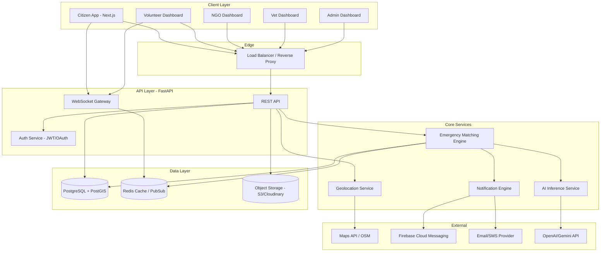

### 10.2 User Flow (Citizen Report Journey)

```mermaid
flowchart LR
    Start([Citizen opens app]) --> Capture[Capture photo + auto-GPS]
    Capture --> Confirm{Location correct?}
    Confirm -- No --> Pin[Manually pin on map]
    Confirm -- Yes --> Describe[Add description + animal type]
    Pin --> Describe
    Describe --> Submit[Submit report]
    Submit --> Severity[AI severity estimate runs]
    Severity --> Priority[Priority score computed]
    Priority --> Match[Matching engine triggered]
    Match --> Track[Citizen sees live status on map]
    Track --> Resolved{Case resolved?}
    Resolved -- No --> Track
    Resolved -- Yes --> Feedback[Citizen confirms outcome]
    Feedback --> End([End])
```

### 10.3 Rescue Workflow (Responder Side)

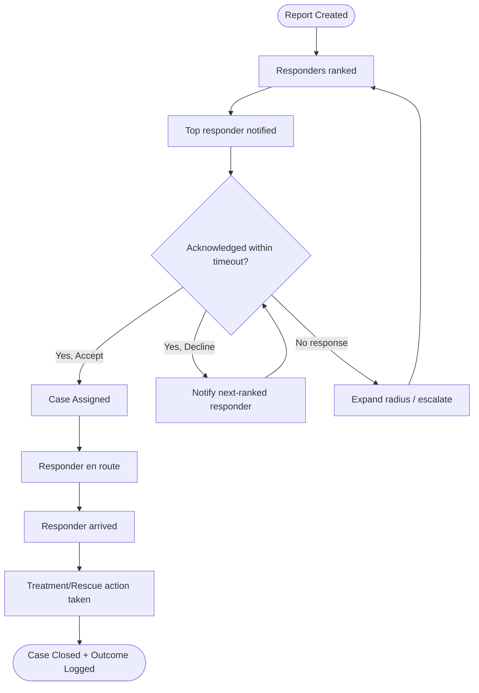

### 10.4 Notification Workflow

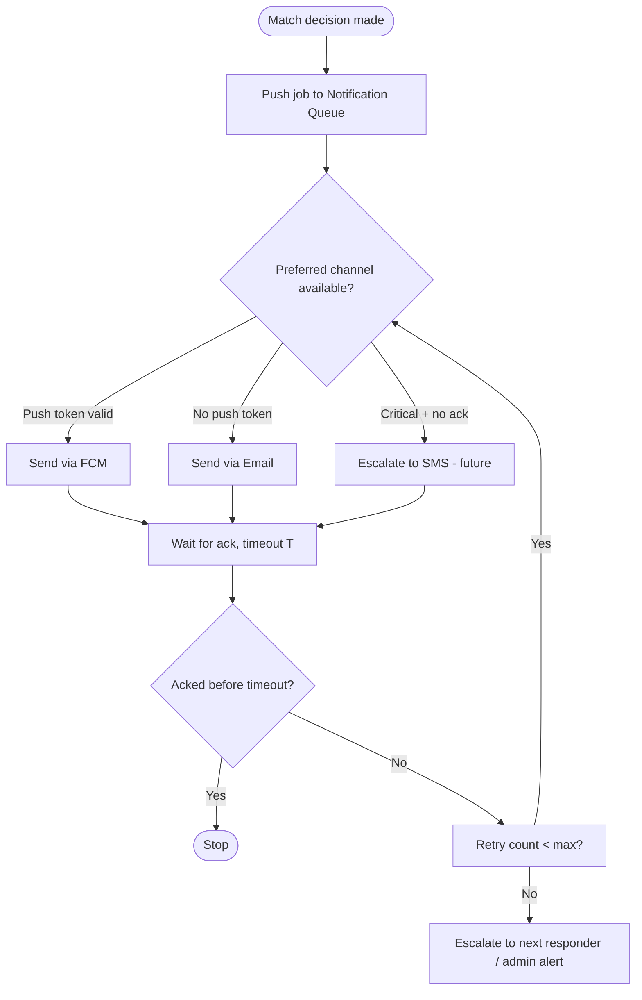

### 10.5 AI Pipeline

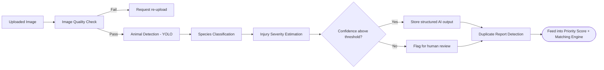

### 10.6 Geolocation Pipeline

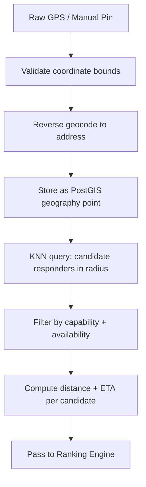

### 10.7 Database Relationships (High-Level ER)

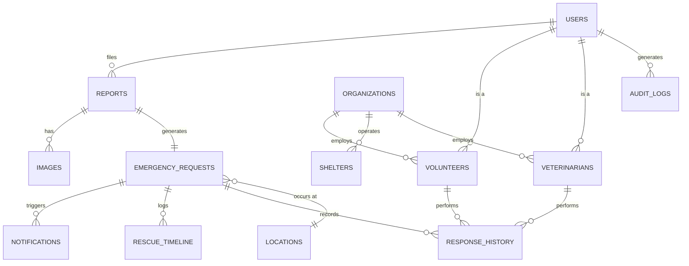

### 10.8 Deployment Architecture

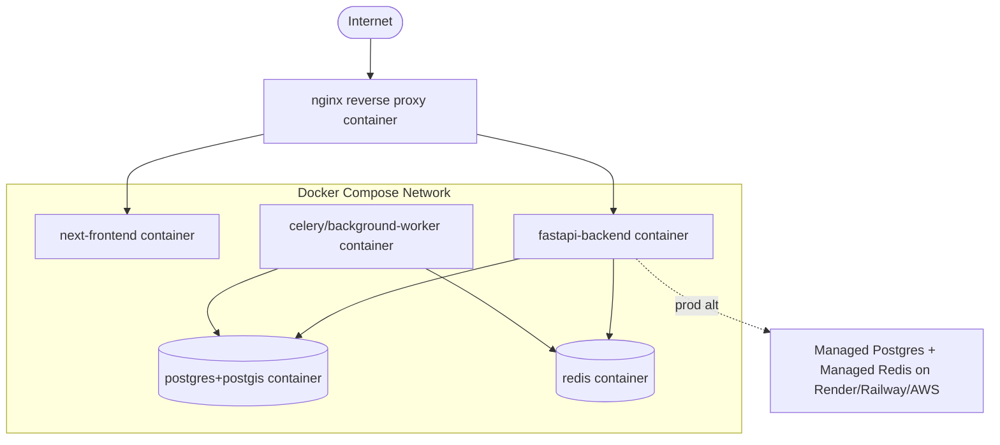

**Production considerations.** In production, split the background worker (radius-expansion timers, notification retries, AI inference calls) into its own container/process so a slow AI call never blocks the request-serving API process.

**Common mistakes.** Putting WebSocket state directly in apph process memory — this breaks the moment you scale to >1 API replica; use Redis pub/sub as the diagram shows so any replica can broadcast to any connected client.

**Best practices.** Keep the matching engine logic in a pure, framework-agnostic Python module (no FastAPI imports inside it) so it's independently unit-testable and could even be extracted into its own microservice later without a rewrite.

**Research opportunities.** The deployment architecture itself can be benchmarked (Section 6.9-style) for the WebSocket-broadcast-via-Redis pattern's latency under concurrent load — a smaller but legitimate systems-evaluation side-contribution.

**Viva questions.**
- *"Why Redis and not just Postgres for live location/state?"* — Live ephemeral, frequently-overwritten state (current location pings, rate-limit counters, pub/sub fan-out) doesn't need durability or transactional guarantees, and Postgres write amplification at that frequency would be wasteful; Redis is purpose-built for this access pattern.
- *"Walk me through what happens, system-wide, from report submission to first notification."* — Use diagrams 10.2 → 10.6 → 10.3 → 10.4 in sequence as your narration script.

---

## 11. Database Design

**Concept.** PostgreSQL with the PostGIS extension as the single source of truth; every spatially-relevant table stores a `geography(Point, 4326)` column (SRID 4326 = WGS84, the standard GPS lat/lng reference system) rather than separate float lat/lng columns, so spatial indexing and KNN operators work natively.

**Why it is needed.** Storing lat/lng as two plain floats forces every distance computation into application code (slow, error-prone Haversine reimplementation); a native `geography` column gets you indexed distance/KNN operators for free.

**Production considerations.** Always use `geography` (not bare `geometry`) when your coordinates are real-world lat/lng and you want distances in meters automatically — `geometry` assumes a flat plane and will silently give you wrong distances unless you're careful with projections.

**Common mistakes.** Forgetting `CREATE EXTENSION postgis;` in a fresh database, forgetting a GiST index on the geography column (queries silently fall back to sequential scan — Section 6.9), and storing timestamps without timezone (`timestamp` instead of `timestamptz`) which causes subtle bugs the moment you have responders across timezones or daylight-saving edge cases.

### 11.1 Schema DDL

```sql
CREATE EXTENSION IF NOT EXISTS postgis;
CREATE EXTENSION IF NOT EXISTS "uuid-ossp";

-- ========== USERS ==========
CREATE TABLE users (
    id              UUID PRIMARY KEY DEFAULT uuid_generate_v4(),
    email           VARCHAR(255) UNIQUE NOT NULL,
    phone           VARCHAR(20) UNIQUE,
    password_hash   VARCHAR(255) NOT NULL,
    full_name       VARCHAR(255) NOT NULL,
    role            VARCHAR(20) NOT NULL CHECK (role IN
                      ('citizen','volunteer','veterinarian','ngo_admin','shelter_admin','admin')),
    is_active       BOOLEAN DEFAULT TRUE,
    is_verified     BOOLEAN DEFAULT FALSE,
    fcm_token       TEXT,
    created_at      TIMESTAMPTZ DEFAULT now(),
    updated_at      TIMESTAMPTZ DEFAULT now()
);
CREATE INDEX idx_users_role ON users(role);
CREATE INDEX idx_users_email ON users(email);

-- ========== ORGANIZATIONS ==========
CREATE TABLE organizations (
    id              UUID PRIMARY KEY DEFAULT uuid_generate_v4(),
    name            VARCHAR(255) NOT NULL,
    org_type        VARCHAR(20) NOT NULL CHECK (org_type IN ('ngo','shelter','clinic')),
    registration_no VARCHAR(100),
    contact_email   VARCHAR(255),
    contact_phone   VARCHAR(20),
    location        GEOGRAPHY(Point, 4326) NOT NULL,
    address_text    TEXT,
    capacity        INTEGER DEFAULT 0,
    is_verified     BOOLEAN DEFAULT FALSE,
    created_at      TIMESTAMPTZ DEFAULT now()
);
CREATE INDEX idx_org_location ON organizations USING GIST(location);

-- ========== VETERINARIANS ==========
CREATE TABLE veterinarians (
    id                  UUID PRIMARY KEY DEFAULT uuid_generate_v4(),
    user_id             UUID NOT NULL REFERENCES users(id) ON DELETE CASCADE,
    organization_id     UUID REFERENCES organizations(id) ON DELETE SET NULL,
    license_no          VARCHAR(100) NOT NULL,
    specialization      VARCHAR(100),
    years_experience    INTEGER DEFAULT 0,
    current_location    GEOGRAPHY(Point, 4326),
    is_on_duty          BOOLEAN DEFAULT FALSE,
    active_case_count   INTEGER DEFAULT 0,
    reliability_score   NUMERIC(4,3) DEFAULT 0.500,
    created_at          TIMESTAMPTZ DEFAULT now()
);
CREATE INDEX idx_vet_location ON veterinarians USING GIST(current_location);
CREATE INDEX idx_vet_on_duty ON veterinarians(is_on_duty);

-- ========== VOLUNTEERS ==========
CREATE TABLE volunteers (
    id                  UUID PRIMARY KEY DEFAULT uuid_generate_v4(),
    user_id             UUID NOT NULL REFERENCES users(id) ON DELETE CASCADE,
    organization_id     UUID REFERENCES organizations(id) ON DELETE SET NULL,
    vehicle_type        VARCHAR(30) CHECK (vehicle_type IN ('two_wheeler','car','van','none')),
    capability_tags     TEXT[] DEFAULT '{}',     -- e.g. {'large_animal','first_aid_trained'}
    current_location    GEOGRAPHY(Point, 4326),
    is_on_duty          BOOLEAN DEFAULT FALSE,
    active_case_count   INTEGER DEFAULT 0,
    reliability_score   NUMERIC(4,3) DEFAULT 0.500,
    total_rescues       INTEGER DEFAULT 0,
    created_at          TIMESTAMPTZ DEFAULT now()
);
CREATE INDEX idx_volunteer_location ON volunteers USING GIST(current_location);
CREATE INDEX idx_volunteer_on_duty ON volunteers(is_on_duty);
CREATE INDEX idx_volunteer_capability_tags ON volunteers USING GIN(capability_tags);

-- ========== SHELTERS ==========
CREATE TABLE shelters (
    id                  UUID PRIMARY KEY DEFAULT uuid_generate_v4(),
    organization_id     UUID NOT NULL REFERENCES organizations(id) ON DELETE CASCADE,
    location            GEOGRAPHY(Point, 4326) NOT NULL,
    total_capacity      INTEGER NOT NULL DEFAULT 0,
    current_occupancy   INTEGER NOT NULL DEFAULT 0,
    accepts_species     TEXT[] DEFAULT '{}',
    created_at          TIMESTAMPTZ DEFAULT now()
);
CREATE INDEX idx_shelter_location ON shelters USING GIST(location);

-- ========== ANIMALS ==========
CREATE TABLE animals (
    id              UUID PRIMARY KEY DEFAULT uuid_generate_v4(),
    species         VARCHAR(50),
    estimated_breed VARCHAR(100),
    estimated_age   VARCHAR(30),
    sex             VARCHAR(10) CHECK (sex IN ('male','female','unknown')),
    distinguishing_marks TEXT,
    is_chipped      BOOLEAN DEFAULT FALSE,
    created_at      TIMESTAMPTZ DEFAULT now()
);

-- ========== LOCATIONS ==========
-- Normalized location entity reused across reports/orgs when reverse-geocoded metadata is needed
CREATE TABLE locations (
    id              UUID PRIMARY KEY DEFAULT uuid_generate_v4(),
    point           GEOGRAPHY(Point, 4326) NOT NULL,
    address_text    TEXT,
    city            VARCHAR(100),
    state           VARCHAR(100),
    postal_code     VARCHAR(20),
    accuracy_meters NUMERIC(6,2),
    source          VARCHAR(20) CHECK (source IN ('gps','manual_pin','exif')),
    created_at      TIMESTAMPTZ DEFAULT now()
);
CREATE INDEX idx_locations_point ON locations USING GIST(point);

-- ========== REPORTS ==========
CREATE TABLE reports (
    id                  UUID PRIMARY KEY DEFAULT uuid_generate_v4(),
    reporter_id         UUID NOT NULL REFERENCES users(id),
    animal_id           UUID REFERENCES animals(id),
    location_id         UUID NOT NULL REFERENCES locations(id),
    description         TEXT,
    severity_label      VARCHAR(20) CHECK (severity_label IN
                          ('minor','moderate','severe','critical','unclear')),
    severity_confidence NUMERIC(4,3),
    priority_score      NUMERIC(6,3) DEFAULT 0,
    status              VARCHAR(30) NOT NULL DEFAULT 'submitted' CHECK (status IN
                          ('submitted','triaged','matching','assigned','en_route',
                           'in_progress','resolved','closed','cancelled')),
    is_duplicate_of     UUID REFERENCES reports(id),
    created_at          TIMESTAMPTZ DEFAULT now(),
    updated_at          TIMESTAMPTZ DEFAULT now()
);
CREATE INDEX idx_reports_status ON reports(status);
CREATE INDEX idx_reports_priority ON reports(priority_score DESC);
CREATE INDEX idx_reports_created_at ON reports(created_at);

-- ========== IMAGES ==========
CREATE TABLE images (
    id              UUID PRIMARY KEY DEFAULT uuid_generate_v4(),
    report_id       UUID NOT NULL REFERENCES reports(id) ON DELETE CASCADE,
    storage_url     TEXT NOT NULL,
    quality_score   NUMERIC(4,3),
    ai_detected_species VARCHAR(50),
    ai_confidence   NUMERIC(4,3),
    uploaded_at     TIMESTAMPTZ DEFAULT now()
);
CREATE INDEX idx_images_report ON images(report_id);

-- ========== EMERGENCY_REQUESTS ==========
CREATE TABLE emergency_requests (
    id                  UUID PRIMARY KEY DEFAULT uuid_generate_v4(),
    report_id           UUID NOT NULL UNIQUE REFERENCES reports(id) ON DELETE CASCADE,
    current_radius_km   NUMERIC(5,2) DEFAULT 2.0,
    expansion_count     INTEGER DEFAULT 0,
    assigned_responder_id UUID,
    assigned_responder_type VARCHAR(20) CHECK (assigned_responder_type IN
                              ('volunteer','veterinarian','ngo','shelter')),
    matching_attempts   INTEGER DEFAULT 0,
    created_at          TIMESTAMPTZ DEFAULT now(),
    resolved_at         TIMESTAMPTZ
);
CREATE INDEX idx_er_report ON emergency_requests(report_id);

-- ========== NOTIFICATIONS ==========
CREATE TABLE notifications (
    id                  UUID PRIMARY KEY DEFAULT uuid_generate_v4(),
    emergency_request_id UUID NOT NULL REFERENCES emergency_requests(id) ON DELETE CASCADE,
    recipient_user_id   UUID NOT NULL REFERENCES users(id),
    channel             VARCHAR(20) CHECK (channel IN ('push','email','sms')),
    status              VARCHAR(20) DEFAULT 'queued' CHECK (status IN
                          ('queued','sent','delivered','acked','declined','timed_out','failed')),
    sent_at             TIMESTAMPTZ,
    responded_at        TIMESTAMPTZ,
    retry_count         INTEGER DEFAULT 0,
    created_at          TIMESTAMPTZ DEFAULT now()
);
CREATE INDEX idx_notif_er ON notifications(emergency_request_id);
CREATE INDEX idx_notif_status ON notifications(status);

-- ========== RESCUE_TIMELINE ==========
-- Append-only immutable event log per case, used as evaluation ground truth (Section 6 evaluations)
CREATE TABLE rescue_timeline (
    id              UUID PRIMARY KEY DEFAULT uuid_generate_v4(),
    report_id       UUID NOT NULL REFERENCES reports(id) ON DELETE CASCADE,
    event_type      VARCHAR(40) NOT NULL,   -- e.g. 'submitted','assigned','en_route','arrived','resolved'
    actor_user_id   UUID REFERENCES users(id),
    metadata        JSONB,
    occurred_at     TIMESTAMPTZ DEFAULT now()
);
CREATE INDEX idx_timeline_report ON rescue_timeline(report_id);
CREATE INDEX idx_timeline_event_type ON rescue_timeline(event_type);

-- ========== RESPONSE_HISTORY ==========
-- One row per responder per case, captures outcome for reliability scoring (Section 6.6)
CREATE TABLE response_history (
    id                  UUID PRIMARY KEY DEFAULT uuid_generate_v4(),
    report_id           UUID NOT NULL REFERENCES reports(id) ON DELETE CASCADE,
    responder_user_id   UUID NOT NULL REFERENCES users(id),
    responder_type      VARCHAR(20) CHECK (responder_type IN ('volunteer','veterinarian')),
    was_assigned        BOOLEAN DEFAULT FALSE,
    accepted            BOOLEAN,
    arrived             BOOLEAN,
    outcome             VARCHAR(20) CHECK (outcome IN
                          ('success','partial','failed','no_show','unknown')),
    response_time_seconds INTEGER,
    created_at          TIMESTAMPTZ DEFAULT now()
);
CREATE INDEX idx_resp_hist_responder ON response_history(responder_user_id);
CREATE INDEX idx_resp_hist_outcome ON response_history(outcome);

-- ========== AUDIT_LOGS ==========
CREATE TABLE audit_logs (
    id              UUID PRIMARY KEY DEFAULT uuid_generate_v4(),
    actor_user_id   UUID REFERENCES users(id),
    action          VARCHAR(100) NOT NULL,
    entity_type     VARCHAR(50),
    entity_id       UUID,
    before_state    JSONB,
    after_state     JSONB,
    ip_address      INET,
    created_at      TIMESTAMPTZ DEFAULT now()
);
CREATE INDEX idx_audit_actor ON audit_logs(actor_user_id);
CREATE INDEX idx_audit_entity ON audit_logs(entity_type, entity_id);
```

### 11.2 Detailed Entity-Relationship Diagram

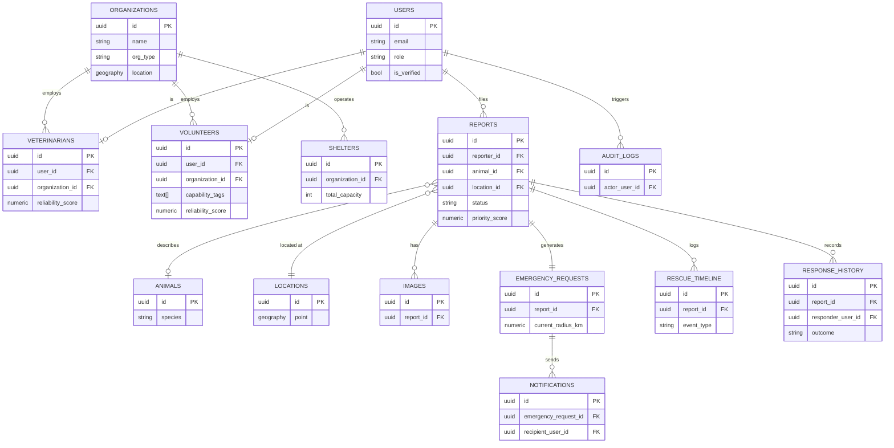

### 11.3 Optimization Strategies

- **Spatial indexes** (GiST) on every `geography`/`geometry` column that's ever filtered or ordered by distance — without this, Section 6.9's whole benchmark story collapses.
- **Partial indexes** for hot filtered queries, e.g. `CREATE INDEX idx_volunteers_active ON volunteers(current_location) WHERE is_on_duty = TRUE;` — much smaller and faster than indexing the full table when most rows are off-duty at any moment.
- **JSONB for flexible, rarely-queried metadata** (`audit_logs.before_state`, `rescue_timeline.metadata`) instead of adding new columns for every event-specific field — keeps schema migrations rare.
- **Partitioning `rescue_timeline` and `audit_logs` by month** once volume grows, since both are append-only and naturally time-ordered (range partitioning is the textbook fit).
- **Connection pooling** (PgBouncer or SQLAlchemy's pool) since FastAPI's async workers will otherwise open far more connections than Postgres' default `max_connections` comfortably allows under load.
- **Read replicas** for the Analytics Dashboard (Section 23/16 hotspot queries) so heavy aggregation queries never compete with the live matching engine's write/read path.

**Common mistakes.** Using `geometry` instead of `geography` and forgetting to specify SRID 4326 (mismatched SRIDs between columns silently break distance calculations or throw cryptic errors); storing `capability_tags` as a comma-separated string instead of a Postgres `TEXT[]` array (loses the GIN-indexable containment queries you need for capability matching).

**Viva questions.**
- *"Why UUID primary keys instead of auto-increment integers?"* — Avoids leaking sequential record counts/guessable IDs across a multi-tenant system (NGOs, citizens) and makes merging data from offline-first mobile clients (which may generate IDs client-side) conflict-free.
- *"Why is `response_history` separate from `rescue_timeline`?"* — `rescue_timeline` is a generic append-only event log for *any* state transition (good for debugging/audit); `response_history` is a denormalized, query-optimized table specifically shaped for the reliability-scoring and outcome-prediction models (Sections 6.5/6.6) — separating them avoids forcing your ML feature queries to parse generic JSONB event logs.

---

## 12. Backend Architecture (FastAPI)

**Concept.** A modular, layered FastAPI backend: `routers` (HTTP boundary) → `services` (business logic, framework-agnostic) → `repositories` (data access) → `models` (ORM) — the same layering discipline you already use in your Knowledge Graph RAG capstone, applied here.

**Why it is needed.** Without this separation, matching-engine logic (Section 16) ends up tangled inside route handlers, making it untestable without spinning up the full HTTP stack — a common reason student backend test coverage stays near zero.

### 12.1 Folder Structure

```
backend/
├── app/
│   ├── main.py                     # FastAPI app instantiation, middleware, router includes
│   ├── core/
│   │   ├── config.py                # Pydantic Settings (env vars)
│   │   ├── security.py              # JWT encode/decode, password hashing
│   │   ├── dependencies.py          # get_db, get_current_user, RBAC guards
│   │   └── exceptions.py            # Custom exception classes + handlers
│   ├── db/
│   │   ├── session.py                # SQLAlchemy async engine/session factory
│   │   └── base.py                   # Declarative base
│   ├── models/                       # SQLAlchemy ORM models, 1 file per entity group
│   │   ├── user.py
│   │   ├── organization.py
│   │   ├── responder.py              # Volunteer + Veterinarian
│   │   ├── report.py
│   │   ├── emergency_request.py
│   │   ├── notification.py
│   │   └── audit.py
│   ├── schemas/                      # Pydantic request/response DTOs, mirrors models/
│   │   ├── user.py
│   │   ├── report.py
│   │   └── ...
│   ├── routers/                      # Thin HTTP layer, one router per resource
│   │   ├── auth.py
│   │   ├── reports.py
│   │   ├── responders.py
│   │   ├── organizations.py
│   │   ├── emergency.py
│   │   ├── notifications.py
│   │   ├── analytics.py
│   │   ├── admin.py
│   │   └── websocket.py
│   ├── services/                     # Pure business logic, framework-agnostic where possible
│   │   ├── matching_engine.py        # Section 16 core algorithm
│   │   ├── ranking.py                # Multi-factor scoring functions
│   │   ├── radius_policy.py          # Adaptive radius expansion (Section 6.4)
│   │   ├── priority_scoring.py       # Section 6.1
│   │   ├── reliability_scoring.py    # Section 6.6
│   │   ├── ai_inference.py           # Wraps AI provider calls (Section 17)
│   │   ├── geo_service.py            # PostGIS query helpers, reverse geocode
│   │   └── notification_service.py   # Section 18 dispatch + retry logic
│   ├── repositories/                 # Data access, raw queries / ORM queries isolated here
│   │   ├── report_repo.py
│   │   ├── responder_repo.py
│   │   └── notification_repo.py
│   ├── tasks/                        # Background jobs (Celery or FastAPI BackgroundTasks/arq)
│   │   ├── worker.py
│   │   ├── radius_expansion_job.py
│   │   ├── notification_retry_job.py
│   │   └── hotspot_recompute_job.py
│   ├── ws/
│   │   ├── manager.py                 # Connection manager + Redis pub/sub bridge
│   │   └── events.py
│   └── utils/
│       ├── distance.py
│       └── validators.py
├── tests/
│   ├── unit/
│   │   ├── test_ranking.py
│   │   ├── test_radius_policy.py
│   │   └── test_priority_scoring.py
│   ├── integration/
│   │   ├── test_reports_api.py
│   │   └── test_matching_flow.py
│   └── load/
│       └── locustfile.py
├── alembic/                          # DB migrations
│   └── versions/
├── Dockerfile
├── requirements.txt
└── pyproject.toml
```

### 12.2 What Each Layer Owns

| Layer | Owns | Must NOT contain |
|---|---|---|
| `routers/` | Request parsing, auth dependency injection, calling one service method, shaping the HTTP response | Business logic, raw SQL, scoring math |
| `services/` | All business rules: ranking formulas, radius policy, priority math, AI orchestration | FastAPI `Request`/`Response` objects, HTTP status codes |
| `repositories/` | All DB queries (ORM or raw SQL), isolating SQL from business logic | Scoring/ranking decisions |
| `models/` | Table structure only | Validation logic (that's `schemas/`) |
| `schemas/` | Request/response validation via Pydantic | DB queries |
| `tasks/` | Anything that runs outside the request/response cycle (timers, retries) | Direct HTTP responses |

**Production considerations.** Keep `services/matching_engine.py` importable and runnable with zero FastAPI/DB dependencies for unit testing (pass in plain dicts/dataclasses, mock the repository) — this single discipline is what makes Section 22's unit-testing claims credible rather than aspirational.

**Common mistakes.** Calling `await db.execute(...)` directly inside a router function "just this once" — this always grows; enforce the repository boundary with code review discipline (or a simple lint rule/import-checker in CI) from week 1.

**Best practices.** Use Pydantic `Settings` (`core/config.py`) for all configuration — never read `os.environ` scattered across files; this also makes Docker/Compose environment-variable wiring (Section 24) trivial to reason about.

**Research opportunities.** The clean separation between `services/matching_engine.py` and everything else means you can swap in alternative ranking algorithms (Section 6.3's ablation study) by simply injecting a different scoring function — document this as a designed-for-experimentation architecture decision in your paper's Methodology section.

**Viva questions.**
- *"Where exactly does your ranking algorithm live, and why there?"* — `services/ranking.py`, framework-agnostic, so it's independently unit-tested and reusable if matching is ever extracted into its own microservice.
- *"How would you swap OpenAI for Gemini without touching routers?"* — `services/ai_inference.py` is the single integration point behind an interface; routers only ever call `ai_inference.classify_severity(image)`, never a provider SDK directly.

---

## 13. Frontend Architecture (Next.js)

**Concept.** One Next.js (App Router) project with role-based route groups, a shared design system, and a single map abstraction (Leaflet, swappable for Google Maps) reused across every dashboard.

**Why it is needed.** Six distinct dashboards sound like six apps, but they share 80% of their primitives (map component, report card, status badge, notification toast) — a shared component library prevents six divergent, half-maintained UIs.

### 13.1 Folder Structure

```
frontend/
├── app/
│   ├── (auth)/login/page.tsx
│   ├── (auth)/register/page.tsx
│   ├── (citizen)/report/new/page.tsx
│   ├── (citizen)/report/[id]/page.tsx          # Live tracking page
│   ├── (volunteer)/dashboard/page.tsx
│   ├── (volunteer)/cases/[id]/page.tsx
│   ├── (ngo)/dashboard/page.tsx
│   ├── (ngo)/roster/page.tsx
│   ├── (vet)/dashboard/page.tsx
│   ├── (admin)/dashboard/page.tsx
│   ├── (admin)/audit/page.tsx
│   ├── (shared)/analytics/page.tsx
│   └── layout.tsx
├── components/
│   ├── map/
│   │   ├── MapView.tsx                # Leaflet wrapper, accepts markers[]
│   │   ├── HotspotHeatmapLayer.tsx
│   │   └── LiveTrackingLayer.tsx      # Subscribes to WS updates
│   ├── reports/
│   │   ├── ReportCard.tsx
│   │   ├── ReportForm.tsx
│   │   └── StatusBadge.tsx
│   ├── notifications/
│   │   └── NotificationToast.tsx
│   └── ui/                            # buttons, inputs, modals (design system primitives)
├── hooks/
│   ├── useWebSocket.ts
│   ├── useGeolocation.ts
│   └── useAuth.ts
├── lib/
│   ├── api-client.ts                  # Typed fetch wrapper
│   ├── ws-client.ts
│   └── rbac.ts                        # Frontend route guards mirroring backend RBAC
├── types/
│   └── index.ts                       # Shared TS types, generated/synced with backend Pydantic schemas
├── styles/
└── public/
```

### 13.2 Dashboard-Specific Notes

| Dashboard | Key views | Primary real-time need |
|---|---|---|
| Citizen App | Report form, live tracking map, history, outcome feedback | WS updates on own report's status |
| Volunteer Dashboard | Incoming assignment alerts, accept/decline, active case map, availability toggle | Push notification + WS for new assignments |
| NGO Dashboard | Roster management, case overview across all org volunteers, capacity view | WS for org-wide case updates |
| Veterinarian Dashboard | Similar to volunteer, plus clinical notes / treatment logging | WS + structured case intake form |
| Administrator Dashboard | All cases, manual reassignment override, audit log viewer, user verification | WS for system-wide event stream (high volume — paginate/throttle) |
| Analytics Dashboard | Hotspot heatmap, response-time trend charts, responder leaderboard | Mostly polling/refresh, not WS (aggregate data, not per-event) |

**Implementation strategy.** Build the Citizen App and Volunteer Dashboard first (the FR-01 → FR-11 critical path) — the other four dashboards reuse the same `MapView`/`ReportCard` components with different filters and permissions, so they come together fast once the core two are solid.

**Production considerations.** Debounce/throttle WebSocket-driven re-renders on the Admin Dashboard specifically — a system-wide event stream can fire far more often than a human admin needs to see individually.

**Common mistakes.** Re-implementing map marker logic per-dashboard instead of parameterizing one `MapView`; fetching the entire reports table client-side for the Analytics Dashboard instead of having the backend pre-aggregate (Section 21 caching).

**Best practices.** Generate frontend TypeScript types from backend Pydantic schemas (e.g., via `openapi-typescript` against FastAPI's auto-generated OpenAPI spec) so the two never silently drift apart — a strong "I understand full-stack type safety" viva point.

**Viva questions.**
- *"Why one Next.js app with route groups instead of six separate apps?"* — Shared components, shared auth/session state, and one deployable unit reduce duplication and operational overhead for a solo-maintained system; route groups give role-based separation without the cost of six codebases.
- *"How do you keep frontend and backend types in sync?"* — OpenAPI-spec-driven type generation, regenerated as part of the dev workflow/CI.

---

## 14. Authentication & Role-Based Access Control

**Concept.** JWT-based stateless authentication (access token short-lived ~15min, refresh token longer-lived ~7days, rotated on use), with OAuth (Google) as an optional citizen-facing convenience login, and a centralized RBAC dependency in FastAPI that every protected route declares explicitly.

**Why it is needed.** Six roles with very different data-access boundaries (a volunteer must never see another citizen's exact home address before accepting a case — Section 15 privacy) make ad-hoc, scattered permission checks a guaranteed source of leaks.

### 14.1 RBAC Matrix (excerpt)

| Action | Citizen | Volunteer | Veterinarian | NGO Admin | Shelter Admin | Admin |
|---|---|---|---|---|---|---|
| Create report | ✅ | ✅ | ❌ | ❌ | ❌ | ✅ |
| View own report status | ✅ | — | — | — | — | ✅ |
| View assigned case detail (incl. precise location) | ❌ pre-accept / ✅ post-accept | ✅ if assigned | ✅ if assigned | ✅ org cases | ✅ org cases | ✅ all |
| Accept/decline assignment | ❌ | ✅ | ✅ | ❌ | ❌ | ✅ override |
| Manage org roster | ❌ | ❌ | ❌ | ✅ | ✅ | ✅ |
| View audit logs | ❌ | ❌ | ❌ | ❌ | ❌ | ✅ |
| View analytics dashboard | ❌ | ❌ limited | ❌ limited | ✅ org-scoped | ✅ org-scoped | ✅ global |
| Manually reassign a case | ❌ | ❌ | ❌ | ✅ org cases | ❌ | ✅ all |

### 14.2 Implementation Pattern

```python
# core/dependencies.py
from fastapi import Depends, HTTPException, status

def require_role(*allowed_roles: str):
    def checker(current_user: User = Depends(get_current_user)):
        if current_user.role not in allowed_roles:
            raise HTTPException(status_code=status.HTTP_403_FORBIDDEN,
                                 detail="Insufficient role permissions")
        return current_user
    return checker

# routers/admin.py
@router.get("/audit-logs")
async def list_audit_logs(user: User = Depends(require_role("admin"))):
    ...
```

**Mathematical intuition.** N/A — this is a discrete authorization-policy problem, best modeled as a permission matrix (above) rather than continuous math; the "intuition" is treating RBAC as a lookup table you can unit-test exhaustively (6 roles × N actions = a finite, enumerable test matrix).

**Production considerations.** Rotate JWT signing secrets via environment-managed secrets (Section 20), and store refresh tokens hashed in the DB (never plaintext) so a DB leak alone doesn't grant token reuse.

**Common mistakes.** Checking roles only in the frontend (trivially bypassed via direct API calls) instead of enforcing every check server-side; storing JWTs in `localStorage` instead of httpOnly cookies (XSS-exposed) for the web frontend.

**Best practices.** Write one parametrized test per RBAC matrix cell (or at minimum per role-action pair that's `Must` priority) — this directly produces your Section 22 test-coverage evidence.

**Research opportunities.** None directly — RBAC is solved engineering, not a research contribution; correctly *not* over-claiming this as "novel" in your paper is itself a credibility signal.

**Viva questions.**
- *"Why JWT and not server-side sessions?"* — Stateless tokens scale horizontally without a shared session store, fitting the multi-replica API layer in Section 10's architecture; trade-off is harder immediate revocation, mitigated by short access-token lifetimes + refresh rotation.
- *"How do you prevent a volunteer from seeing a citizen's exact address before accepting?"* — Location precision is conditionally serialized in the response schema based on `assignment_status`, enforced server-side in the service layer, not just hidden in the UI (Section 15).

---

## 15. Geolocation System

**Concept.** Six sub-systems working together: raw GPS capture, geofencing (defining service-area boundaries), reverse geocoding (coordinates → human-readable address), nearest-neighbor search, spatial range/radius queries, and an adaptive-radius expansion policy (Section 6.4) layered on top of all of them.

**Why it is needed.** "Find nearby responders" sounds trivial but each sub-system has real failure modes: GPS drifts 10-50m in cities, geocoding APIs rate-limit, and naive distance queries don't scale (Section 6.9).

**GPS.** Device GPS accuracy is reported alongside the coordinate (`accuracy_meters` in the `locations` table) — always capture and store it, and treat readings with accuracy worse than ~50m as "needs manual confirmation" in the UI (FR-02's fallback chain).

**Geofencing.** Define each organization's effective service area as a `geography(Polygon)` (or simply a radius around their base location for v1) and use `ST_Within`/`ST_DWithin` to filter candidate responders to those actually willing/able to serve that area — relevant for NGOs with explicit jurisdiction agreements.

**Reverse geocoding.** On report submission, call a reverse-geocoding API (Nominatim/OSM for free-tier, Google Maps Geocoding API for production-grade) to convert the point into `city`/`state`/`address_text` for human-readable display and for hotspot analytics aggregation (Section 6.10) at a city/area granularity.

**Nearest Neighbor Search.** PostGIS's `<->` operator with a GiST index performs true K-Nearest-Neighbor search:

```sql
SELECT v.id, v.user_id,
       ST_Distance(v.current_location, :report_point) AS distance_m
FROM volunteers v
WHERE v.is_on_duty = TRUE
ORDER BY v.current_location <-> :report_point
LIMIT 20;
```

**Spatial Queries (radius filter).** Combine KNN ordering with a hard radius cutoff using `ST_DWithin` (which itself uses the spatial index, unlike `ST_Distance(...) < x` which computes distance for every row first):

```sql
SELECT v.id, ST_Distance(v.current_location, :report_point) AS distance_m
FROM volunteers v
WHERE v.is_on_duty = TRUE
  AND ST_DWithin(v.current_location, :report_point, :radius_meters)
ORDER BY v.current_location <-> :report_point
LIMIT 20;
```

**Radius Expansion Algorithm.** See Section 6.4 for the research framing; operationally, it's a background job (`tasks/radius_expansion_job.py`) that re-runs the above query with `radius_meters *= growth_factor` every `T` seconds while `emergency_requests.assigned_responder_id IS NULL`, capped at `max_radius_km` and `max_expansion_count`.

**Map rendering.** Leaflet with OpenStreetMap tiles for cost-free development; swappable to Google Maps JS SDK for production if budget allows (better India-specific road/address data in many regions) — keep the `MapView` component (Section 13) provider-agnostic via a thin adapter interface.

**Distance calculations.** Always compute distance via PostGIS (`ST_Distance` on `geography` returns meters using a spheroidal model), never reimplement Haversine in application code unless explicitly building the Section 6.9 benchmark comparison (where doing so on purpose is the point).

**Production considerations.** Cache reverse-geocode results aggressively (Redis, keyed by rounded lat/lng) since geocoding APIs are rate-limited and many reports cluster in the same areas.

**Common mistakes.** Mixing up `ST_Distance` (always works, but slow without `ST_DWithin`'s index-assisted pre-filter) and forgetting that `geometry`-typed `ST_Distance` returns degrees, not meters, if you accidentally used `geometry` instead of `geography`.

**Best practices.** Always pass radius in **meters** to PostGIS functions (it's the native unit for `geography`); keep a single `utils/distance.py` constant for km↔m conversion so unit-mismatch bugs can't silently creep in across the codebase.

**Research opportunities.** Empirically measuring real-world GPS accuracy distribution from your own pilot users (if any) vs. assumed accuracy is a small but genuine measurement contribution.

**Viva questions.**
- *"What's the difference between `ST_Distance` and `ST_DWithin`, and why does it matter for performance?"* — `ST_DWithin` can use the spatial index to prune candidates *before* computing exact distances, while a bare `WHERE ST_Distance(...) < x` computes distance for every row first, defeating the index — this is your Section 6.9 benchmark's core insight.
- *"What happens when GPS accuracy is poor?"* — Below an accuracy threshold, the UI prompts for manual map-pin confirmation rather than trusting the raw device reading silently.

---

## 16. Emergency Matching Engine

**Concept.** The matching engine is a pipeline: **candidate retrieval** (geospatial + capability filter) → **scoring** (multi-factor weighted formula) → **ranking** (sort by score) → **dispatch** (notify top-K with fallback) → **re-evaluation** (on decline/timeout/radius-expansion, recompute and re-dispatch).

**Inputs and their treatment:**

| Factor | Symbol | Normalization | Direction |
|---|---|---|---|
| Distance | `d` | `f_d = 1 - min(d/d_max, 1)` | closer = better |
| Estimated travel time | `t_eta` | `f_t = 1 - min(t_eta/t_max, 1)` | faster = better |
| Current active caseload | `c` | `f_c = 1 - min(c/c_max, 1)` | less loaded = better |
| Organization/responder type match | `m` | binary or partial 0/0.5/1 | exact match = best |
| Volunteer/vet reliability history | `r` | already in [0,1] (Bayesian score, Section 6.6) | higher = better |
| Animal severity vs responder capability | `s_match` | binary/partial | capable of severity = required |
| Time-of-day availability | `a` | binary 0/1 (on-duty flag) | must be 1 to be a candidate at all |

**Scoring formula:**

```
Score(responder) = w1·f_d + w2·f_t + w3·f_c + w4·m + w5·r + w6·s_match
subject to: a == 1  (hard filter, not weighted)
where w1..w6 sum to 1, tuned via the ablation study in Section 6.3
```

**Default starting weights** (before your own ablation tuning): `w1=0.30 (distance), w2=0.15 (ETA), w3=0.15 (caseload), w4=0.10 (org match), w5=0.20 (reliability), w6=0.10 (capability match)` — distance and reliability dominate by design, since they are the two factors most directly tied to both objectives in Section 2 (speed and success probability).

**Outputs:**
- A ranked list of candidates (top-K, typically K=5).
- A designated "primary" (rank 1) and "fallback chain" (ranks 2–5), consumed by the Notification Engine (Section 18) for sequential escalation.
- A `current_radius_km` decision: if fewer than `min_candidates` (e.g., 3) are found, trigger immediate radius expansion rather than waiting for the timeout-based job.

### 16.1 Pseudocode

```python
def run_matching(report: Report) -> MatchResult:
    radius_km = INITIAL_RADIUS_KM
    attempts = 0

    while attempts < MAX_EXPANSION_ATTEMPTS:
        candidates = repo.find_candidates(
            point=report.location.point,
            radius_m=radius_km * 1000,
            required_capability=report.required_capability,
            on_duty_only=True,
        )

        if len(candidates) >= MIN_CANDIDATES:
            break

        radius_km *= RADIUS_GROWTH_FACTOR
        attempts += 1

    scored = [
        (c, score(c, report)) for c in candidates
    ]
    ranked = sorted(scored, key=lambda x: x[1], reverse=True)
    top_k = ranked[:TOP_K]

    return MatchResult(
        primary=top_k[0] if top_k else None,
        fallback_chain=top_k[1:],
        final_radius_km=radius_km,
        expansion_attempts=attempts,
    )

def score(candidate, report) -> float:
    f_d = 1 - min(candidate.distance_m / D_MAX, 1)
    f_t = 1 - min(candidate.eta_seconds / T_MAX, 1)
    f_c = 1 - min(candidate.active_case_count / C_MAX, 1)
    m   = capability_match_score(candidate, report)
    r   = candidate.reliability_score
    s_match = severity_capability_match(candidate, report.severity_label)

    return (W1*f_d + W2*f_t + W3*f_c + W4*m + W5*r + W6*s_match)
```

### 16.2 Flowchart

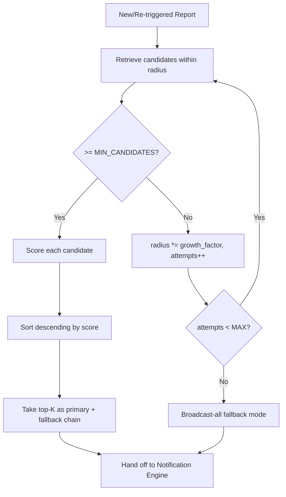

### 16.3 Computational Complexity

| Step | Complexity | Notes |
|---|---|---|
| Candidate retrieval (indexed KNN + `ST_DWithin`) | `O(log n + k)` average | `n` = total responders, `k` = candidates returned; GiST index (Section 6.9) |
| Scoring per candidate | `O(1)` per candidate | constant number of factors |
| Scoring all candidates | `O(k)` | linear in candidates found, not total responders |
| Ranking (sort) | `O(k log k)` | trivial for k ≈ 20–50 |
| Radius expansion loop | `O(E · (log n + k))` | `E` = expansion attempts, bounded by `MAX_EXPANSION_ATTEMPTS` |
| **Total per matching run** | `O(E·log n + E·k log k)` | dominated by the indexed spatial query, not the scoring math — confirms the engineering investment in Section 6.9's indexing is the right one |

**Production considerations.** Recompute scores (not just notify the same ranked list) every time the engine re-triggers (decline, timeout, radius expansion) — candidate availability/caseload changes between attempts, so a stale ranked list is a correctness bug, not just a minor inefficiency.

**Common mistakes.** Hardcoding `TOP_K`/weights as magic numbers scattered through the codebase instead of centralized, documented constants (`core/config.py`) — these are exactly the hyperparameters your Section 6.3 ablation study needs to vary systematically.

**Best practices.** Log every scoring decision's full factor breakdown (not just the final score) to `rescue_timeline.metadata` — this is what makes the ranking *explainable* in an admin override review and *analyzable* for your ablation study, without needing to re-derive it from raw data later.

**Research opportunities.** This entire section *is* the implementation of contributions 6.1, 6.3, and 6.4 — the pseudocode and complexity table above can go nearly verbatim into your paper's Methodology/System Architecture section.

**Viva questions.**
- *"Walk me through what happens if your top 3 ranked responders all decline."* — Notification Engine (Section 18) escalates through the fallback chain sequentially with timeouts; if the chain exhausts, the matching engine re-triggers with an expanded radius, producing a fresh ranked list.
- *"Why weighted sum and not, say, a learned ranking model (e.g., a neural ranker)?"* — Interpretability and cold-start: a learned ranker needs training data you don't have yet at launch; a weighted-sum formula is auditable by an admin during a dispute and tunable via the ablation study without retraining — appropriate for v1, explicitly framed as future work to replace with a learned model once Section 6.5-style outcome data accumulates.

---

## 17. AI Module

**Concept.** Five pluggable AI sub-modules sitting behind a single `services/ai_inference.py` interface (Section 12), each independently swappable between a hosted LLM/VLM API (OpenAI/Gemini) for fast prototyping and a fine-tuned local model (YOLO/ViT) for production cost/latency control.

### 17.1 Animal Detection

- **Goal:** Confirm the image actually contains an animal (reject empty/irrelevant uploads early).
- **Approach:** YOLOv8 (pretrained on a general object-detection dataset, fine-tuned/filtered to animal classes) for production; a VLM prompt ("does this image contain an animal? yes/no + bounding box") for rapid prototyping.
- **Training pipeline:** Start with pretrained YOLO weights (COCO has dog/cat/cow/horse classes already) → fine-tune on a small self-collected/augmented set if street-animal-specific accuracy is insufficient → version-control model weights separately from code (DVC or simple S3-versioned artifacts).
- **Evaluation metrics:** mAP@0.5 (mean Average Precision) for detection quality; precision/recall specifically on the "no animal present" rejection case (false negatives here waste a citizen's submission).
- **Deployment:** ONNX-exported model served via a lightweight inference endpoint (or batched on a background worker) to keep the main API process responsive.

### 17.2 Species Classification

- **Goal:** Dog / Cat / Cow / Bird / Other, feeding both the matching engine's capability-match factor (Section 16) and analytics.
- **Approach:** Lightweight CNN (MobileNetV3/EfficientNet-lite) fine-tuned on Stanford Dogs + Oxford-IIIT Pet + a small custom "cow/cattle" set (street-cattle being a major India-specific case the standard pet datasets don't cover).
- **Evaluation metrics:** Top-1 accuracy, per-class F1 (especially watch for class imbalance — dogs will dominate report volume).

### 17.3 Injury Severity Estimation

- See Section 6.2 for the full research framing (ordinal classification, weighted kappa, human-review fallback). Implementation: prompt a VLM with a structured rubric (e.g., "rate visible injury severity 1-4 based on: bleeding presence, mobility impairment, visible fracture/wound size, distress signs") and require a confidence score in the same response, parsed as structured JSON output.

### 17.4 Duplicate Report Detection

- **Goal:** Multiple citizens reporting the same incident shouldn't trigger redundant, conflicting dispatches.
- **Approach:** Combine (a) spatial proximity (`ST_DWithin` within ~100m), (b) temporal proximity (within ~30 minutes), and (c) image similarity (perceptual hashing via `imagehash` library, or embedding cosine similarity via a vision encoder) — flag as likely-duplicate if all three thresholds are met, merge into the original report's `is_duplicate_of` field, and notify all reporters of the merged status.
- **Mathematical intuition:** Treat this as a three-way AND of independent weak signals — each signal alone (location OR time OR image) has false positives, but their conjunction is a strong duplicate indicator (a basic precision-via-conjunction trick worth explicitly naming in your paper).
- **Evaluation methodology:** Precision/recall on a hand-constructed test set of known-duplicate and known-distinct report pairs (synthesize by deliberately submitting near-identical and clearly-different reports during testing).

### 17.5 Image Quality Assessment

- **Goal:** Reject blurry/dark/irrelevant images before they reach the more expensive detection/severity models (cost and latency optimization, not just UX).
- **Approach:** Cheap classical CV heuristics first (Laplacian-variance blur detection, mean-brightness check) as a fast pre-filter; only images passing this gate proceed to the heavier AI pipeline (Section 10.5's "QC" step).
- **Evaluation metrics:** Manual spot-check pass/fail rate against a labeled "good/bad photo" sample set; track what fraction of uploads get rejected at this stage (informs UX copy on the upload screen).

**Production considerations.** Put a hard per-request cost/latency budget on the AI pipeline (e.g., total AI inference < 3 seconds) — if any step times out, fall back to rule-based defaults (e.g., default severity = "moderate, needs human review") rather than blocking the report from entering the matching pipeline.

**Common mistakes.** Calling a hosted LLM/VLM API synchronously inside the request-handling path without a timeout/circuit breaker — one slow provider call shouldn't hang the entire report-submission endpoint.

**Best practices.** Cache/log every AI inference input+output pair (with consent/privacy handling) — this becomes your labeled evaluation dataset over time, directly feeding Sections 6.2 and 6.5's evaluation needs.

**Research opportunities.** Comparing hosted-VLM-prompted severity classification vs. a small fine-tuned classifier on your eventual labeled set (accuracy vs. cost vs. latency trade-off) is a clean, publishable mini-experiment.

**Viva questions.**
- *"What happens if OpenAI/Gemini's API is down or rate-limited?"* — Circuit breaker trips, system falls back to rule-based severity defaults and flags for human review; the report still enters the matching pipeline, satisfying NFR "no report permanently lost."
- *"Why classical CV for image quality instead of another AI model?"* — Cost and latency: blur/brightness heuristics are near-instant and filter out a meaningful fraction of bad uploads before paying for expensive model calls — a deliberate engineering trade-off, not a missed opportunity to use AI everywhere.

---

## 18. Notification Engine

**Concept.** A queue-backed, multi-channel dispatcher with explicit retry and escalation policy, decoupled from the request/response cycle so a slow push-notification provider never blocks report submission.

**Channels:** Push (Firebase Cloud Messaging, primary for mobile-first responders), Email (universal fallback), SMS (future — highest reliability for low-connectivity volunteers, but cost-per-message makes it a "critical cases only" channel).

**Retry strategy:** Exponential backoff per channel attempt (e.g., retry at 30s, 90s, 270s) capped at `max_retries`, then escalate to the next channel or next-ranked responder per the workflow in Section 10.4.

**Escalation policy:** Three-tier — (1) retry same channel, (2) switch channel (push → email), (3) escalate to next-ranked responder in the fallback chain; if the entire fallback chain (Section 16) is exhausted, alert an Admin directly (a designed "circuit of last resort" so NFR "no report permanently lost" holds even in the worst case).

**Queue design:** A simple Redis-backed task queue (or Celery with Redis as broker) decouples "decide to notify" (fast, synchronous) from "actually send via FCM/SMTP" (slow, network-bound, retryable) — implemented as `tasks/notification_retry_job.py` workers consuming from the queue.

**Production considerations.** Idempotency: ensure retries don't double-notify a responder who already acknowledged between retry attempts (check `notifications.status` before each send attempt, not just before the first).

**Common mistakes.** Synchronous in-request notification sending (blocks report submission on a third-party API's latency); no dead-letter handling for permanently-failed notifications (they should surface to the Admin Dashboard, not vanish silently).

**Best practices.** Make retry/escalation timers configurable per severity (`critical` cases get shorter timeouts before escalating than `minor` cases) — directly ties back to the dual-objective framing in Section 2.

**Research opportunities.** Comparing fixed vs. severity-adaptive escalation timeouts on simulated time-to-acknowledgment is a small, fast companion experiment to Section 6.1's priority-scoring evaluation.

**Viva questions.**
- *"What's your dead-letter/last-resort path if every channel and every fallback responder fails?"* — Direct Admin alert with full case context, logged as a distinct `rescue_timeline` event type, ensuring the case is never silently dropped.
- *"Why decouple notification sending into a queue instead of sending directly in the API request?"* — Third-party notification providers have unpredictable latency/availability; coupling them to the request path would make report submission only as reliable as the flakiest external provider.

---

## 19. Real-Time Communication (WebSockets)

**Concept.** A WebSocket gateway (Section 10's `WS` component) backed by Redis pub/sub, so any API replica can broadcast an event to any connected client regardless of which replica originally accepted that client's connection.

**Architecture and event flow.**

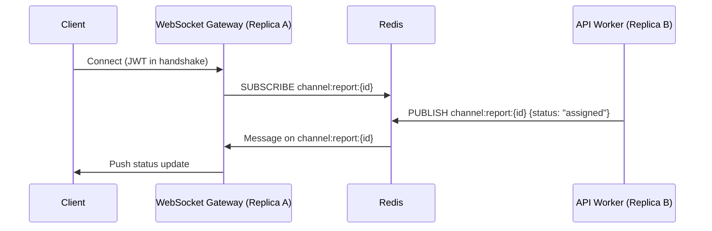

**Event types:** `report.status_changed`, `responder.assignment_offered`, `responder.assignment_accepted`, `case.eta_updated`, `admin.escalation_alert` — each scoped to a Redis channel keyed by the relevant report/org ID so clients only receive events they're authorized to see (enforced at subscribe-time against the RBAC matrix, Section 14).

**Production considerations.** Authenticate the WebSocket handshake with the same JWT used for REST calls (don't invent a separate auth mechanism); handle reconnection gracefully on the client (`hooks/useWebSocket.ts`) since mobile clients drop connections frequently on network switches.

**Common mistakes.** Broadcasting every event to every connected client and filtering client-side (leaks data across tenants/roles); not handling the "client missed an event while disconnected" case — always pair WS push with a REST "get current state" fallback the client can poll on reconnect.

**Best practices.** Keep WebSocket messages small and typed (a `type` discriminator field + minimal payload), letting the client fetch full details via REST if needed — keeps the pub/sub layer fast and the message schema simple to version.

**Research opportunities.** Benchmarking WS-broadcast-via-Redis fan-out latency under concurrent load (Section 22's load testing) is a legitimate small systems-evaluation, reusing the same benchmarking discipline as Section 6.9.

**Viva questions.**
- *"How does a status update reach a client connected to a different server replica than the one that processed the update?"* — Redis pub/sub is the cross-replica broadcast bus; any replica publishing to a channel reaches every replica's subscribers, including ones on different WS Gateway instances.
- *"What happens if a client's WebSocket disconnects mid-case?"* — On reconnect, the client calls a REST endpoint to fetch current report/case state, so it never relies solely on having received every WS message.

---

## 20. Security

**Concept.** Apply OWASP Top 10 systematically against this specific system's attack surface (citizen PII/location, image uploads, multi-tenant org data), not as a generic checklist.

| OWASP Category | Concrete Risk in This System | Mitigation |
|---|---|---|
| Broken Access Control | Volunteer fetching another citizen's exact home location pre-acceptance | Server-side conditional field serialization based on assignment status (Section 14) |
| Cryptographic Failures | Plaintext password/refresh-token storage | bcrypt/argon2 password hashing, hashed refresh tokens at rest |
| Injection | Raw SQL string-concatenation in `repositories/` | SQLAlchemy parameterized queries everywhere; never f-string raw SQL |
| Insecure Design | No rate limit on report submission → spam/abuse flooding the matching engine | Redis-backed rate limiting per user/IP (Section 21) |
| Security Misconfiguration | Debug mode / verbose error stacks exposed in production | Environment-gated `DEBUG` flag, generic error responses in prod (`core/exceptions.py`) |
| Vulnerable Components | Outdated FastAPI/Next.js/Postgres dependencies | Dependabot/`pip-audit`/`npm audit` in CI |
| Auth Failures | Long-lived access tokens, no rotation | Short-lived access tokens + rotating refresh tokens (Section 14) |
| Data Integrity Failures | Unsigned/unverified webhook payloads (e.g., from notification providers) | HMAC signature verification on inbound webhooks |
| Logging Failures | No audit trail for admin overrides | `audit_logs` table (Section 11), populated on every state-changing admin action |
| SSRF | Reverse-geocoding/AI calls fetching attacker-supplied URLs | Allowlist outbound domains, never fetch arbitrary user-supplied URLs server-side |

**Rate limiting.** Per-user and per-IP limits on report submission (e.g., 5 reports/hour) and login attempts (e.g., 5 attempts/15min with exponential lockout) implemented via Redis counters with TTL.

**File validation.** Enforce max upload size, allowlist MIME types (image/jpeg, image/png only), re-encode uploaded images server-side (strips malicious EXIF/embedded payloads and normalizes format) before storage, and run the Section 17.5 quality/content checks before accepting.

**JWT.** Signed with a strong secret (or asymmetric RS256 if multiple services need to verify without holding the signing key), short expiry, `aud`/`iss` claims validated, never accept an unsigned/`alg: none` token.

**Input validation.** Pydantic schemas on every endpoint as the first line of defense (type, length, format constraints) — reject malformed input before it reaches any service logic.

**Location privacy.** Precise coordinates withheld from non-assigned responders (Section 14/15); citizens can optionally report from a "nearby" point rather than their exact current location for non-time-critical cases (a configurable privacy/utility trade-off, worth a sentence in your paper's ethics/limitations discussion).

**Secure API design.** HTTPS-only in production (enforced at the reverse-proxy/Nginx layer, Section 10.8), CORS restricted to known frontend origins, security headers (HSTS, X-Content-Type-Options, CSP) set globally via middleware.

**Secrets management.** Environment variables injected via Docker Compose `.env` (never committed — `.env.example` committed instead), and a managed secrets store (e.g., the deployment platform's built-in secrets, or Vault) for production rather than plaintext `.env` files on a server.

**Common mistakes.** Trusting client-supplied `user_id`/`role` fields in request bodies instead of deriving identity solely from the verified JWT; logging full request bodies (including images/PII) at INFO level in plaintext logs.

**Best practices.** Run `bandit` (Python) and `npm audit`/`eslint-plugin-security` in CI; do a manual OWASP-Top-10 self-audit pass and document findings/fixes — this self-audit writeup is excellent viva and resume material.

**Viva questions.**
- *"Walk me through one OWASP risk specific to this system (not a generic web app) and your mitigation."* — Location-precision leakage to unassigned responders (Broken Access Control), mitigated via conditional server-side field serialization tied to assignment state.
- *"How do you prevent abuse/spam reports from flooding your matching engine?"* — Redis-backed per-user/IP rate limiting on report submission, plus the duplicate-detection module (Section 17.4) catching near-identical spam.

---

## 21. Performance Optimization

**Concept.** Optimize at every layer the architecture diagram (Section 10) touches: DB query speed, cache hit rate, async I/O usage, payload size, and background-task offloading — each with a measurable before/after number, since "we optimized performance" without a benchmark is not credible engineering evidence.

**Caching (Redis).**
- Cache reverse-geocode results (Section 15) keyed by rounded coordinates.
- Cache the Analytics Dashboard's aggregate queries (hotspot data, leaderboard) with a short TTL (e.g., 60s) — these don't need to be real-time-fresh.
- Cache an organization's `is_on_duty` responder list for fast candidate pre-filtering, invalidated on any availability toggle.

**Spatial indexing.** Already covered in depth in Sections 6.9/11/15 — the single highest-leverage performance decision in this entire system.

**Async processing.** Use FastAPI's native `async def` endpoints with an async DB driver (e.g., `asyncpg` via SQLAlchemy's async engine) so I/O-bound operations (DB queries, external API calls) don't block the event loop; offload genuinely CPU-bound work (image re-encoding, classical CV checks) to a process pool or background worker rather than blocking the async event loop.

**Pagination.** Cursor-based pagination (not naive `OFFSET`) for the Admin Dashboard's case list and `audit_logs` viewer — `OFFSET` degrades linearly with offset size on large tables, while a cursor (`WHERE created_at < :last_seen ORDER BY created_at DESC LIMIT N`) stays fast regardless of table size, especially paired with the `idx_reports_created_at` index.

**Lazy loading.** Frontend: lazy-load the heavier Analytics Dashboard charts/heatmap library only when that route is visited (Next.js dynamic imports), not on every app load.

**Image compression.** Re-encode/resize uploaded images server-side to a max dimension (e.g., 1600px) and reasonable JPEG quality before both AI inference (smaller images = faster inference) and storage (smaller storage/bandwidth cost) — do this once at upload time, not repeatedly.

**Background tasks.** Anything not required for the immediate HTTP response (AI inference, notification sending, audit logging, hotspot recomputation) belongs in `tasks/`, not inline in the request path — directly reduces FR "report-to-first-notification < 5s" risk by keeping the synchronous path minimal (validate → store → enqueue → respond).

**Production considerations.** Set explicit DB connection pool sizes matched to your container's expected concurrency, and load-test (Section 22) to find the actual bottleneck rather than guessing which optimization matters most — premature optimization on the wrong layer wastes time you don't have as a solo builder.

**Common mistakes.** Caching data that changes every few seconds (defeats the purpose, adds staleness risk for no benefit) vs. failing to cache genuinely-expensive, rarely-changing aggregate queries (the opposite, equally common mistake).

**Best practices.** Benchmark before *and* after every optimization you claim in your report — a single before/after latency number (e.g., "Analytics query: 1.2s uncached → 8ms cached, p95") is worth more in your viva than five paragraphs describing the optimization.

**Research opportunities.** The spatial-indexing benchmark (Section 6.9) is your strongest, most rigorous performance-research artifact — consider extending it into a small standalone results table comparing 3+ query strategies (naive scan, `ST_Distance` filter, indexed `ST_DWithin` + KNN) at multiple table sizes.

**Viva questions.**
- *"Give me one specific number that proves a specific optimization worked."* — Have your spatial-index benchmark numbers (Section 6.9/22) memorized exactly.
- *"Why async FastAPI instead of sync (Flask-style) here specifically?"* — The system is I/O-heavy (DB queries, external Maps/AI/notification API calls) far more than CPU-heavy, which is exactly the workload profile async I/O is designed to make efficient — many concurrent slow I/O waits, not many concurrent CPU bursts.

---

## 22. Testing Strategy

**Concept.** Five test types, each targeting a different risk in this system: unit (logic correctness), integration (component wiring), load (concurrency/scale), geospatial (correctness of spatial-specific logic), AI evaluation (model quality, distinct from software correctness), and end-to-end (full user journey).

**Unit Testing.** Target `services/ranking.py`, `services/radius_policy.py`, `services/priority_scoring.py`, `services/reliability_scoring.py` — pure functions, easy to hit ≥70% coverage (NFR target) with table-driven tests (one test function, many input/expected-output rows).

```python
# tests/unit/test_ranking.py
import pytest
from app.services.ranking import score

@pytest.mark.parametrize("candidate, report, expected_min, expected_max", [
    (mock_candidate(distance_m=500, reliability=0.9), mock_report(), 0.7, 1.0),
    (mock_candidate(distance_m=15000, reliability=0.1), mock_report(), 0.0, 0.3),
])
def test_score_ordering(candidate, report, expected_min, expected_max):
    result = score(candidate, report)
    assert expected_min <= result <= expected_max
```

**Integration Testing.** Spin up a test Postgres+PostGIS instance (Docker, via `pytest-docker` or `testcontainers-python`) and test the full `reports` → `emergency_requests` → matching flow against a real database, not mocks — this is where spatial-query correctness bugs actually surface.

**Load Testing.** Use Locust (already scaffolded at `tests/load/locustfile.py`) to simulate concurrent report submissions and WebSocket connections; validate the NFR targets directly (p95 latency < 150ms for geospatial queries, ≥500 concurrent WS connections).

```python
# tests/load/locustfile.py
from locust import HttpUser, task, between

class CitizenUser(HttpUser):
    wait_time = between(1, 3)

    @task
    def submit_report(self):
        self.client.post("/api/reports", json={
            "lat": 12.97 + random_jitter(), "lng": 77.59 + random_jitter(),
            "description": "Injured stray near market", "animal_type": "dog"
        })
```

**Geospatial Testing.** Specifically test edge cases: report exactly at radius boundary, antimeridian/pole edge cases (unlikely for India-only deployment but worth a sentence acknowledging scope), zero candidates within max radius (broadcast-fallback path), and SRID mismatches (a deliberately malformed test fixture to confirm the system rejects rather than silently mis-computes).

**AI Evaluation.** Distinct from unit/integration tests — these are *model quality* metrics, not pass/fail assertions: confusion matrix + weighted kappa for severity classification (Section 6.2), mAP for detection (Section 17.1), precision/recall for duplicate detection (Section 17.4) — run as a separate evaluation notebook/script, reported in your paper's Experiments section (27), not as CI gates (model quality thresholds are softer than code-correctness assertions).

**End-to-End Testing.** Playwright/Cypress driving the actual Next.js frontend against a running backend: citizen submits report → simulate volunteer accept → verify citizen's tracking page receives the WS update — covers the FR-01→FR-11 critical path in one automated script.

**Production considerations.** Run unit+integration tests in CI on every commit; run load tests manually/periodically (they're expensive and slow, not suited to every-commit CI) before major milestones (end of each roadmap phase, Section 31).

**Common mistakes.** Mocking the database in "integration" tests (defeats the purpose — you're just unit-testing with extra ceremony); skipping geospatial edge-case tests because "the happy path works," then discovering SRID bugs only in production.

**Best practices.** Keep a `tests/fixtures/` directory with realistic, reusable mock reports/responders (varying distances, severities, reliability scores) shared across unit and integration tests — avoids each test file reinventing slightly-different mock data.

**Research opportunities.** The AI evaluation suite (confusion matrices, kappa, mAP, precision/recall) *is* your paper's Experiments section's raw material — design these tests to produce paper-ready tables/plots directly, not just pass/fail booleans.

**Viva questions.**
- *"What's your test coverage on the matching engine specifically, and how did you measure it?"* — Have the exact `pytest --cov` percentage for `services/` ready.
- *"How do you test something inherently probabilistic, like the AI severity classifier?"* — Not with pass/fail unit tests — with held-out labeled-set evaluation metrics (confusion matrix, weighted kappa), explicitly distinguishing model evaluation from software correctness testing.

---

## 23. Monitoring & Observability

**Concept.** Four pillars: structured logging (what happened), metrics (how much/how fast, aggregated over time), tracing (the path of one request across services), and health checks (is the system up right now) — plus error reporting tying failures back to a specific user-impacting event.

**Logging.** Structured JSON logs (not bare `print`/string logs) with consistent fields (`request_id`, `user_id`, `report_id`, `event`) so logs are queryable/filterable, not just readable line-by-line; use Python's `structlog` or `loguru` with a JSON renderer.

**Metrics.** Expose a `/metrics` Prometheus-format endpoint tracking: request latency histograms per route, matching-engine duration, radius-expansion-attempt counts, notification success/failure rates by channel, active WebSocket connection count — visualize in Grafana (even a single-pane local dashboard is enough for a final-year project demo).

**Tracing.** OpenTelemetry instrumentation across the report-submission → matching → notification path so a single `trace_id` lets you see exactly where time was spent for any one report — directly useful for diagnosing why NFR's "<5s to first notification" target was missed on a specific slow case.

**Error Reporting.** Sentry (or a self-hosted equivalent) capturing unhandled exceptions with full context (request, user, stack trace) — critical for catching AI-provider failures (Section 17) and notification-provider failures (Section 18) that might otherwise fail silently in a background worker.

**Health Checks.** A `/health` endpoint checking DB connectivity, Redis connectivity, and (optionally) a lightweight AI-provider ping — used by Docker Compose's `healthcheck` directive (Section 24) and any production orchestrator/load balancer to know when a container is actually ready to serve traffic.

```python
# routers/health.py
@router.get("/health")
async def health_check(db: AsyncSession = Depends(get_db)):
    checks = {"db": await check_db(db), "redis": await check_redis()}
    healthy = all(checks.values())
    return JSONResponse(
        status_code=200 if healthy else 503,
        content={"status": "ok" if healthy else "degraded", "checks": checks}
    )
```

**Production considerations.** Alert (not just log) on specific thresholds that map directly to your NFRs — e.g., alert if p95 geospatial query latency exceeds 150ms for 5 consecutive minutes, or if the notification dead-letter rate (Section 18) exceeds zero.

**Common mistakes.** Logging PII (exact GPS coordinates, full names) in plaintext at INFO level without redaction; having health checks that only verify "the process is running" rather than verifying actual downstream dependency health (DB/Redis reachability).

**Best practices.** Tie every dashboard panel back to a specific NFR (Section 9) — this makes your monitoring setup look deliberate and evaluation-driven in a viva, not just "I added Grafana because it looked good."

**Research opportunities.** None directly — observability is standard production practice, not a research claim; presenting it as rigorous *engineering* (distinct from your research claims) is itself good scientific hygiene in how you frame your paper's contribution boundaries.

**Viva questions.**
- *"Show me one metric on your dashboard and tell me what NFR it validates."* — Have one specific panel (e.g., geospatial query p95 latency histogram) mapped explicitly to NFR's 150ms target.
- *"How would you debug a report that took 30 seconds to get its first notification, when your target is 5?"* — Pull the `trace_id` for that report, walk the OpenTelemetry trace span-by-span to find which stage (AI inference? notification provider? DB query?) consumed the excess time.

---

## 24. Dockerization

**Concept.** Multi-stage Dockerfiles per service (small final images), one `docker-compose.yml` wiring backend, frontend, Postgres+PostGIS, Redis, and a background worker together for one-command local bring-up, with a separate production-leaning compose override.

### 24.1 Backend Dockerfile (multi-stage)

```dockerfile
# backend/Dockerfile
FROM python:3.12-slim AS builder
WORKDIR /app
RUN pip install --no-cache-dir --break-system-packages poetry
COPY pyproject.toml poetry.lock ./
RUN poetry export -f requirements.txt --output requirements.txt --without-hashes

FROM python:3.12-slim
WORKDIR /app
COPY --from=builder /app/requirements.txt .
RUN pip install --no-cache-dir --break-system-packages -r requirements.txt
COPY ./app ./app
COPY ./alembic ./alembic
COPY alembic.ini .
EXPOSE 8000
HEALTHCHECK --interval=30s --timeout=5s --retries=3 \
    CMD curl -f http://localhost:8000/health || exit 1
CMD ["uvicorn", "app.main:app", "--host", "0.0.0.0", "--port", "8000"]
```

### 24.2 docker-compose.yml (development)

```yaml
version: "3.9"
services:
  postgres:
    image: postgis/postgis:16-3.4
    environment:
      POSTGRES_DB: rescue_db
      POSTGRES_USER: rescue_user
      POSTGRES_PASSWORD: ${DB_PASSWORD}
    volumes:
      - pgdata:/var/lib/postgresql/data
    ports: ["5432:5432"]
    healthcheck:
      test: ["CMD-SHELL", "pg_isready -U rescue_user"]
      interval: 10s
      retries: 5

  redis:
    image: redis:7-alpine
    ports: ["6379:6379"]
    healthcheck:
      test: ["CMD", "redis-cli", "ping"]
      interval: 10s

  backend:
    build: ./backend
    env_file: .env
    depends_on:
      postgres: { condition: service_healthy }
      redis: { condition: service_healthy }
    ports: ["8000:8000"]
    volumes:
      - ./backend/app:/app/app   # live-reload mount for dev

  worker:
    build: ./backend
    command: ["python", "-m", "app.tasks.worker"]
    env_file: .env
    depends_on:
      postgres: { condition: service_healthy }
      redis: { condition: service_healthy }

  frontend:
    build: ./frontend
    env_file: .env
    ports: ["3000:3000"]
    depends_on: [backend]

volumes:
  pgdata:
```

**Development setup.** `docker compose up --build`, then `docker compose exec backend alembic upgrade head` to apply migrations on first run; live-reload volumes (backend `app/` mount, Next.js dev server) keep iteration fast without rebuilding images on every change.

**Production setup.** Separate `docker-compose.prod.yml` removing dev-only volume mounts, adding an `nginx` reverse-proxy service (Section 10.8) with TLS termination, pointing `DATABASE_URL`/`REDIS_URL` at managed services (Section 25) instead of the bundled containers, and setting `restart: unless-stopped` policies.

**Production considerations.** Never bake secrets into the image layers (use `--build-arg` only for non-secret build config, runtime secrets via env/`.env` or the platform's secret manager); pin exact image versions (`postgis/postgis:16-3.4`, not `:latest`) for reproducibility.

**Common mistakes.** Running the backend as root inside the container (add a non-root `USER` directive); forgetting `depends_on` health conditions, causing the backend to start before Postgres is actually ready to accept connections (a very common "works on my machine, fails in CI" bug).

**Best practices.** Keep one `.env.example` checked into the repo documenting every required variable with a placeholder value — this is the single biggest "zero-assumption setup" credibility signal (Objective 9) for anyone cloning your repo.

**Viva questions.**
- *"Walk me through what happens, container by container, when I run `docker compose up`."* — Postgres and Redis start and run health checks first; backend and worker wait on those health conditions before starting; frontend waits on backend; once all are healthy, the system is fully operational with zero manual steps beyond the one command.
- *"Why a separate `worker` service instead of running background tasks inside the `backend` container?"* — Isolates resource contention (a slow AI-inference job shouldn't compete with the API process for CPU/memory) and allows independent scaling (you could run 1 backend replica and 3 worker replicas if notification volume spikes).

---

## 25. Deployment

**Concept.** Three viable tiers depending on budget/stage: Render/Railway (cheapest, fastest to deploy, good for FYP demo + portfolio), DigitalOcean (mid-tier, more control, App Platform or a droplet running Docker Compose directly), AWS (most "production-grade" on a resume, more setup overhead — ECS/Fargate + RDS PostGIS + ElastiCache).

| Platform | Best for | Postgres+PostGIS | Redis | Notes |
|---|---|---|---|---|
| Render | Fast FYP/portfolio demo | Managed Postgres (verify PostGIS extension support) | Managed Redis | Free tier sleeps on inactivity — mention this caveat in your demo planning |
| Railway | Similar to Render, simple Docker Compose-like deploys | Managed Postgres | Managed Redis | Generous free/hobby tier, good for solo projects |
| DigitalOcean | More control, still simple | Managed DB or self-hosted on a Droplet | Managed or self-hosted | App Platform for PaaS-style, or raw Droplet + your existing `docker-compose.prod.yml` |
| AWS | Resume weight, real production patterns | RDS PostgreSQL with PostGIS extension enabled | ElastiCache | ECS/Fargate for containers, S3 for images, CloudWatch for Section 23 monitoring |

**Recommended path for this project:** Start on Render/Railway for the FYP demo and initial portfolio deployment (fast, free-tier friendly, low operational burden for a solo student); document an AWS migration path in your paper/README as a "production scaling" discussion even if you don't fully execute it — this demonstrates production awareness without requiring you to actually pay for/operate AWS infrastructure for a student project.

**Production considerations.** Database migrations (Alembic) must run as a deploy step, not manually after the fact — wire `alembic upgrade head` into your deploy pipeline/CI so schema and code never drift out of sync.

**Common mistakes.** Deploying with `DEBUG=True` (verbose stack traces leak to end users — an OWASP Security Misconfiguration risk, Section 20); forgetting to enable the PostGIS extension on a fresh managed-Postgres instance (it's not always on by default — `CREATE EXTENSION postgis;` must be run explicitly even on managed platforms).

**Best practices.** Set up a simple CI/CD pipeline (GitHub Actions) running tests (Section 22) on every push, and auto-deploying `main` branch to your chosen platform on green builds — a working CI/CD pipeline is a strong, easy-to-demonstrate portfolio signal.

**Viva questions.**
- *"Why did you choose Render/Railway over AWS for your deployed demo?"* — Speed-to-deploy and zero-cost iteration for a student project, with AWS migration documented as the production-scaling path rather than executed prematurely.
- *"What's your rollback strategy if a deploy breaks production?"* — Platform-level instant rollback to the previous container image/deploy, combined with reversible Alembic migrations (always pair an `upgrade` with a tested `downgrade`).

---

## 26. Research Methodology

**Concept.** Define the experimental skeleton once, here, and reuse it directly as your paper's Methodology/Experiments sections (27) — research questions, hypotheses, variables, metrics, baselines, design, statistics, and validity threats, all stated precisely enough to be falsifiable.

**Research Questions (RQs).**
- RQ1: Does multi-factor responder ranking (Section 16) reduce simulated time-to-successful-assignment compared to naive nearest-distance ranking?
- RQ2: Does adaptive radius expansion (Section 6.4) find qualified responders faster than fixed-radius search across varying responder-density scenarios?
- RQ3: Which individual ranking factor contributes most to assignment quality (ablation, Section 6.3)?

**Hypotheses.**
- H1: Multi-factor ranking yields a statistically significant reduction in mean simulated time-to-successful-assignment vs. distance-only ranking.
- H2: Adaptive radius expansion achieves comparable or better candidate-discovery time than a "safe" large fixed radius, while querying far fewer candidates on average (efficiency gain) — and strictly outperforms a "narrow" fixed radius in low-density scenarios.
- H3: Reliability score and distance contribute more to assignment-quality variance than organization-type match (a directional, testable hypothesis from your ablation).

**Independent Variables.** Ranking strategy (naive-distance vs. multi-factor), radius policy (fixed-narrow / fixed-wide / adaptive), responder density scenario (sparse/medium/dense), individual factor inclusion/exclusion (for the ablation).

**Dependent Variables.** Time-to-successful-assignment, number of candidates queried, simulated rescue-success-probability proxy (Section 6.5's logistic model output on simulated cases), p95 query latency.

**Evaluation Metrics.** Mean/median/p95 of time-to-assignment; Mann–Whitney U test for significance (response-time distributions are right-skewed, not assumed normal — justify this test choice explicitly in your paper); weighted Cohen's kappa for severity classification; AUC-ROC/Brier score for success prediction; precision/recall for duplicate detection; mAP for detection.

**Baseline Methods.** Naive nearest-distance-only assignment (the most obvious "what would a beginner build" baseline) and fixed-radius search at two different radii (a "too narrow" and a "too wide" baseline) — both baselines are easy to implement (a few lines disabling the weighting/expansion logic) and make your proposed methods' improvement legible.

**Experimental Design.** Controlled simulation: generate N synthetic responder pools at 3 density levels × M synthetic report locations, run each ranking/radius strategy against the identical generated scenarios (paired comparison, not independent samples — this lets you use a paired test, which has more statistical power than an unpaired one for the same sample size), repeat with multiple random seeds and report mean ± standard deviation.

**Statistical Analysis.** Report effect size (not just p-value) — e.g., Cliff's delta for the Mann–Whitney comparisons — since "statistically significant" alone doesn't tell a reviewer whether the improvement is practically meaningful; a small p-value with a tiny effect size is a common, easily-criticized over-claim.

**Threats to Validity.**
- *Internal validity:* Synthetic responder/report data may not capture real behavioral patterns (e.g., real volunteers might decline for reasons not modeled) — mitigate by being explicit that simulation results are a controlled proof-of-concept, not a claim about real-world deployment outcomes.
- *External validity:* Results from simulated Bengaluru-shaped density distributions may not generalize to other cities/countries — scope your claims geographically.
- *Construct validity:* "Simulated rescue-success-probability" is a proxy, not ground-truth outcome data — name this limitation explicitly rather than letting a reviewer discover it.
- *Statistical validity:* Multiple comparisons (testing 3+ RQs on overlapping data) inflate false-positive risk — apply a Bonferroni or Holm correction if testing many hypotheses on the same dataset.

**Production considerations.** Pre-register your hypotheses (even just in a dated Obsidian note or a Git commit) *before* running the experiments — this is good scientific practice and gives you a clean, honest answer if a viva panel asks "did you decide your hypotheses before or after seeing the results?"

**Common mistakes.** Running an experiment, getting a result, and *then* writing a hypothesis that matches it (HARKing — Hypothesizing After Results are Known) — a credibility risk if it becomes apparent under questioning.

**Viva questions.**
- *"Why Mann-Whitney U instead of a t-test?"* — Response-time data is typically right-skewed (a few very slow outliers), violating the t-test's normality assumption; Mann-Whitney is a non-parametric rank-based test robust to that skew.
- *"What's the biggest threat to validity in your evaluation, and how did you address it?"* — Construct validity of the simulated success-probability proxy; addressed by explicitly scoping claims as "demonstrated on controlled simulation" rather than "proven in real-world deployment."

---

## 27. Research Paper Blueprint (IEEE Format)

> Maps directly onto IEEE's standard two-column conference template. Each subsection below tells you what content from this blueprint feeds it.

**Title:** *An Adaptive Geospatial Matching Framework for AI-Assisted Stray Animal Emergency Response* (working title — adjust once your primary 2-3 contributions, Section 6, are finalized).

**Abstract (150-250 words).** One sentence problem (Section 2) → one sentence gap (Section 5) → one sentence proposed method (your chosen 2-3 primary contributions from Section 6) → one sentence evaluation approach (Section 26) → one sentence headline result (fill in once experiments run) → one sentence significance/impact.

**I. Introduction.** Motivate with the scale of the stray-animal problem (cite a statistic with a source), state the coordination-failure problem (Section 2's diffusion-of-responsibility example), state your contributions as a numbered list (this numbered list should map 1:1 to Section 6's chosen primary contributions), and preview your evaluation's headline finding.

**II. Related Work.** Organize into 3 subsections matching Section 3's categories (animal-welfare reporting systems, general emergency dispatch, on-demand matching platforms) — for each, name 2-4 specific systems/papers (from Section 4's survey table), describe their approach in your own words (1-2 sentences each), and end each subsection with an explicit gap sentence pointing at Section 5.

**III. Methodology / Proposed System.** Use Section 10's architecture diagrams (especially 10.1, 10.3, 10.6) and Section 16's pseudocode/formula directly; explain your chosen primary contributions' mathematical formulation (pull from Section 6's "Mathematical intuition" subsections verbatim-adapted).

**IV. System Architecture.** Expand on III with implementation specifics: tech stack (your existing stack list), database schema highlights (Section 11, perhaps just the ER diagram + 2-3 key tables, not all 14), and the matching engine's complexity analysis (Section 16.3's table).

**V. Experimental Setup.** Pull directly from Section 26: RQs, hypotheses, independent/dependent variables, baselines, simulation design parameters (density levels, sample sizes, random seeds).

**VI. Results.** Present as tables/plots: mean±SD time-to-assignment per strategy, the ablation factor-importance chart (Section 6.3), the spatial-index latency benchmark (Section 6.9) as a strong supporting systems-result, statistical test results with effect sizes (Section 26).

**VII. Discussion.** Interpret results against your hypotheses (confirmed/partially confirmed/rejected — be honest if a hypothesis wasn't supported, this is normal and doesn't weaken the paper if discussed well), discuss practical implications for real-world NGO/volunteer coordination.

**VIII. Limitations.** Simulated vs. real-world data gap (Section 26's threats to validity), AI severity classifier's small/synthetic validation set (Section 6.2), single-city/region scope.

**IX. Future Work.** The 7 "secondary" contributions you didn't deeply evaluate (Section 6's non-primary ones), real-deployment pilot with an actual NGO partner, learned ranking model once outcome data accumulates (Section 16's noted future direction).

**X. Conclusion.** Restate contributions and headline result in 3-4 sentences, no new information.

**References.** Your literature survey table (Section 4) formatted in IEEE citation style; aim for 15-25 references as discussed in Section 4.

**Production considerations.** Write Sections III-VI (Methodology through Results) *after* your implementation and experiments are largely done — writing Introduction/Related Work first (you can draft these early since they don't depend on results) while implementation is ongoing is the efficient order.

**Common mistakes.** Writing Results before running real experiments and then "fitting" the experiment to match — always run experiments first, report whatever you actually find, including null/negative results (a well-discussed negative result is more credible than a suspiciously perfect positive one).

**Viva questions.**
- *"What's your paper's single headline contribution, in one sentence?"* — Rehearse this until automatic; it should be one of your Section 6 primary contributions stated with its evaluation result.
- *"If you had to cut your paper down to defend only ONE section under time pressure, which would you pick and why?"* — Usually Section VI (Results) — it's the section that turns claims into evidence.

---

## 28. Publication Strategy

**Concept.** Match venue ambition to evidence strength, and treat publication ethics/reproducibility as non-negotiable parts of the submission, not afterthoughts.

**Suggested venues (tiered by typical accessibility for a strong student paper):**
- *Student/regional conferences:* IEEE-affiliated student conferences, local university symposiums, INDIACom, or similar regional IEEE conferences — realistic first target for a solid evaluation with simulated data.
- *Workshop tracks:* Workshops co-located with larger AI/GIS conferences (e.g., a "AI for Social Good" or "Geospatial AI" workshop track) — often have lighter review bars and are explicitly looking for applied, social-impact work like this.
- *Open-access preprint first:* Post to arXiv (cs.SE / cs.AI categories) regardless of where else you submit — establishes priority/timestamp and makes the work citable immediately, with zero gatekeeping.
- *Stretch targets (only with strong real-deployment data):* Mid-tier ACM/IEEE conferences in GIS, HCI-for-good, or emergency informatics — realistic only if you secure a real NGO pilot deployment generating genuine outcome data (Section 6.5).

**Publication ethics.** Disclose AI-assistance in writing/code generation per the venue's policy (many now require an AI-use disclosure statement); never fabricate or "smooth over" experimental results; disclose the synthetic nature of your evaluation data prominently rather than implying real-world validation.

**Reproducibility.** Publish your synthetic-data-generation scripts, exact hyperparameters/weights used in the matching engine (Section 16), and random seeds alongside the paper — a "Reproducibility" appendix or linked repo section listing exact versions (Python, key libraries, Postgres/PostGIS versions) used.

**Dataset preparation.** If releasing any self-collected labeled data (Section 6.2's severity-labeled images), strip/blur identifying information from any background context in photos, document the labeling protocol and inter-rater reliability, and release under a clear open license (e.g., CC-BY) with a datasheet describing collection method and known biases.

**Code release.** Public GitHub repo (this doubles as your portfolio artifact, Section 29) with a clear README, the `.env.example` from Section 24, a `LICENSE` file (MIT or Apache 2.0 are standard, permissive choices for an academic/portfolio project), and a `CITATION.cff` file if you want others to cite the software itself.

**Common mistakes.** Submitting to a venue clearly mismatched to your evidence strength (e.g., a top-tier ACM conference with only simulated-data results) — wastes review cycles and can read as a lack of venue awareness; failing to mention synthetic-data limitations upfront, which reviewers will flag harder if they discover it themselves rather than you disclosing it.

**Best practices.** Get one faculty mentor/co-author to review before submission — even informal feedback catches framing issues you're too close to the work to see.

**Viva questions.**
- *"Where do you plan to submit this, and why that venue specifically?"* — Have one concrete, named venue (not "a good conference") matched explicitly to your evidence strength.
- *"What would you need to add to your evaluation to target a stronger venue?"* — Real-deployment outcome data from an NGO pilot (Section 6.5/26's threats-to-validity discussion) is almost always the honest answer.

---

## 29. Resume Section

**ATS-friendly project title:**
`AI-Powered Geospatial Emergency Response System for Stray Animal Rescue | FastAPI, Next.js, PostGIS, Redis, Computer Vision`

**Impact bullets (choose 3-4, tense-consistent, quantified where your evaluation supports it):**

- Designed and implemented a real-time geospatial emergency-dispatch platform matching animal-distress reports to optimal responders using a multi-factor weighted ranking algorithm, reducing simulated time-to-assignment by **[X]%** versus naive nearest-distance baseline across controlled experiments.
- Engineered a PostGIS-backed spatial indexing layer (GiST, KNN operators) achieving **[Y]ms p95 query latency** at 100K+ simulated responder records, a **[Z]x** improvement over unindexed sequential scan.
- Built an adaptive search-radius expansion policy and AI-assisted injury-severity triage pipeline (vision-language model integration with rule-based fallback), validated via ablation study isolating the contribution of each of 6 ranking factors.
- Architected and deployed a full-stack, containerized system (FastAPI, Next.js, PostgreSQL/PostGIS, Redis, WebSockets, Docker Compose) supporting 6 role-based dashboards and real-time case tracking across **[N]** simulated/test concurrent users.
- Authored an IEEE-format research paper formalizing the responder-matching problem as a multi-objective optimization, with a reproducible synthetic-data evaluation pipeline and open-sourced codebase.

**Production considerations.** Fill in `[X]`/`[Y]`/`[Z]`/`[N]` only with numbers you can defend on the spot in an interview — an unverifiable resume number is worse than no number; round conservatively if your evaluation has variance across seeds (Section 26).

**Common mistakes.** Listing every technology in the stack as a bullet point itself (recruiters skim, and a wall of tool names without outcomes reads as junior); claiming production deployment scale/numbers your evaluation doesn't actually support.

**Viva/Interview questions.**
- *"Tell me about a number on your resume — defend it."* — Have the exact benchmark methodology (Section 6.9, 22, 26) ready to walk through for any quantified bullet.

---

## 30. Interview Preparation (75+ Q&A)

> Organized by domain. Answers are intentionally concise — expand verbally in a real interview by referencing the relevant section number above.

### FastAPI (8)

1. **Why FastAPI over Flask/Django for this project?** Native async support fits an I/O-heavy workload (Section 21), automatic OpenAPI docs aid frontend type generation (Section 13), and Pydantic-based validation reduces boilerplate vs. Flask's manual validation.
2. **How does FastAPI's dependency injection work?** `Depends()` resolves a callable at request time, supporting nested dependencies (e.g., `get_current_user` depends on `get_db`); used here for `require_role()` (Section 14).
3. **Sync vs async route handlers — when does it matter?** A sync `def` route runs in a threadpool; an `async def` route runs on the event loop directly — mixing a blocking call inside an `async def` (e.g., a sync DB driver call) blocks the entire event loop, a common FastAPI performance bug.
4. **How do you handle background work in FastAPI?** `BackgroundTasks` for simple fire-and-forget (e.g., logging), a real task queue (Celery/arq + Redis) for anything retryable/critical like notifications (Section 18) — `BackgroundTasks` has no retry/persistence guarantees.
5. **How does Pydantic validation differ from manual validation?** Declarative schema with type coercion and automatic 422 error responses on mismatch, versus imperative if/else checks scattered through handler code.
6. **How do you structure a large FastAPI app?** Router-per-resource with `APIRouter`, included via `app.include_router()` in `main.py` (Section 12's folder structure), keeping `main.py` itself thin.
7. **How do you test FastAPI endpoints?** `TestClient`/`httpx.AsyncClient` against the app instance, with a test DB (Section 22's integration tests) rather than mocking the framework itself.
8. **How do you version your API?** URL-path versioning (`/api/v1/...`) is simplest for a project this size; header-based versioning is more flexible but adds complexity not justified here.

### Next.js (7)

9. **Why App Router over Pages Router?** Native React Server Components, nested layouts, and route groups (Section 13's `(citizen)`/`(volunteer)` groups) map cleanly onto this project's role-based dashboard structure.
10. **Server Components vs Client Components — how did you decide?** Data-fetching-heavy, mostly-static views (e.g., initial dashboard load) as Server Components; anything needing hooks/interactivity (the live-tracking map, WebSocket subscriptions) as Client Components (`"use client"`).
11. **How do you handle real-time data in Next.js?** A custom `useWebSocket` hook (Section 13) inside a Client Component, since WebSocket connections are inherently client-side, browser-API-dependent.
12. **How do you manage auth state across the app?** JWT stored in an httpOnly cookie (set by the backend on login), read server-side in middleware for route protection, mirrored client-side via a lightweight auth context for UI state (Section 14).
13. **How do you keep six dashboards from becoming six codebases?** Shared component library (`components/map`, `components/reports`) parameterized by role/permissions rather than duplicated per-dashboard (Section 13).
14. **How do you handle loading/error states for data-heavy dashboards?** Next.js's `loading.tsx`/`error.tsx` file conventions per route segment, plus skeleton components for the map/chart-heavy views.
15. **How would you optimize the Analytics Dashboard's initial load?** Dynamic import of the heatmap/chart libraries (Section 21's lazy loading) so they're not in the initial bundle for users who never visit that route.

### GIS / PostGIS (10)

16. **What is PostGIS and why use it over plain lat/lng columns?** A Postgres extension adding spatial types/indexes/functions; plain floats force distance math into application code and can't use spatial indexes (Section 11).
17. **`geography` vs `geometry` — what's the difference?** `geography` computes distances on a spheroidal Earth model in meters automatically; `geometry` assumes a flat Cartesian plane and needs explicit projection handling to get correct real-world distances.
18. **What SRID did you use and why?** 4326 (WGS84), the standard GPS coordinate reference system — matches what device GPS and most mapping APIs natively output.
19. **How does a GiST index speed up spatial queries?** It builds an R-tree-like bounding-box hierarchy, letting the planner prune most of the table before computing exact distances, turning an `O(n)` scan into roughly `O(log n)` (Section 6.9).
20. **Difference between `ST_Distance` and `ST_DWithin`?** `ST_DWithin` can use the spatial index for an index-assisted radius pre-filter; a bare `ST_Distance(...) < x` computes distance for every row first (Section 15).
21. **How do you find the K nearest neighbors efficiently?** The `<->` KNN distance operator combined with `ORDER BY ... LIMIT K` and a GiST index (Section 15).
22. **What's reverse geocoding and what tool did you use?** Converting coordinates to a human-readable address; Nominatim/OSM for dev, Google Geocoding API as a production option (Section 15).
23. **How do you handle GPS inaccuracy?** Store `accuracy_meters` alongside every captured point; below a threshold, prompt for manual map-pin confirmation rather than trusting the raw reading (Section 15).
24. **What's geofencing and where did you use it?** Defining a polygon/radius service-area boundary; used to filter candidate responders to an organization's actual jurisdiction (Section 15).
25. **How would you benchmark spatial query performance?** Compare p50/p95/p99 latency at increasing table sizes (1K/100K/1M rows) with vs. without a GiST index (Section 6.9/22).

### Algorithms (10)

26. **What's the time complexity of your matching engine end-to-end?** `O(E·log n + E·k log k)` per run — dominated by the indexed spatial query, not the scoring math (Section 16.3).
27. **Why brute-force for the multi-stop route ordering instead of a heuristic?** At ≤5 stops, `(n-1)!` is tiny (≤24), so exact brute-force is both simpler and provably optimal — no need for a heuristic at this scale (Section 6.8).
28. **What's DBSCAN and why use it for hotspot detection over k-means?** Density-based clustering that doesn't require pre-specifying cluster count and naturally labels sparse points as noise instead of forcing them into a cluster — better fit for irregularly-shaped, noisy report-location data (Section 6.10).
29. **Explain the exponential urgency-decay function.** `1 - e^(-λt)` grows from 0 toward 1 as unassigned wait time `t` increases, modeling rising urgency without ever exceeding a bounded maximum (Section 6.1).
30. **What's a Beta-Binomial smoothed estimate and why use it for reliability scoring?** A Bayesian estimator that regresses small-sample raw averages toward a sensible prior, avoiding overconfident scores from 1-2 data points (Section 6.6).
31. **How would you ablate your ranking formula?** Remove one weighted factor at a time (set its weight to 0, renormalize), measure impact on a simulated outcome metric, and rank factors by impact magnitude (Section 6.3).
32. **Why weighted-sum ranking instead of a learned ranking model?** Interpretability and cold-start — no training data exists yet at launch; a weighted-sum is auditable and tunable without retraining, explicitly framed as a stepping stone to a learned ranker later (Section 16).
33. **How does adaptive radius expansion avoid overshooting candidate counts?** A moderate growth factor (1.4-1.6x, not 2x) accounts for the fact that expected candidates scale roughly with `r²` (Poisson point process intuition), so aggressive growth would massively overshoot (Section 6.4).
34. **What statistical test would you use to compare two ranking strategies' response times, and why?** Mann-Whitney U test (non-parametric), since response-time distributions are typically right-skewed, violating the t-test's normality assumption (Section 26).
35. **Why report effect size alongside p-value?** A statistically significant result can still be practically negligible; effect size (e.g., Cliff's delta) quantifies the magnitude of the difference, not just whether it's distinguishable from chance (Section 26).

### Databases (8)

36. **Why UUID primary keys instead of auto-increment integers?** Avoids leaking sequential counts across a multi-tenant system and enables conflict-free client-generated IDs for potential offline-first clients (Section 11).
37. **Why is `rescue_timeline` separate from `response_history`?** One's a generic append-only event log (debugging/audit), the other's a denormalized table shaped specifically for reliability/outcome-prediction feature queries (Section 11).
38. **How do you prevent connection-pool exhaustion under load?** Explicit pool sizing matched to expected concurrency, plus PgBouncer in front of Postgres if FastAPI's async worker count exceeds Postgres' comfortable connection limit (Section 11/21).
39. **Why partition `audit_logs`/`rescue_timeline` by month?** Both are append-only, naturally time-ordered, high-volume tables — range partitioning keeps queries and maintenance (e.g., archiving old partitions) fast as volume grows (Section 11).
40. **What's a partial index and where did you use one?** An index built over only rows matching a condition (e.g., `WHERE is_on_duty = TRUE`) — smaller and faster than a full-table index when most rows don't match that condition (Section 11).
41. **Why `TEXT[]` with a GIN index for `capability_tags` instead of a join table?** Simpler for a small, relatively static tag set per responder, with GIN enabling fast containment queries (`@>`) for capability matching, without the join overhead of a full many-to-many table for this scale.
42. **How do you handle schema migrations?** Alembic, with every migration including a tested `downgrade`, wired into the deploy pipeline so schema and code never drift (Section 24/25).
43. **Why `TIMESTAMPTZ` instead of `TIMESTAMP`?** Stores time with timezone awareness, avoiding subtle bugs once responders/citizens span multiple timezones or daylight-saving transitions.

### AI / Computer Vision (8)

44. **How do you handle the AI provider being down?** Circuit breaker + rule-based fallback severity default, ensuring the report still enters the matching pipeline (Section 17).
45. **Why ordinal classification (not plain multi-class) for severity?** A "critical predicted as minor" error is far worse than "moderate predicted as severe" — ordinal-aware metrics (weighted kappa) penalize accordingly, plain accuracy doesn't (Section 6.2).
46. **How do you evaluate a classifier when you don't trust raw accuracy?** Confusion matrix + quadratic-weighted Cohen's kappa, which accounts for both class imbalance and the ordinal distance between predicted and true classes (Section 6.2).
47. **How does your duplicate-detection module work?** Conjunction of three independent weak signals — spatial proximity, temporal proximity, and image-hash similarity — each individually noisy, but the AND combination is a strong precision signal (Section 17.4).
48. **Why classical CV (Laplacian blur detection) before the AI pipeline?** Cheap, near-instant pre-filter that rejects clearly-bad images before paying the cost/latency of the heavier detection/severity models (Section 17.5).
49. **What's the training pipeline for your species classifier?** Fine-tune a lightweight pretrained CNN (MobileNetV3/EfficientNet-lite) on Stanford Dogs + Oxford-IIIT Pet + a small custom street-cattle set, evaluated via top-1 accuracy and per-class F1 (Section 17.2).
50. **Why a VLM prompt for severity instead of training a classifier from scratch?** Faster to prototype with no labeled data required upfront; explicitly framed as a v1 approach with a documented future-work path to a fine-tuned classifier once labeled data accumulates (Section 6.2/17.3).
51. **How would you know if your AI severity classifier is actually trustworthy enough for production?** Weighted-kappa and confusion-matrix performance on a held-out, ideally vet-labeled validation set, with a mandatory low-confidence-escalates-to-human fallback regardless of aggregate metrics (Section 6.2).

### System Design (8)

52. **Walk me through the system end-to-end for one report.** Capture → AI triage → priority scoring → candidate retrieval → ranking → notification → accept/decline/escalate → status updates via WebSocket → resolution → outcome feedback (Sections 10.2-10.4, 16, 18, 19).
53. **Why Redis for live location/state instead of just Postgres?** Ephemeral, high-frequency, non-durable-critical state (location pings, rate-limit counters, pub/sub) fits Redis' access pattern far better than incurring Postgres write amplification at that frequency (Section 10).
54. **How does your system scale horizontally?** Stateless API replicas behind a load balancer, with WebSocket state bridged via Redis pub/sub so any replica can serve any connected client (Section 10/19).
55. **What's your single point of failure, and how do you mitigate it?** Postgres is the most central SPOF; mitigated via managed-service replication/backups in production rather than a self-hosted single instance (Section 25).
56. **How would you redesign this for 10x the report volume?** Read replicas for analytics queries, partition high-volume append-only tables (Section 11), scale worker replicas independently of API replicas (Section 24), and revisit the matching engine's candidate-retrieval `LIMIT` to avoid scoring too many candidates per run.
57. **What's the hardest concurrency problem in this system?** Two near-simultaneous matching runs both selecting the same responder as their top candidate before either notification is acknowledged — mitigated by an explicit optimistic-locking check on `active_case_count`/assignment state before finalizing dispatch.
58. **Why decouple notification sending from the matching decision?** Third-party notification providers have unpredictable latency; coupling them synchronously would make report-submission reliability bottlenecked by the flakiest external provider (Section 18).
59. **How do you ensure no report is ever silently lost?** A multi-tier escalation chain ending in a guaranteed Admin alert if every responder and channel fails — an explicit, tested "circuit of last resort" (Section 18).

### Research Methodology (8)

60. **What's your research gap, in one sentence?** No surveyed system combines adaptive-radius geospatial matching with a multi-factor, ablation-tested responder-ranking function evaluated against rescue-outcome metrics in the animal-welfare-emergency context (Section 5).
61. **What's your primary hypothesis and was it supported?** [Fill in after running experiments] — be ready to honestly report partial or null results (Section 26).
62. **Why simulation instead of real-world data for your core evaluation?** Real outcome-labeled data requires an operational deployment period you don't have at submission time; simulation lets you control ground truth for a clean controlled comparison, explicitly scoped as a proof-of-concept (Section 26).
63. **What statistical test did you use and why?** Mann-Whitney U for skewed response-time comparisons, with Cliff's delta for effect size (Section 26).
64. **What's a threat to your study's external validity?** Simulated density distributions modeled on one city's geography may not generalize to other regions (Section 26).
65. **How did you avoid HARKing (hypothesizing after results are known)?** Pre-registered hypotheses (dated notes/commits) before running experiments (Section 26).
66. **What would make your evaluation more convincing to a skeptical reviewer?** A real NGO pilot deployment generating genuine outcome-labeled data, explicitly named as future work (Section 27, Section IX).
67. **How do you justify your choice of evaluation metrics?** Each metric maps to a specific RQ/hypothesis (Section 26) — e.g., weighted kappa specifically because severity misclassification cost is ordinal, not symmetric.

### Security (5)

68. **What's the most security-sensitive data flow in this system, specifically?** Citizen exact location exposure to an unverified, not-yet-accepted responder — mitigated by conditional server-side field serialization tied to assignment state (Section 14/20).
69. **How do you prevent SQL injection given you write some raw SQL?** SQLAlchemy parameterized queries exclusively in `repositories/`; raw SQL string concatenation is explicitly disallowed by code-review discipline (Section 20).
70. **How do you validate uploaded images are safe?** MIME-type allowlisting, size limits, server-side re-encoding (strips malicious embedded payloads), plus the quality/content pipeline (Section 17.5/20).
71. **How do you handle JWT revocation given tokens are stateless?** Short-lived access tokens limit the exposure window; refresh tokens are stored hashed and can be invalidated server-side, achieving practical revocation without a full session store (Section 14).
72. **What rate-limiting strategy did you use and why?** Redis-backed per-user/IP counters with TTLs on report submission and login attempts, directly mitigating both spam/abuse and brute-force risks (Section 20/21).

### Docker (4)

73. **Why multi-stage Docker builds?** Keeps the final image small by excluding build-only dependencies (e.g., Poetry itself) from the runtime image (Section 24).
74. **How does `depends_on` with health conditions prevent startup race conditions?** The backend container won't start until Postgres/Redis report healthy via their `healthcheck` directives, avoiding "backend started before DB was ready to accept connections" failures (Section 24).
75. **Why a separate worker container instead of running background jobs in the API container?** Resource isolation (a slow AI call shouldn't compete with API request handling) and independent scaling of worker vs. API replica counts (Section 24).

### WebSockets (4)

76. **How do you authenticate a WebSocket connection?** Same JWT used for REST, passed during the handshake and validated before the connection is accepted (Section 19).
77. **How does a status update reach clients connected to a different server replica?** Redis pub/sub broadcasts across all replicas' subscribers regardless of which replica handled the original event (Section 19).
78. **What happens if a client misses an event while disconnected?** Reconnection triggers a REST call to fetch current state — WebSocket push is an optimization, never the sole source of truth (Section 19).
79. **Why keep WebSocket payloads minimal?** Keeps the pub/sub layer fast and message schemas simple to version; clients fetch full details via REST when needed (Section 19).

**Production considerations.** Rehearse the 8-10 questions most relevant to whatever role you're interviewing for (backend-heavy → System Design/Databases/Docker; AI-heavy → AI/CV/Research Methodology) rather than trying to be equally sharp on all 79.

**Best practices.** For every answer, be ready to go one level deeper if asked "why" again — interviewers often probe 2-3 levels past the first answer, and every answer here links back to a section with the full depth behind it.

---

## 31. Development Roadmap (16 Weeks)

> Each week: Objectives, Deliverables, Milestones, Git commits, Testing goals, Documentation tasks, Research tasks, Expected output. Treat weeks 1-8 as the non-negotiable critical path (a working system); weeks 9-16 add AI depth, evaluation rigor, and publication polish — if you run short on time, compress weeks 13-16 before touching 1-8.

### Week 1 — Foundations & Environment
- **Objectives:** Repo scaffold, Docker Compose skeleton, Postgres+PostGIS running, FastAPI "hello world" with `/health`.
- **Deliverables:** `docker compose up` brings up Postgres+Redis+backend successfully.
- **Milestones:** First green CI run.
- **Git commits:** `init: project scaffold`, `chore: docker-compose base services`, `feat: health check endpoint`.
- **Testing goals:** One smoke test hitting `/health`.
- **Documentation tasks:** README skeleton with setup instructions (Section 24's `.env.example` pattern started here).
- **Research tasks:** Begin literature search (Section 4) — first 30-40 candidate papers logged.
- **Expected output:** Runnable empty-shell system + research search underway.

### Week 2 — Database Schema & Core Models
- **Objectives:** Implement all 14 tables (Section 11) via Alembic migrations; seed script for test data.
- **Deliverables:** Full schema applied, ER diagram matches implementation exactly.
- **Milestones:** First successful migration `upgrade`/`downgrade` round-trip.
- **Git commits:** `feat: initial alembic migration - core entities`, `feat: seed script for dev data`.
- **Testing goals:** Migration round-trip test; constraint violation tests (e.g., invalid `role` enum rejected).
- **Documentation tasks:** Document schema design decisions (geography vs geometry, Section 11).
- **Research tasks:** Narrow literature survey to 15-25 final sources; draft Section 4/5 (gap analysis) in Obsidian.
- **Expected output:** Production-shaped schema, ready for service-layer logic.

### Week 3 — Auth & RBAC
- **Objectives:** JWT auth flow (register/login/refresh), RBAC dependency (Section 14), 6-role test users.
- **Deliverables:** Working login → protected-route flow for all six roles.
- **Milestones:** RBAC matrix (Section 14.1) fully covered by parametrized tests.
- **Git commits:** `feat: jwt auth`, `feat: rbac dependency`, `test: rbac matrix coverage`.
- **Testing goals:** One test per RBAC matrix Must-priority cell.
- **Documentation tasks:** Auth flow sequence diagram.
- **Research tasks:** Finalize 2-3 primary research contributions (Section 6) to pursue deeply.
- **Expected output:** Secure, role-aware API foundation.

### Week 4 — Report Submission & Geolocation Core
- **Objectives:** Report creation endpoint (FR-01/02), image upload + storage (S3/Cloudinary), PostGIS point storage.
- **Deliverables:** Citizen can submit a report with photo + location end-to-end.
- **Milestones:** First report row with a real `geography` point successfully inserted and queryable.
- **Git commits:** `feat: report submission endpoint`, `feat: image upload to object storage`, `feat: postgis point storage`.
- **Testing goals:** Integration test for full submission flow against a real test DB.
- **Documentation tasks:** API spec (OpenAPI auto-docs reviewed for clarity).
- **Research tasks:** Begin synthetic-data-generation script for later evaluation (Section 26).
- **Expected output:** Functional reporting pipeline, no matching yet.

### Week 5 — Naive Matching Baseline
- **Objectives:** Implement the naive nearest-distance baseline (Section 26's baseline) end-to-end: candidate retrieval, sort by distance, return top-K.
- **Deliverables:** A report triggers a ranked (distance-only) responder list.
- **Milestones:** First successful KNN query against seeded responder data.
- **Git commits:** `feat: naive distance-based candidate retrieval`, `feat: baseline ranking`.
- **Testing goals:** Unit tests for the KNN query repository function with known seeded distances.
- **Documentation tasks:** Document the baseline explicitly as "v1, to be replaced/compared in Week 7."
- **Research tasks:** Set up the spatial-index benchmark harness (Section 6.9) — measure baseline (no-index) latency now for later comparison.
- **Expected output:** A genuinely working, demoable (if simplistic) end-to-end dispatch loop.

### Week 6 — Spatial Indexing & Benchmarking
- **Objectives:** Add GiST indexes, switch queries to `ST_DWithin` + KNN operator (Section 15), run the indexed-vs-unindexed benchmark (Section 6.9/22).
- **Deliverables:** Benchmark report with p50/p95/p99 latency at 1K/100K/1M synthetic rows.
- **Milestones:** Order-of-magnitude latency improvement demonstrated and documented.
- **Git commits:** `feat: gist spatial indexes`, `perf: switch to ST_DWithin + KNN`, `test: spatial query benchmark script`.
- **Testing goals:** Automated benchmark script committed to `tests/load/` or a `benchmarks/` folder.
- **Documentation tasks:** Benchmark results table + chart (this becomes a paper figure, Section 27 Results).
- **Research tasks:** This week's benchmark IS Section 6.9's core evaluation — write it up now while fresh.
- **Expected output:** Your strongest, most rigorous performance-engineering artifact, fully documented.

### Week 7 — Multi-factor Ranking Engine
- **Objectives:** Implement the full weighted scoring formula (Section 16) replacing the naive baseline; make weights configurable.
- **Deliverables:** `services/ranking.py` fully implemented and unit-tested.
- **Milestones:** Side-by-side comparison endpoint/script showing naive vs. multi-factor rankings differ meaningfully on the same seeded data.
- **Git commits:** `feat: multi-factor ranking engine`, `feat: configurable ranking weights`, `test: ranking unit tests`.
- **Testing goals:** Table-driven unit tests covering each factor's directional effect (Section 22).
- **Documentation tasks:** Document the formula and default weights (Section 16) in the README/Obsidian.
- **Research tasks:** Design the ablation-study experiment plan (which factors, how many runs, what metric) — don't run it yet, just design it rigorously.
- **Expected output:** The core research-contribution algorithm, implemented and testable.

### Week 8 — Adaptive Radius + Notification Engine v1
- **Objectives:** Implement radius expansion policy (Section 6.4/16), basic notification dispatch (push/email, Section 18) without full retry/escalation yet.
- **Deliverables:** A report with zero nearby candidates successfully expands radius and eventually finds/notifies someone.
- **Milestones:** First end-to-end "citizen reports → responder gets a real push notification" demo.
- **Git commits:** `feat: adaptive radius expansion job`, `feat: basic notification dispatch`.
- **Testing goals:** Integration test for the radius-expansion loop with a deliberately sparse seeded scenario.
- **Documentation tasks:** Update architecture diagrams (Section 10) if implementation diverged from the original design.
- **Research tasks:** Run the radius-expansion-vs-fixed-radius simulation (RQ2, Section 26) — this is a fast, self-contained experiment, good to bank early.
- **Expected output:** **Critical-path system complete** — reporting, ranking, radius expansion, and notification all working together. This is your mid-project demo milestone.

### Week 9 — Real-Time Tracking (WebSockets)
- **Objectives:** WebSocket gateway + Redis pub/sub (Section 19), citizen live-tracking page (Section 13).
- **Deliverables:** Citizen sees real-time status changes on their report without refreshing.
- **Milestones:** Multi-replica broadcast verified locally (run 2 backend containers, confirm a client connected to one receives an event published via the other).
- **Git commits:** `feat: websocket gateway`, `feat: redis pubsub bridge`, `feat: citizen live tracking page`.
- **Testing goals:** Manual + scripted WS connection test; reconnection-and-resync test (Section 19's "missed event" handling).
- **Documentation tasks:** Sequence diagram (Section 19) finalized against actual implementation.
- **Research tasks:** None this week — pure engineering week, intentionally light on research load to balance the heavier research weeks around it.
- **Expected output:** Fully real-time citizen experience.

### Week 10 — AI Module Integration
- **Objectives:** Wire in severity classification (Section 17.3, VLM-prompted v1), image quality pre-filter (Section 17.5), and the human-review fallback path.
- **Deliverables:** Reports now carry an AI-estimated severity label feeding the priority score (Section 6.1).
- **Milestones:** First end-to-end demo where severity visibly changes ranking/priority behavior.
- **Git commits:** `feat: ai severity classification service`, `feat: image quality pre-filter`, `feat: low-confidence human-review fallback`.
- **Testing goals:** Mocked-provider unit tests (don't hit the real API in CI); manual evaluation on a small hand-collected image set.
- **Documentation tasks:** Document the severity rubric prompt and fallback logic.
- **Research tasks:** Begin hand-labeling a 50-100 image validation set for Section 6.2's evaluation (start early — labeling takes longer than expected).
- **Expected output:** AI-assisted triage live in the pipeline, with safety fallback verified.

### Week 11 — Remaining Dashboards
- **Objectives:** Build out NGO, Veterinarian, Shelter, and Admin dashboards (Section 13.2) reusing shared components.
- **Deliverables:** All six roles have a functional, role-appropriate dashboard.
- **Milestones:** Admin can manually override an assignment end-to-end.
- **Git commits:** `feat: ngo dashboard`, `feat: vet dashboard`, `feat: admin dashboard + override`, `feat: audit log viewer`.
- **Testing goals:** E2E test (Playwright/Cypress) covering at least one full citizen→volunteer journey (Section 22).
- **Documentation tasks:** Screenshot/record a short demo walkthrough per dashboard for your portfolio README.
- **Research tasks:** Run the multi-factor-vs-naive ranking comparison experiment (RQ1, Section 26) now that both strategies are stable in code.
- **Expected output:** Feature-complete frontend across all roles.

### Week 12 — Duplicate Detection, Reliability Scoring, Analytics
- **Objectives:** Implement duplicate detection (Section 17.4), Bayesian reliability scoring (Section 6.6), and the Analytics Dashboard with hotspot heatmap (Section 6.10).
- **Deliverables:** DBSCAN-based hotspot layer rendering on the Analytics Dashboard; reliability scores updating after each simulated case outcome.
- **Milestones:** Visually convincing hotspot heatmap on synthetic clustered data.
- **Git commits:** `feat: duplicate detection module`, `feat: bayesian reliability scoring`, `feat: hotspot detection + heatmap`.
- **Testing goals:** Precision/recall test for duplicate detection on a constructed pair set (Section 17.4); convergence-stability test for reliability scoring (Section 6.6).
- **Documentation tasks:** Document DBSCAN parameters (`eps`, `minPts`) and how they were chosen.
- **Research tasks:** Run the factor-ablation study (RQ3, Section 6.3/26) — your third core experiment.
- **Expected output:** Secondary research contributions implemented and lightly evaluated; all three core experiments (RQ1-3) now have results.

### Week 13 — Security, Performance & Load Testing
- **Objectives:** OWASP self-audit (Section 20), rate limiting, full load test against NFR targets (Section 9/22).
- **Deliverables:** Load-test report against the p95-latency and concurrent-WS-connection NFRs.
- **Milestones:** All Section 9 NFR targets either met or honestly documented as not-yet-met with explanation.
- **Git commits:** `security: rate limiting`, `security: input validation hardening`, `perf: caching layer`, `test: locust load test`.
- **Testing goals:** Full Locust run; `bandit`/`npm audit` clean (or documented exceptions).
- **Documentation tasks:** Security self-audit writeup (great viva and portfolio material, Section 20).
- **Research tasks:** Begin drafting Section III-IV (Methodology/Architecture) of the IEEE paper — implementation is stable enough now to describe accurately.
- **Expected output:** Production-hardened, benchmarked system.

### Week 14 — Monitoring, Dockerization Polish, Deployment
- **Objectives:** Metrics/logging/tracing (Section 23), production Docker Compose + Nginx (Section 24), deploy to Render/Railway (Section 25).
- **Deliverables:** Live, publicly-accessible deployed demo URL.
- **Milestones:** First successful production deploy with CI/CD auto-deploy on `main`.
- **Git commits:** `feat: structured logging + metrics endpoint`, `feat: production docker-compose + nginx`, `ci: deploy pipeline`.
- **Testing goals:** Health-check verification against the deployed instance; smoke test against production URL.
- **Documentation tasks:** Final README pass (zero-assumption setup verified by literally re-running it from a clean clone).
- **Research tasks:** Draft Section V-VI (Experimental Setup/Results) of the paper using Weeks 6/11/12's experiment outputs.
- **Expected output:** Live deployed system + most of the paper's technical sections drafted.

### Week 15 — Paper Writing & Portfolio Polish
- **Objectives:** Complete IEEE paper draft (Section 27) Introduction through Conclusion; polish GitHub repo (README, license, demo GIF/video).
- **Deliverables:** Full paper draft ready for mentor/co-author review.
- **Milestones:** Paper draft complete; repo passes a "stranger could set this up in 10 minutes" test.
- **Git commits:** `docs: final README polish`, `docs: add demo video/gif`, `chore: add LICENSE and CITATION.cff`.
- **Testing goals:** Final full regression test pass (unit + integration + E2E) before any final demo.
- **Documentation tasks:** Resume bullets (Section 29) finalized with real, defensible numbers from your experiments.
- **Research tasks:** Internal review pass on the paper draft — check every claim against an actual result/citation (no unsupported assertions).
- **Expected output:** Submission-ready paper draft + portfolio-ready public repository.

### Week 16 — Viva Prep, Buffer & Submission
- **Objectives:** Rehearse viva questions (Sections throughout, especially 1, 2, 5, 16, 26), incorporate mentor feedback on the paper, submit to chosen venue/arXiv (Section 28).
- **Deliverables:** Paper submitted; viva presentation deck built from this blueprint's diagrams/results.
- **Milestones:** Successful viva/defense; paper submitted to at least the arXiv preprint baseline (Section 28) even if a conference submission is still pending.
- **Git commits:** `docs: final paper revision`, `chore: v1.0 tag`.
- **Testing goals:** None new — this week is buffer for fixing whatever the Week 15 regression pass surfaced.
- **Documentation tasks:** One-page project summary for quick recruiter/portfolio skimming.
- **Research tasks:** Submit paper; note reviewer-venue feedback turnaround expectations for post-graduation follow-up.
- **Expected output:** Completed final-year project, submitted research paper, live portfolio deployment, and a rehearsed viva narrative — all four primary goals (Section 0) satisfied.

**Production considerations.** Build in slack: Weeks 1-8 are the truly non-negotiable critical path; if any week overruns, absorb the delay by compressing Weeks 11-12's "secondary contribution" scope (implement fewer of the 7 secondary contributions at full depth) rather than cutting Weeks 1-9's core system or Weeks 13-16's evaluation/paper time.

**Common mistakes.** Front-loading AI-module polish (Week 10's natural temptation) before the core matching/ranking/radius engine (Weeks 5-8) is solid — always confirm the non-AI critical path works end-to-end first.

**Viva questions.**
- *"Which week's deliverable are you most proud of, and why?"* — Usually Week 6 (the indexing benchmark) or Week 7 (the ranking engine) — have a specific, rehearsed answer with numbers.
- *"What would you cut first if you had to compress this roadmap to 10 weeks?"* — Secondary contributions (Section 6's non-primary 7) and Week 11's full six-dashboard polish — the honest answer demonstrates prioritization judgment, which panels value.

---

## 31.5 Reference Code Implementations

> Runnable-shape Python for the algorithms described in prose/formula earlier (Sections 6, 16, 18) — these are reference implementations meant to be adapted into `services/`, not drop-in production code (error handling, type hints, and DB wiring are abbreviated for readability).

### A. Priority Scoring (Section 6.1)

```python
# app/services/priority_scoring.py
import math
from dataclasses import dataclass

SEVERITY_WEIGHTS = {"minor": 0.2, "moderate": 0.5, "severe": 0.8, "critical": 1.0, "unclear": 0.6}
VULNERABILITY_WEIGHTS = {"puppy_kitten": 1.0, "pregnant": 1.0, "elderly": 0.7, "adult": 0.5}

@dataclass
class PriorityInputs:
    severity_label: str
    seconds_unassigned: float
    vulnerability_tag: str = "adult"
    location_risk: float = 0.0   # e.g. near highway/traffic = higher, 0-1 normalized
    decay_lambda: float = 0.0008  # tuned so ~30min unassigned reaches ~85% urgency

def urgency_decay(seconds_unassigned: float, lam: float) -> float:
    """Exponential growth toward 1 as wait time increases — never silently starves a report."""
    return 1 - math.exp(-lam * seconds_unassigned)

def compute_priority(inputs: PriorityInputs,
                      w_severity=0.4, w_urgency=0.3, w_vuln=0.2, w_location=0.1) -> float:
    severity = SEVERITY_WEIGHTS.get(inputs.severity_label, 0.5)
    urgency = urgency_decay(inputs.seconds_unassigned, inputs.decay_lambda)
    vuln = VULNERABILITY_WEIGHTS.get(inputs.vulnerability_tag, 0.5)

    score = (w_severity * severity + w_urgency * urgency +
             w_vuln * vuln + w_location * inputs.location_risk)
    return round(min(score, 1.0), 4)
```

### B. Adaptive Radius Policy (Section 6.4)

```python
# app/services/radius_policy.py
from dataclasses import dataclass

@dataclass
class RadiusConfig:
    initial_km: float = 2.0
    growth_factor: float = 1.5
    max_km: float = 25.0
    max_attempts: int = 6
    min_candidates: int = 3

def next_radius(current_km: float, config: RadiusConfig) -> float:
    expanded = current_km * config.growth_factor
    return min(expanded, config.max_km)

async def find_candidates_with_expansion(repo, report_point, capability, config: RadiusConfig):
    radius_km = config.initial_km
    attempts = 0
    candidates = []

    while attempts < config.max_attempts:
        candidates = await repo.find_within_radius(
            point=report_point, radius_m=radius_km * 1000, capability=capability,
        )
        if len(candidates) >= config.min_candidates or radius_km >= config.max_km:
            break
        radius_km = next_radius(radius_km, config)
        attempts += 1

    return candidates, radius_km, attempts
```

### C. Bayesian Reliability Scoring (Section 6.6)

```python
# app/services/reliability_scoring.py
from dataclasses import dataclass

@dataclass
class ReliabilityPrior:
    alpha: float = 2.0   # prior "successes" — mildly optimistic for a brand-new responder
    beta: float = 2.0    # prior "failures"

def update_reliability(successes: int, failures: int, prior: ReliabilityPrior = ReliabilityPrior()) -> float:
    """Beta-Binomial posterior mean — regresses small samples toward the prior, avoids
    overconfident scores from 1-2 data points (a raw average would give 100% or 0%)."""
    posterior_alpha = successes + prior.alpha
    posterior_beta = failures + prior.beta
    return round(posterior_alpha / (posterior_alpha + posterior_beta), 4)

def reliability_credible_interval(successes: int, failures: int,
                                   prior: ReliabilityPrior = ReliabilityPrior()) -> tuple[float, float]:
    """Approximate 90% credible interval width shrinks as more outcomes accumulate —
    useful for flagging 'still uncertain, treat cautiously' responders in the ranking engine."""
    from scipy.stats import beta as beta_dist
    a, b = successes + prior.alpha, failures + prior.beta
    return beta_dist.ppf(0.05, a, b), beta_dist.ppf(0.95, a, b)
```

### D. Duplicate Detection (Section 17.4)

```python
# app/services/duplicate_detection.py
from dataclasses import dataclass
from datetime import timedelta
import imagehash
from PIL import Image

@dataclass
class DuplicateThresholds:
    max_distance_m: float = 100.0
    max_time_delta: timedelta = timedelta(minutes=30)
    max_hash_distance: int = 8   # perceptual hash Hamming distance; lower = more similar

def is_likely_duplicate(candidate_report, existing_report) -> bool:
    spatial_match = candidate_report.distance_to(existing_report) <= DuplicateThresholds.max_distance_m
    temporal_match = abs(candidate_report.created_at - existing_report.created_at) <= DuplicateThresholds.max_time_delta

    if not (spatial_match and temporal_match):
        return False   # short-circuit before the more expensive image-hash comparison

    hash_a = imagehash.phash(Image.open(candidate_report.primary_image_path))
    hash_b = imagehash.phash(Image.open(existing_report.primary_image_path))
    visual_match = (hash_a - hash_b) <= DuplicateThresholds.max_hash_distance

    return spatial_match and temporal_match and visual_match
```

### E. Notification Retry Job (Section 18)

```python
# app/tasks/notification_retry_job.py
import asyncio

RETRY_SCHEDULE_SECONDS = [30, 90, 270]   # exponential backoff

async def dispatch_with_retry(notification, send_fn, mark_status_fn):
    for attempt, delay in enumerate(RETRY_SCHEDULE_SECONDS):
        await asyncio.sleep(delay if attempt > 0 else 0)

        current_status = await mark_status_fn.get_status(notification.id)
        if current_status in ("acked", "declined"):
            return current_status   # idempotency: stop if already responded

        success = await send_fn(notification)
        await mark_status_fn.update(notification.id, "sent" if success else "failed", attempt)

        acked = await mark_status_fn.wait_for_ack(notification.id, timeout=delay or 30)
        if acked:
            return "acked"

    return "timed_out"   # caller escalates to next channel / next responder in fallback chain
```

**Common mistakes across all five snippets above.** Hardcoding thresholds/weights inline instead of as named, documented constants (makes the Section 6.3 ablation study and Section 26 experiments harder to run systematically); skipping the short-circuit in duplicate detection (computing perceptual hashes for every pair instead of only after the cheap spatial+temporal filters pass, wasting compute at scale).

**Best practices.** Every function above is a pure function (or close to it) taking explicit inputs and returning a value — no hidden DB calls or global state inside the math itself — which is exactly what makes Section 22's unit-testing strategy straightforward to execute against them.

---

## 32. Appendix: Glossary & References

**Glossary (selected terms):**
- **GiST index:** Generalized Search Tree — Postgres's extensible indexing framework underlying PostGIS spatial indexes.
- **SRID:** Spatial Reference Identifier; 4326 = WGS84, the standard GPS lat/lng coordinate system.
- **KNN:** K-Nearest-Neighbors — here, the K geographically closest responders to a report.
- **Ablation study:** An experiment that removes one component/factor at a time to measure its individual contribution to overall performance.
- **Weighted Cohen's kappa:** An inter-rater/classification agreement metric that penalizes errors proportionally to their ordinal distance from the true label.
- **DBSCAN:** Density-Based Spatial Clustering of Applications with Noise — a clustering algorithm used here for hotspot detection.
- **Beta-Binomial smoothing:** A Bayesian technique for stabilizing small-sample success-rate estimates by regressing toward a prior.
- **Circuit breaker:** A fault-tolerance pattern that stops calling a failing dependency after repeated failures, falling back to a default behavior.

**Reference categories to populate (Section 4's survey table feeds this directly):**
1. Foundational GIS/spatial-database literature (PostGIS, spatial indexing).
2. Emergency dispatch / ambulance routing optimization papers.
3. On-demand matching platform literature (ride-hailing driver-rider matching).
4. Recent (2022+) ML/LLM-for-triage or VLM-based classification papers.
5. Animal-welfare technology papers/reports (likely thin — explicitly note this as part of your gap, Section 5).
6. Clustering/hotspot-detection literature (DBSCAN, KDE in spatial crime/incident analytics).

> *Populate this section with your actual 15-25 sources from Section 4's literature survey before finalizing the paper (Section 27) — this appendix is intentionally left as a structured placeholder since the real citations must come from your own search, not be fabricated.*

---
