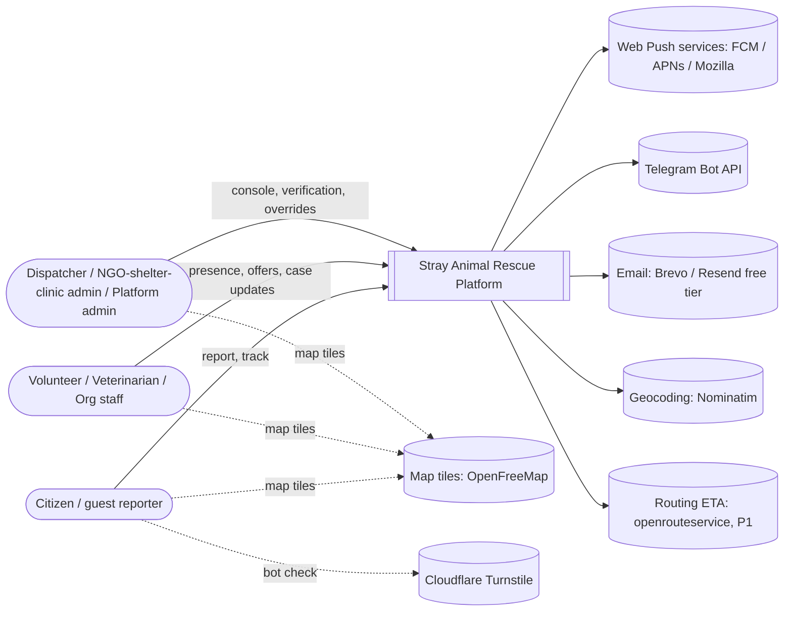
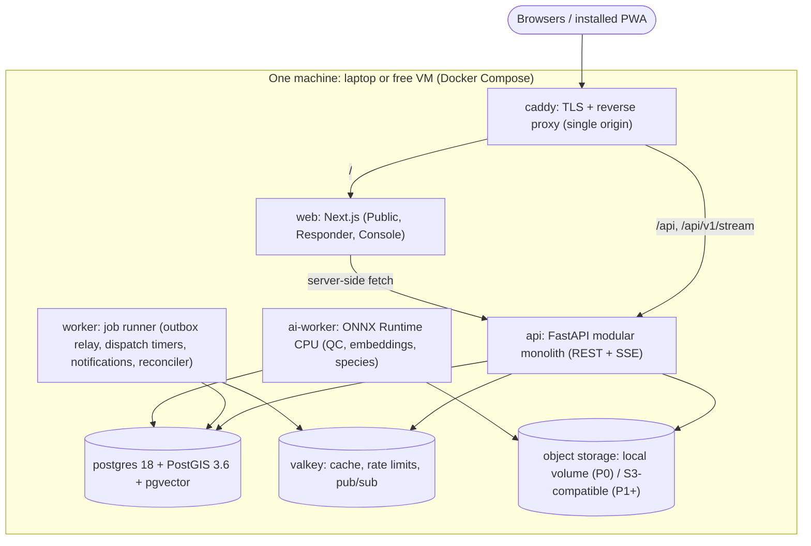
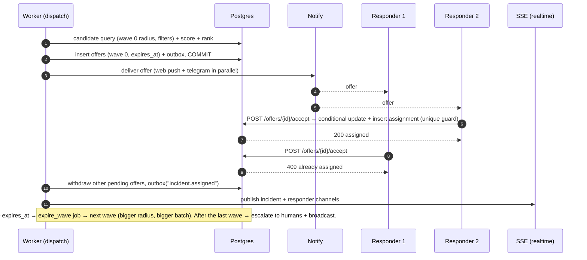
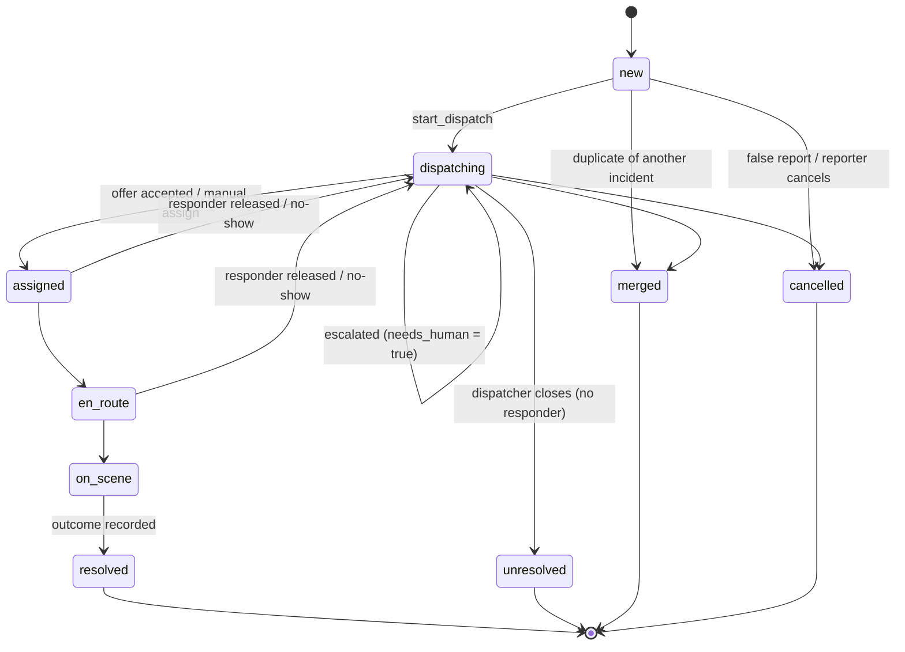
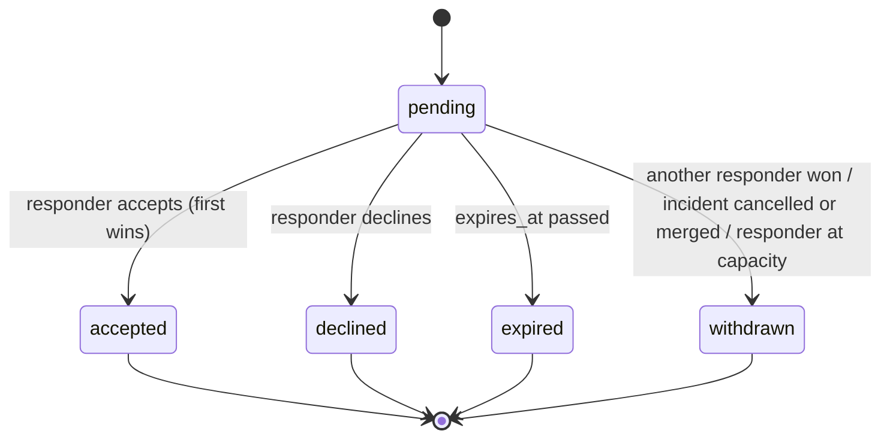
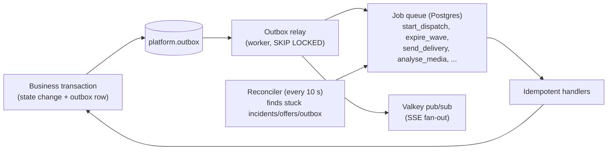
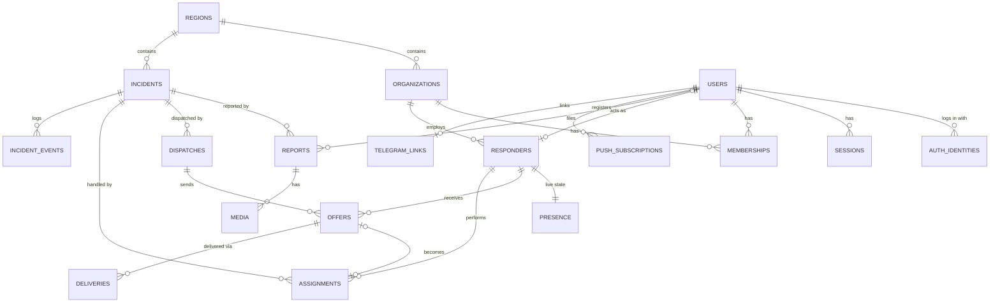
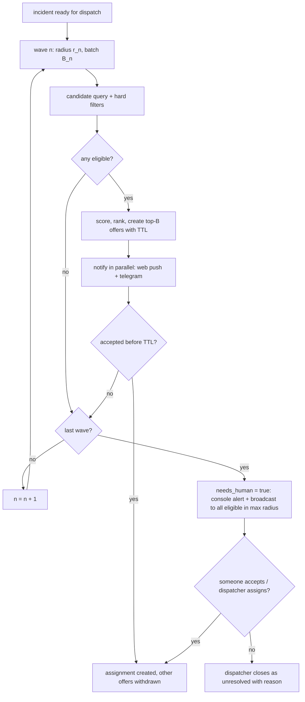
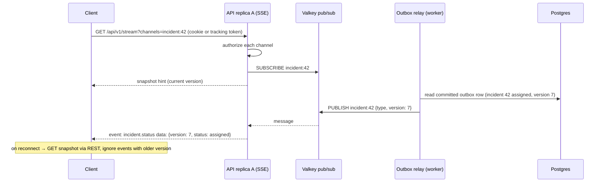

# AI-Powered Intelligent Geospatial Emergency Response System for Stray Animal Rescue
## Complete Research, Engineering & Publication Blueprint — v2 (production-grade, ₹0-first, scale-ready)

> **Document type:** Master blueprint (Final Year Project + Research Paper + Portfolio System + AI Engineering Learning Project)
> **Audience:** Solo student builder, viva panel, research co-authors, technical interviewers
> **How to use this document:** Read Part A and Part B once, top to bottom. Then use each section as a standalone reference during the matching week of the roadmap (Section 31). Research sections (1–9, 26–30) keep the teaching template (Concept → Why → Example → Math → Implementation → Production → Mistakes → Best practices → Research → Viva). Engineering sections (10–25) use a decision template: **Decision → Why → Design → Scale path → Mistakes to avoid → Viva questions**.

### Document control

| Item | Value |
|---|---|
| Version | **2.0** — 2026-11-21 (v1 = original blueprint, git commit `82a622b`) |
| Status | Draft for human review. Every architectural choice is a *proposed* decision until it is recorded as an ADR in the project's KYROS `DECISIONS.md` (list in Appendix B, Section 33). |
| Budget | **₹0** now: free, open-source, local, or free-tier only. Anything that costs money is marked **💰** with its cost and needs explicit approval before use. |
| Scale target | Architecture must grow from one city on one machine to multi-state/national scale **by configuration and module extraction, not by rewrite** (Section 25.4). |
| Freshness | Third-party limits (free tiers, licenses, laws) were checked on 2026-11-21 (Appendix C, Section 33). Free tiers change often: re-verify before relying on any number. |
| SQL check | Run on 2026-11-21 against `postgis/postgis:18-3.6`: Section 11.1 DDL (22 tables, every foreign key indexed), 15.3 candidate query, 16.4 accept transaction (a second live assignment is rejected by `assignments_one_live_per_incident`), 31.5 priority and reconciler queries, built-in `uuidv7()`, `ST_Covers` works on geography while `ST_Within` does not exist for it. Not yet run: the pgvector column (`vector(768)`), because the image with `postgresql-18-pgvector` was still downloading. |
| What changed vs v1 | 40+ defects fixed (full list with severity: Appendix A, Section 33). Biggest changes: CAD-style data model (incidents ≠ reports), wave-based dispatch with first-accept-wins offers, DB-enforced no-double-assignment, transactional outbox + durable timers + reconciler (real "no report lost" guarantee), AI moved off the critical path, guest reporting, server-side sessions, SSE instead of WebSockets, modular monolith with extraction path, honest ₹0 deployment profiles, DPDP-aware privacy. |

---

## Table of Contents

**Part A — Problem & research framing**
1. Executive Summary
2. Problem Statement
3. Existing Systems
4. Literature Survey Strategy
5. Research Gap Analysis
6. Core Research Contributions (Deep Dive on 10)
7. Objectives
8. Functional Requirements
9. Non-Functional Requirements & SLOs

**Part B — Engineering blueprint**
10. System Architecture (principles, C4 diagrams, modules, flows, state machines)
11. Data Model (PostgreSQL 18 + PostGIS + pgvector)
12. Backend Architecture (FastAPI modular monolith)
13. Frontend Architecture (Next.js: Public, Responder, Console surfaces)
14. Identity, Sessions & Authorization
15. Geospatial System
16. Dispatch Engine (matching, scoring, waves, offers)
17. AI Module
18. Notification Engine
19. Real-Time Updates (SSE + pub/sub)
20. Security & Privacy (OWASP, DPDP)
21. Performance & Capacity Planning
22. Testing Strategy
23. Observability
24. Containers, Environments & CI/CD
25. Deployment at ₹0 and the Scale Path

**Part C — Research execution**
26. Research Methodology
27. Research Paper Blueprint (IEEE Format)
28. Publication Strategy
29. Resume Section
30. Interview Preparation (80+ Q&A)

**Part D — Delivery**
31. Development Roadmap (16 Weeks)
31.5. Reference Code Implementations
32. Appendix: Glossary & References
33. Appendices A–E: v1 review findings · ADR list · ₹0 free-tier matrix (with sources) · KYROS capability shortlist · Migration plan for the existing scaffold

---

## 1. Executive Summary

**Concept.** This project is a geospatial emergency-dispatch platform — conceptually closer to how Uber matches drivers to riders, or how 911/112 dispatch centers route ambulances, than to a typical animal-welfare CRUD app. A citizen reports an injured or sick stray animal with a photo and GPS pin. The system must, within seconds, rank the best available responder (vet, NGO, shelter, or volunteer) from a pool that is constantly changing in location, workload, and reliability, and must keep escalating until someone actually shows up. The "product" looks simple (a report button and a map) but the **engineering core is a real-time, multi-constraint assignment problem under uncertainty** — which is exactly what makes it research-worthy rather than a portfolio toy.

**Why it is needed.** Three failure modes plague real-world stray rescue today: (1) reports go to a single static phone number or social media post and get lost, (2) the nearest responder on a map is not necessarily the *best* responder (they may be off-duty, overloaded, or historically unreliable), and (3) there is no learning loop — the same mistakes (wrong radius, wrong volunteer, slow escalation) repeat indefinitely. A system that closes this loop with data is both a humane-tech contribution and a transferable case study in spatio-temporal optimization, applicable to ambulance dispatch, disaster response, and food-rescue logistics.

**Real-world example.** Imagine Bengaluru: a citizen photographs a dog hit by a vehicle near Indiranagar at 11 PM. A static directory gives them three vet phone numbers, none of which pick up. Your system instead computes that the nearest on-duty volunteer is 2.1 km away but has handled 4 cases this week (high fatigue risk), while a vet clinic 3.4 km away has zero active cases and a 92% historical response rate at night — and offers the case to both at once (first to accept wins), widening the circle after 60 seconds if neither accepts and alerting a human dispatcher after the last wave.

**Mathematical intuition.** The core abstraction is a **time-varying weighted bipartite matching problem**: reports = one side of the bipartite graph, responders = the other side, edge weight = a composite rescue-suitability score (Section 16), and the system must solve a *new* instance of this matching problem on every incoming report without resolving the whole graph from scratch (an online matching variant, not classical batch matching; the batched alternative is evaluated as an extension in Section 16.8).

**Implementation strategy.** Build it in three deliberately staged layers so each is independently demoable and viva-defensible: (a) a correct geospatial CRUD + PostGIS nearest-neighbor MVP, (b) a multi-factor ranking engine replacing naive distance-only sorting, (c) AI-assisted severity scoring and duplicate detection layered on top. Each layer is a checkpoint — never block layer (a) waiting for layer (c) to be perfect.

**Production considerations.** Real GPS is noisy (urban canyon effect, indoor reports), responders go offline without notice, and report volume spikes regionally (monsoon season = more injured strays). Design for graceful degradation: severity starts from the citizen's triage answers (rules) and AI only refines it later, so an AI outage changes nothing on the rescue path; if nobody accepts, widen the wave and finally escalate to humans rather than fail silently.

**Common mistakes.** Students often (1) treat this as a maps-CRUD app and stop at "show pins on a map," missing the matching/ranking research contribution entirely; (2) hardcode a fixed search radius instead of an adaptive one; (3) skip the audit/timeline tables, making the system impossible to evaluate later; (4) over-invest in AI computer-vision polish before the core dispatch logic is even correct.

**Best practices.** Get the PostGIS nearest-neighbor query and the ranking formula right and *tested* before touching the frontend. Keep every AI model behind an interface (Section 17) so models can be swapped without touching dispatch (you already do this in your capstone with swappable LLM providers — apply the same pattern here). Providers are not equivalent, though: hosted APIs cost money or, on free tiers, may use citizens' photos for training, and Ultralytics YOLO is AGPL-3.0 — the default here is local, permissively licensed models at ₹0.

**Research opportunities.** The system itself is one research output; the *evaluation* of any one component (e.g., does adaptive radius expansion reduce time-to-acknowledgment versus fixed radius?) is a second, smaller, faster-to-publish research output. Plan for both.

**Viva questions.**
- *"Why is this not just a CRUD app with a map?"* — Because the core deliverable is a ranking/assignment algorithm under real-time, multi-factor, uncertain constraints, not a database of pins.
- *"What happens if your AI model is down?"* — Nothing on the rescue path: dispatch already started from rule-based triage of the citizen's answers; AI is an asynchronous enhancement layer, not a dependency (Section 10.0, P3).
- *"What's the single hardest engineering problem here?"* — Keeping the responder-availability state consistent and fresh enough that ranking decisions made on stale data don't waste critical minutes.

---

## 2. Problem Statement

**Concept.** Formally: *Given a real-time stream of animal-distress reports, each with a location, photo, and timestamp, and a dynamically changing pool of geographically distributed responders with heterogeneous capabilities, availability, and reliability, design a system that minimizes expected time-to-rescue while maximizing rescue success probability, under resource scarcity and incomplete information.*

**Why it is needed.** India alone has an estimated free-ranging dog population in the tens of millions, and most municipal/NGO rescue capacity is undocumented, unindexed, and unreachable through any unified channel. The *coordination* problem — not awareness — is the bottleneck: well-meaning volunteers exist, but discovery and trust-based prioritization between citizen and responder is missing.

**Real-world example.** A 2023-style scenario: a citizen WhatsApp-forwards a photo of an injured cow to five different NGO group chats simultaneously. All five think someone else is handling it. Nobody goes. This is a textbook **diffusion-of-responsibility coordination failure** — solvable by a single source-of-truth assignment system with explicit accept/decline state.

**Mathematical intuition.** Two competing objectives: minimize `E[T_rescue]` (expected time to first responder arrival) and maximize `P(success | severity, T_rescue, responder_capability)`. These are in tension — the fastest responder may not be the most capable one — so the system is fundamentally a **multi-objective optimization** problem, not single-objective shortest-path.

**Implementation strategy.** Frame every later design decision (ranking weights, radius expansion, escalation timers) as a lever on these two objectives, and make the trade-off explicit and configurable rather than hardcoded — this is what turns "I built an app" into "I built and *evaluated* a system."

**Production considerations.** Severity ground truth is rarely available in real time (you don't know if the rescue actually "succeeded" until hours later, if ever) — design the data model to capture *outcome feedback* (Section 11: offers, assignments with outcomes, incident events) from day one, or you will have no labels to evaluate against later.

**Common mistakes.** Writing the problem statement only in terms of features ("users can report, vets can respond") instead of in terms of the optimization objective. A panel will ask "what are you actually optimizing?" — have a precise answer.

**Best practices.** State the problem statement once, precisely, and refer back to it every time you justify a design decision in your viva or paper.

**Research opportunities.** The dual-objective framing (speed vs. success probability) is itself publishable as a framing contribution if no prior stray-rescue paper has formalized it this way (verify in Section 4).

**Viva questions.**
- *"What exactly are you optimizing, mathematically?"* — Weighted combination of expected time-to-rescue and rescue success probability, configurable via the ranking formula's weights.
- *"Why is this hard and not just nearest-neighbor search?"* — Nearest responder ≠ best responder; capability, workload, and reliability must factor in, and the optimal trade-off shifts with severity.

---

## 3. Existing Systems

**Concept.** Survey three categories: (1) generic stray-reporting apps (e.g., city-specific dog-bite/stray hotlines, NGO-built apps), (2) general emergency dispatch systems (911 CAD systems, ambulance dispatch software), (3) adjacent on-demand matching platforms (Uber/Ola driver matching, food-delivery rider assignment).

**Why it is needed.** A literature/market survey without naming what already exists makes your "research gap" claims unfalsifiable. You must show you looked.

**Real-world example.** Compare: a municipal stray-dog helpline (phone-only, no tracking, no ranking — pure manual triage) vs. Uber's driver-matching (sophisticated ranking, but optimizing for completely different objectives — ETA and revenue, not survival probability) vs. an NGO's static "list of vets by city" web page (zero dynamism, zero matching logic).

**Mathematical intuition.** None of the surveyed systems combine: (a) geospatial nearest-neighbor, (b) multi-factor responder ranking, (c) adaptive radius, and (d) animal-specific severity triage in one pipeline — that combination *is* your gap (formalize in Section 5).

**Implementation strategy.** Build a comparison table (you will render this in your paper's Related Work, Section 27) with columns: System | Real-time matching? | Multi-factor ranking? | Adaptive radius? | AI severity triage? | Open data/API? | Animal-specific?

**Production considerations.** Note honestly where existing systems are *better* than what you can build solo (e.g., real 911 CAD systems have decades of operational tuning) — a defensible research claim acknowledges scope, it doesn't claim to beat production emergency infrastructure.

**Common mistakes.** Claiming "no existing system does this" without evidence — always cite at least 3–5 concrete systems/papers you actually examined.

**Best practices.** Keep screenshots or citations of at least 3 real apps/papers in your appendix as evidence for the viva panel.

**Research opportunities.** The comparison table itself, expanded with citations, becomes Related Work (Section 27) almost verbatim.

**Viva questions.**
- *"Show me three systems you compared this against."* — Have named, specific answers ready, not generic categories.
- *"What does Uber's matching algorithm do better than yours, and why doesn't that matter here?"* — Uber optimizes ETA/revenue with thousands of available drivers; you optimize survival probability with a *scarce*, heterogeneous responder pool — different problem shape, not a worse solution.

---

## 4. Literature Survey Strategy

**Concept.** A literature survey is not "read 5 papers" — it's a systematic search-and-filter process you can defend procedurally.

**Why it is needed.** Reviewers and viva panels probe *how* you searched, not just what you found, because methodology rigor is itself evaluated.

**Real-world example.** A defensible survey trail: searched Google Scholar / IEEE Xplore / ACM DL with query strings like `("animal rescue" OR "stray animal") AND ("geospatial" OR "GIS") AND ("optimization" OR "matching")`, `"emergency dispatch" AND "nearest neighbor" AND "PostGIS"`, `"ambulance dispatch" AND "machine learning" AND "priority"`; filtered to 2018–2026; kept papers with ≥5 citations or from venues you can name; expanded via snowballing (citations of citations).

**Mathematical intuition.** N/A directly, but apply a simple inclusion funnel: papers found → title-relevant → abstract-relevant → full-read — and report the funnel numbers (e.g., "140 → 38 → 19 → 11") — this single sentence makes your methodology section credible.

**Implementation strategy.** Maintain a spreadsheet (or an Obsidian table, matching your existing PKM workflow) with columns: Citation | Venue | Year | Problem addressed | Method | Dataset | Limitation | Relevance to your gap. This becomes your Related Work draft directly.

**Production considerations.** Re-run the search 2–4 weeks before your paper submission deadline — new relevant papers appear continuously in active areas like LLM-assisted triage.

**Common mistakes.** Citing only blog posts and GitHub repos as "literature" — these support your *engineering* claims, not your *research* claims; you need peer-reviewed or at minimum arXiv-preprint sources for the latter.

**Best practices.** Aim for 15–25 sources for a final-year paper: a mix of (a) foundational GIS/optimization papers (can be older, established), (b) recent (2022+) ML/LLM-for-triage papers, (c) 2–3 emergency-dispatch-specific papers, (d) 2–3 animal-welfare-technology papers if they exist.

**Research opportunities.** If you find the animal-welfare-technology literature is thin (likely), that thinness *is* part of your research gap — explicitly say "the intersection of geospatial optimization and animal welfare is under-studied compared to human emergency dispatch."

**Viva questions.**
- *"How many papers did you read, and how did you choose them?"* — Have the funnel numbers and search strings memorized.
- *"What's the single most relevant prior paper, and what does your work add beyond it?"* — Always have one paper rehearsed as your "closest comparator," with a one-sentence delta.

---

## 5. Research Gap Analysis

**Concept.** Synthesize Sections 3–4 into 3–5 precise, falsifiable gap statements — not vague ("not much research exists") but specific ("no surveyed system combines adaptive-radius nearest-neighbor search with a learned, multi-factor responder ranking function evaluated against rescue-outcome ground truth").

**Why it is needed.** This section is what separates "I built a nice app" from "I made a research contribution" — it is the single most-scrutinized paragraph in your paper and your viva.

**Real-world example.** Gap statement template: *"While [System A] solves [sub-problem] and [Paper B] proposes [method] for [related domain], no work combines [your specific combination] and evaluates it against [your specific metric] in the [stray-animal-rescue] context."*

**Mathematical intuition.** Treat each gap as a missing edge in a 2D matrix of (Technique × Application Domain) — e.g., "multi-factor matching" exists for ride-hailing, "geospatial nearest-neighbor" exists for retail/logistics, but their *conjunction* applied to *welfare-emergency triage with outcome-based learning* is empty in your survey.

**Implementation strategy.** Write exactly 3–5 gaps, number them, and map each one to a specific contribution in Section 6 (1:1 or 1:many mapping) — reviewers love traceability.

**Production considerations.** Keep gap statements scoped to what you can actually evaluate with the data you can collect (don't claim a gap you have no way to test against).

**Common mistakes.** Conflating "this doesn't exist as a polished commercial product" (a market gap) with "this hasn't been studied" (a research gap) — you need the latter, evidenced by Section 4.

**Best practices.** Run each gap statement through the test: *"If I wrote one paragraph proving this gap is real, could I cite 2 papers as evidence?"* If not, narrow the claim.

**Research opportunities.** Each gap doubles as a "Future Work" seed for later sections (27) — gaps you choose not to fully solve now become your paper's Future Work paragraph.

**Viva questions.**
- *"State your research gap in one sentence."* — Rehearse this until it's automatic and precise.
- *"How is this different from a market gap?"* — A market gap is "no app does X"; a research gap is "no published method/evaluation addresses X," evidenced by your literature survey.


---

## 6. Core Research Contributions (Deep Dive on 10)

> Each contribution below follows: Existing limitations → Research gap → Proposed solution → Mathematical intuition → Evaluation methodology → Possible datasets. Pick **2–3 of these as your "primary" contributions** to implement and evaluate deeply (recommended: #1 Dynamic Rescue Priority Scoring, #3 Multi-factor Rescue Ranking, #4 Adaptive Search Radius). Treat the remaining 7 as "secondary contributions" you implement at a lighter rule-based level and discuss as future work — this is normal and expected for a solo final-year project; claiming all 10 at full research depth is not credible and a panel will catch it.

### 6.1 Dynamic Rescue Priority Scoring

- **Existing limitations:** Most reporting apps process reports FIFO (first-in-first-out) or purely by report timestamp, ignoring severity entirely.
- **Research gap:** No lightweight, explainable priority function exists for animal-distress triage analogous to medical triage scores (e.g., START triage) adapted for non-clinical, photo-and-text-only input.
- **Proposed solution:** A composite priority score `P = w1*severity + w2*urgency_decay + w3*animal_vulnerability + w4*location_risk`, whose time-independent part is stored at report time and whose urgency term is computed at read time (Section 31.5-A), so no row is rewritten on a schedule.
- **Mathematical intuition:** Model urgency decay as `urgency_decay(t) = 1 - e^(-λt)`, so priority *rises* the longer a report sits unassigned — an exponential growth toward 1, preventing reports from being silently starved. λ tunes how aggressively neglect is penalized; λ = −ln(0.15)/1800 ≈ 0.001054 s⁻¹ gives 85% urgency after 30 minutes.
- **Evaluation methodology:** Compare mean/median "time-to-acknowledgment" for high-vs-low scored reports; a working priority function should show high-priority reports acknowledged significantly faster (Mann–Whitney U test, since response-time distributions are typically right-skewed, not normal).
- **Possible datasets:** Self-generated synthetic report stream (Section 22, load testing) with injected severity labels; optionally scrape/clean public animal-welfare-NGO incident logs (anonymized) if accessible with permission.

### 6.2 AI Injury Severity Classification

- **Existing limitations:** Manual triage by whoever picks up the phone is inconsistent and untrained; existing CV severity work focuses on human medical imaging, not street-photo animal injuries (poor lighting, motion blur, partial occlusion).
- **Research gap:** No published lightweight severity classifier benchmarked specifically on citizen-submitted (non-clinical) animal injury photographs.
- **Proposed solution:** A 4-level ordinal severity (`minor / moderate / severe / critical`) plus a separate `needs_human` flag (a fifth "unclear" class would break ordinal metrics). P0 derives severity from the citizen's structured triage answers with transparent rules (Section 17.3); the AI candidate is a small open-weight vision-language model run locally and prompted with the rubric, used as a second opinion whose disagreement triggers human review. Citizen photos are not sent to free-tier hosted APIs (Section 17.0).
- **Mathematical intuition:** Treat this as ordinal classification, not plain multi-class — use a loss/metric that penalizes a "critical predicted as minor" error far more than "moderate predicted as severe" (e.g., quadratic-weighted Cohen's kappa rather than raw accuracy).
- **Evaluation methodology:** Confusion matrix + weighted kappa against a small hand-labeled validation set (label it yourself with a vet-published triage rubric, or get 1 veterinary student/professional to label a held-out set for inter-rater reliability — even 50–100 labeled images is publishable as a pilot study).
- **Possible datasets:** No public dataset of "stray animal injury severity" exists at scale (cite this absence as part of your gap); build a small self-collected set (consented photos, vet-labelled). Stanford Dogs and Oxford-IIIT Pet are dog/cat *breed* datasets (no cattle, monkeys or "no animal" class), so they do not fit species either — species is zero-shot with an image–text embedding model (Section 17.2).

### 6.3 Multi-factor Rescue Ranking Algorithm

- **Existing limitations:** Naive systems rank responders by distance alone (`ORDER BY ST_Distance(...)`), ignoring workload, reliability, and capability mismatch.
- **Research gap:** No openly documented ranking formula for *welfare-emergency* responder assignment that's been ablation-tested factor-by-factor (which factors actually matter?).
- **Proposed solution:** Required capabilities and availability are hard filters; the weighted score combines ETA (one proximity factor — distance and ETA together would double-count), Bayesian reliability, workload, preferred-capability fit, service-area fit and location freshness, with weights that depend on severity — detailed fully in Sections 16.1–16.2.
- **Mathematical intuition:** `Score = Σ wi·fi(normalized factor)`, each `fi` normalized to [0,1] via min-max or sigmoid squashing so no single raw-unit factor (e.g., kilometers vs. case count) dominates by scale alone.
- **Evaluation methodology:** **Ablation study** — remove one factor at a time, measure impact on a simulated outcome metric (e.g., "would the top-ranked responder have actually been available/successful in held-out historical data"); report which factors contribute most via a simple feature-importance-style sensitivity analysis.
- **Possible datasets:** Simulated responder-pool data (you control ground truth) for the ablation study; real anonymized volunteer/NGO activity logs if you can partner with one local NGO during the project (huge credibility boost if feasible, optional).

### 6.4 Adaptive Search Radius Expansion

- **Existing limitations:** Fixed-radius search (e.g., "always search 5 km") either misses responders in sparse rural areas or floods dense urban areas with irrelevant candidates.
- **Research gap:** No documented adaptive-radius policy specifically tuned for the responder-density variance seen in mixed urban/peri-urban Indian geography.
- **Proposed solution:** Wave-based dispatch (Section 16.3). Wave *n* offers the case to the top *B_n* ranked candidates inside radius `r_n = r_0 × g^n` for a severity-specific time-to-live; the first acceptance wins. If nobody accepts, the next wave widens the radius **and** the batch. After the last wave the case escalates to human dispatchers and is broadcast to everyone eligible. The adaptivity is over *time* (who is asked when): one KNN query already returns the nearest candidates, so re-querying with growing radii (v1's loop) adds nothing.
- **Mathematical intuition:** Expected candidates found scales roughly with area, i.e., `r²` (Poisson point process intuition: for responder density `ρ`, expected count ≈ `ρ·π·r²`) — so doubling the radius roughly quadruples expected candidate count, meaning radius growth should be *moderate* (e.g., 1.4–1.6×, not 2×) to avoid notifying far more people than needed in the next wave.
- **Evaluation methodology:** Compare time-to-acceptance, notifications sent per incident (responder fatigue) and assignment quality for three policies — sequential one-at-a-time, fixed-radius broadcast, and waves — across simulated density scenarios (dense urban vs. sparse rural), using the simulator that imports the production engine (Section 26).
- **Possible datasets:** Synthetic spatial point-process simulations (easy to generate with NumPy/Shapely) at varying densities; optionally real population-density GIS layers (publicly available government/OSM data) to make simulated responder density realistic.

### 6.5 Rescue Success Prediction

- **Existing limitations:** No system predicts *probability of successful rescue* before dispatch — decisions are reactive, not anticipatory.
- **Research gap:** Predictive modeling of outcome probability conditional on (severity, time-to-rescue, responder type) is unexplored in this domain.
- **Proposed solution:** A simple logistic-regression or gradient-boosted model trained on historical (severity, response_time, responder_type, outcome) tuples once enough data accumulates, used to *flag* low-probability cases for priority escalation rather than to gatekeep dispatch.
- **Mathematical intuition:** `P(success) = σ(β0 + β1·severity + β2·response_time + β3·responder_capability_match)` — logistic regression is the right starting baseline because it's interpretable (you can report odds ratios per factor in your paper, which reviewers value over an opaque black box for a first-pass model).
- **Evaluation methodology:** AUC-ROC and calibration curve (predicted probability vs. observed frequency) on a held-out split; report Brier score since calibration matters more than raw discrimination for a triage-support tool.
- **Possible datasets:** This contribution is **data-starved by nature** early on — be explicit in your paper that this module requires an operational period of data collection and present it as a "designed-for-future-evaluation" contribution with a synthetic-data proof-of-concept now.

### 6.6 Volunteer Reliability Scoring

- **Existing limitations:** No reputation/reliability mechanism exists in informal volunteer networks — the same unreliable volunteer keeps getting tagged in WhatsApp groups regardless of past no-shows.
- **Research gap:** Reliability-scoring literature exists for gig-economy platforms (driver ratings) but isn't adapted to low-frequency, high-stakes volunteer emergency response, where small sample sizes make naive average-rating approaches statistically unstable.
- **Proposed solution:** A **Bayesian-smoothed reliability score** (e.g., Beta-Binomial: `reliability = (successes + α) / (successes + failures + α + β)`) so a volunteer with 1 success out of 1 case isn't scored as a "perfect 100%," and a volunteer with 0 cases isn't scored as 0% — both regress toward a sensible prior.
- **Mathematical intuition:** The Beta-Binomial prior (`α`, `β`) encodes "what we assume about a brand-new volunteer before any evidence" — set α=β=2 (mildly optimistic, mean 50%) or calibrate from your simulated population's true average.
- **Evaluation methodology:** Compare Bayesian-smoothed scores vs. naive raw-average scores on simulated volunteers with small sample counts — show the Bayesian version is less volatile (lower variance) as new data points arrive, via a simple rolling-update simulation plot.
- **Possible datasets:** Fully synthetic — generate volunteers with a true latent reliability, simulate noisy outcome observations, and measure estimator convergence speed/stability.

### 6.7 Rescue Time Prediction

- **Existing limitations:** No travel-time estimate is animal-rescue-context-aware (a volunteer on a two-wheeler vs. an NGO van have very different real-world ETA profiles beyond generic Maps ETA).
- **Research gap:** Generic ETA APIs don't account for responder-type-specific speed/access patterns (e.g., a two-wheeler can navigate narrow lanes a van cannot).
- **Proposed solution:** Augment a base ETA (P0: distance × detour factor ÷ vehicle speed; P1: openrouteservice free matrix API for the top candidates — Section 15.6) with a responder-type correction factor learned from historical (predicted vs. actual arrival time) deltas.
- **Mathematical intuition:** `actual_ETA ≈ base_ETA × correction_factor(responder_type, time_of_day)` — a simple multiplicative bias-correction model, easy to fit via ordinary least squares on log-ETA once you have enough actual-arrival logs.
- **Evaluation methodology:** Mean Absolute Error (MAE) and Mean Absolute Percentage Error (MAPE) of corrected vs. uncorrected ETA against actual arrival timestamps (from your Rescue Timeline table).
- **Possible datasets:** Bootstrap with synthetic responder trip simulations early; transition to real Rescue Timeline data once the system is live for even a few weeks.

### 6.8 Route Optimization

- **Existing limitations:** Single-responder routing (point A to point B) is solved (Google/OSRM); *multi-stop* routing for a responder handling 2–3 simultaneous nearby cases is not optimized by default.
- **Research gap:** Apply classic vehicle-routing-problem (VRP) intuition at *micro-scale* (2–4 stops) to volunteer/NGO multi-case handling, which is rarely discussed at this small scale in VRP literature (most VRP work targets large fleets).
- **Proposed solution:** For a responder with multiple active assignments, solve a small Traveling-Salesman-style ordering (brute-force is fine for ≤5 stops: 4! = 24 permutations) to minimize total travel time, rather than visiting in arbitrary/FIFO order.
- **Mathematical intuition:** For `n` stops, optimal ordering search space is `(n-1)!` (fixing start point) — trivially small for n≤6, so exact brute-force beats any heuristic at this scale; this is a great "know when NOT to over-engineer" viva talking point.
- **Evaluation methodology:** Compare total route distance/time for FIFO ordering vs. brute-force-optimal ordering across simulated multi-stop scenarios — report % time saved.
- **Possible datasets:** Synthetic multi-stop scenarios using openrouteservice free matrix responses (500 requests/day) or heuristic distance matrices between randomly sampled real city coordinates.

### 6.9 Geospatial Matching Algorithm

- **Existing limitations:** Naive `WHERE distance < radius` filters scan-and-filter inefficiently at scale without spatial indexing.
- **Research gap:** None in the strict sense — GiST indexing and KNN operators are established practice. Present this as **engineering validation** (a rigorous, reproducible benchmark of the chosen design), not as a research contribution; over-claiming it is an easy target for reviewers.
- **Proposed solution:** Use PostGIS's `<->` KNN operator with `ST_DWithin` on a **partial** GiST index over available responders only (Section 15.3), benchmarked against naive haversine in application code and an unindexed `ST_Distance` filter.
- **Mathematical intuition:** GiST spatial indexes use bounding-box hierarchies (R-tree family) so a KNN query is `O(log n)` average case vs. `O(n)` for scanning every row and computing distance in application code.
- **Evaluation methodology:** Benchmark query latency (p50/p95/p99) at increasing table sizes (1K / 100K / 1M synthetic rows) with vs. without spatial index — this single benchmark chart is one of the strongest "production engineering" artifacts in your whole report.
- **Possible datasets:** Synthetic — generate N random lat/lng points within a real city's bounding box using `Faker`/NumPy.

### 6.10 Predictive Rescue Hotspot Detection

- **Existing limitations:** No system identifies *where* future reports are likely to cluster (e.g., near certain markets, highways, construction zones) to enable proactive volunteer pre-positioning.
- **Research gap:** Spatio-temporal hotspot detection (well studied in crime analytics, e.g., Kernel Density Estimation, DBSCAN clustering) is unapplied to stray-animal-distress report data.
- **Proposed solution:** Apply DBSCAN (density-based clustering, robust to irregular cluster shapes and noise) on historical incident locations + timestamps — in-database with PostGIS `ST_ClusterDBSCAN` — to surface recurring hotspots on a rolling window (e.g., last 90 days); render heatmaps from H3-cell aggregates (Section 15.4) on the Console analytics page.
- **Mathematical intuition:** DBSCAN groups points where at least `minPts` neighbors exist within radius `ε` — unlike k-means, it doesn't require pre-specifying the number of clusters and naturally labels sparse/isolated reports as noise rather than forcing them into a cluster.
- **Evaluation methodology:** Qualitative validation (do detected hotspots match intuitively known problem areas?) plus quantitative silhouette score for cluster cohesion, and a simple temporal hold-out test (do hotspots detected on first 60 days predict report locations in the next 30 days better than uniform-random?).
- **Possible datasets:** Your own accumulating report table once live; bootstrap initially with synthetic spatially-clustered point generation (Gaussian mixture around 4–6 seeded "true" hotspots plus uniform noise).

---


## 7. Objectives

1. Design and implement a real-time geospatial intake pipeline for stray-animal distress cases: photo, location (GPS → EXIF → manual pin), and a 3-tap structured triage, usable **without creating an account** and tolerant of flaky mobile networks.
2. Build a severity-aware, multi-factor responder ranking engine (Section 16) that outperforms naive nearest-distance assignment on simulated outcome metrics.
3. Implement **wave-based adaptive dispatch** (radius and offer batch grow over time, Section 6.4 / 16.3) and compare it against fixed-radius and one-at-a-time sequential baselines.
4. Integrate AI-assisted triage (image quality, species, duplicate detection, optional severity second opinion) **off the critical path**, with rule-based defaults and human review for low confidence (Section 17).
5. Serve six user roles through **three role-aware surfaces** in one Next.js app: Public (citizen), Responder (volunteer/vet), Console (NGO/shelter/clinic staff, dispatchers, platform admin) (Section 13).
6. Guarantee that no report is silently dropped: transactional outbox, durable timers, a reconciler loop, and escalation to humans (Sections 12.5, 16, 18).
7. Containerize the full stack so `docker compose up` gives the same system on a laptop and on a server, at ₹0 (Sections 24–25).
8. Produce a publishable evaluation of at least two research contributions using a discrete-event **simulator that imports the production dispatch engine** (Sections 22, 26).
9. Document the system for zero-assumption setup (README, `.env.example`, ADRs).
10. Prepare an IEEE-format paper draft and a portfolio-ready public repository with reproducible benchmarks.
11. Keep the architecture **scale-ready**: every scaling step in Section 25.4 is a configuration change or a module extraction, never a data-model rewrite.

**Viva questions.**
- *"Which objective do you consider most at-risk, and why?"* — Objective 8 (publishable evaluation): it needs simulation rigor. Mitigation: the simulator is built in Week 6 and reuses the real engine, so every engine improvement is immediately measurable.
- *"Why is Objective 11 an objective and not a nice-to-have?"* — Because the cheapest time to make a system shardable is before it has data: region keys, UUIDv7 ids, partitioned event tables and module boundaries cost almost nothing on day 1 and are very expensive to retrofit.

---

## 8. Functional Requirements

| ID | Requirement | Actor | Priority | Phase |
|----|---|---|---|---|
| FR-01 | Submit a report with photo(s), location, species, short triage (bleeding? can walk? conscious? trapped/on road?) and optional note — **no login required** | Citizen (guest or signed-in) | Must | P0 |
| FR-02 | Location fallback chain: device GPS (with accuracy) → photo EXIF GPS (read on device before compression) → manual map pin; GPS worse than 50 m asks for pin confirmation | Citizen | Must | P0 |
| FR-03 | Report gets a private **tracking link** (capability URL) showing live status; optional phone/email for call-backs | Citizen | Must | P0 |
| FR-04 | Offline-tolerant submit: report is queued on the device and retried with the same client-generated id (idempotent) | Citizen | Should | P0 |
| FR-05 | System creates or merges into an **incident** (one real-world event, many reports) and computes base priority from triage (Section 6.1) | System | Must | P0 |
| FR-06 | Responder can go on/off duty; while on duty the app shares location at a throttled rate | Volunteer, Vet, Org staff | Must | P0 |
| FR-07 | System finds eligible responders (verified, available, capable, under capacity, inside wave radius) and ranks them (Section 16) | System | Must | P0 |
| FR-08 | System sends **offers** in waves with a severity-based time-to-live; first acceptance wins; later accepts get a clear "already taken" | System, Responder | Must | P0 |
| FR-09 | Responder can accept, decline (with optional reason), release, and update status: en route → on scene → completed (with outcome) | Responder | Must | P0 |
| FR-10 | If all waves expire, the incident escalates to the region's dispatchers/org admins and is broadcast to all eligible responders in max radius | System | Must | P0 |
| FR-11 | Live updates (status, offers, console feed) without page refresh, with resync after reconnect | All | Must | P0 |
| FR-12 | Notifications on at least one fast channel per responder: Web Push and/or Telegram; email for non-urgent messages | System | Must | P0 |
| FR-13 | Console: priority-ordered incident queue per region, map view, manual assign/override, merge/split duplicates | Dispatcher, Org admin | Must | P0 |
| FR-14 | Duplicate detection (space + time + image similarity) suggests or performs merges (Section 17.4) | System | Should | P0 |
| FR-15 | Append-only incident timeline: every state change with time and actor (user/system/AI) | System | Must | P0 |
| FR-16 | Responder verification workflow (identity, vet license) before any offer is sent | Org admin, Platform admin | Must | P0 |
| FR-17 | Organizations manage roster (memberships, roles), service area, shelter capacity and accepted species | Org admin | Should | P0 |
| FR-18 | Role- and relationship-based access control across all six roles (Section 14) | All | Must | P0 |
| FR-19 | Outcome capture by the assigned responder; optional citizen confirmation; feeds reliability (Section 6.6) | Responder, Citizen | Must | P0 |
| FR-20 | Upload validation: type sniffing, size cap, re-encode, EXIF strip after GPS extraction | System | Must | P0 |
| FR-21 | Analytics: H3 hotspot heatmap, response-time trends, wave/acceptance stats, responder leaderboard (opt-in) | Org admin, Platform admin | Should | P1 |
| FR-22 | Audit log of every privileged action (overrides, verification, data export/delete) | Platform admin | Must | P0 |
| FR-23 | Data-principal requests: export or delete own data; reporter contact auto-purged by retention policy | Citizen, Platform admin | Should | P1 |
| FR-24 | Hindi + English UI at launch; more Indian languages by adding message files | All | Should | P0 |
| FR-25 | Telegram bot: link account, receive offers with Accept/Decline buttons, receive status updates | Responder | Should | P0 |
| FR-26 | Multi-responder incidents (e.g., transport + vet) with assignment roles | Dispatcher | Could | P2 |

**What changed from v1 and why.** v1 required an account to report (kills the "≤ 3 steps" goal in an emergency), had no tracking link, no offline handling, no responder verification, no escalation to humans, conflated "report" and "incident" (so duplicates could trigger competing dispatches), and treated email as an emergency channel. These are fixed above.

---

## 9. Non-Functional Requirements & SLOs

Targets are given per phase. **P0** = ₹0 single-machine deployment (FYP/demo). **P1** = small paid pilot with an NGO (needs budget approval, Section 25).

| Category | Requirement | P0 target (₹0) | P1 target (pilot) |
|---|---|---|---|
| Latency | Report accepted (HTTP 201, excluding photo upload) | p95 < 800 ms | p95 < 500 ms |
| Latency | Report accepted → first offer **sent** | p95 < 10 s | p95 < 5 s |
| Latency | Candidate query (Section 15.3) | p95 < 50 ms at 100k presence rows | same |
| Latency | Live status update reaches tracking page | p95 < 2 s | p95 < 1 s |
| Reliability | **No-loss invariant**: every incident reaches `assigned` or `escalated-to-human` within T_max (critical 5 min, severe 8 min, moderate 15 min, minor 35 min) | 100%, measured by `incidents_unattended` = 0 | same |
| Reliability | Durable state before announcement | All events via transactional outbox | same |
| Availability | Monthly availability of report intake | Best effort (single machine; stated openly) | 99.5% |
| Data safety | Backups | Nightly encrypted logical dump, off-box; monthly restore drill; RPO 24 h, RTO 4 h | PITR, RPO ≤ 5 min, RTO 1 h |
| Scalability | Concurrent live connections (SSE) | ≥ 1,000 in load test | ≥ 10,000 |
| Scalability | Presence updates | ≥ 50 writes/s sustained | ≥ 2,000/s (Valkey GEO, Section 25.4) |
| Security | Verification standard | OWASP ASVS (v5) Level 2 checklist, self-audited | external review |
| Security | Authorization | Every object access checked server-side (no IDOR); 0 unauthenticated PII endpoints | same |
| Privacy | Location precision | Exact incident location only to assigned responder and staff; offers show ~0.5 km-snapped location | same |
| Privacy | Retention | Reporter contact purged 90 days after closure; raw photos downscaled after 180 days | per DPDP Rules timeline (Section 20.5) |
| Maintainability | Test coverage | ≥ 80% on `dispatch/engine`, ≥ 70% backend overall | same |
| Maintainability | Module boundaries | Enforced in CI (import-linter) | same |
| Usability | Citizen report | ≤ 3 screens, usable one-handed, works on a ₹8–10k Android phone on 3G | same |
| Usability | Accessibility | WCAG 2.2 AA on Public surface | all surfaces |
| Usability | Languages | English + Hindi | + 2 regional |
| Performance | Public surface JS | < 200 KB gzipped initial; Lighthouse mobile ≥ 90 | same |
| Portability | Bring-up | `docker compose up` + `make seed` | same images, prod overrides |
| Observability | Telemetry | Traces, metrics, logs via OpenTelemetry; `/health/live` + `/health/ready` | + alerting on SLO burn |
| Cost | Monthly spend | **₹0** | approved budget only |

**Viva questions.**
- *"Why is availability 'best effort' in P0? Isn't that weak?"* — It is honest. A single free machine cannot promise 99.5%. The design (stateless app containers, Postgres as the only source of truth, same images everywhere) means reaching 99.5% in P1 is an infrastructure upgrade, not a redesign.
- *"How do you measure the no-loss invariant?"* — A reconciler job counts incidents older than T_max that are neither assigned nor escalated; the metric must be 0 and alerts if not (Section 23).

---

## 10. System Architecture

### 10.0 Architecture principles (the rules every later section follows)

| # | Principle | Why it matters for this system |
|---|---|---|
| P1 | **Modular monolith first.** One deployable backend, split into modules with enforced boundaries. Module boundary = future service boundary. | A solo builder cannot operate 8 microservices; a big ball of mud cannot scale either. Modules give both. |
| P2 | **PostgreSQL is the only source of truth.** Valkey (Redis-compatible) holds only state that can be rebuilt (cache, rate-limit counters, pub/sub fan-out, later live GEO). | `FLUSHALL` on Valkey must never lose a report. |
| P3 | **AI is never on the critical path.** Dispatch starts from citizen triage + rules; AI enriches later. | VLM/vision latency and outages must not delay a rescue (v1 put AI before matching). |
| P4 | **Durable before announced.** Every state change and the event describing it commit in one DB transaction (transactional outbox); jobs and notifications are driven from the outbox. | Makes "no report lost" provable instead of hoped-for. |
| P5 | **Every external provider sits behind a port (interface) with adapters**: maps tiles, routing, geocoding, storage, notifications, AI, identity. | Free providers today, paid or self-hosted tomorrow, with one adapter change. |
| P6 | **Region is a first-class key.** Every operational row carries `region_id` (city/district). | Dispatch is local by nature; region is the natural partition and shard key later. |
| P7 | **Same images everywhere** (laptop, free VM, cloud). Config only through environment (12-factor). | No "works on my machine"; scaling is a deployment change. |
| P8 | **Vendor-neutral telemetry** (OpenTelemetry). | Swap Grafana Cloud free tier for self-hosted or paid without code changes. |
| P9 | **₹0 by default**; paid items flagged 💰 and approved by the human. | Project budget rule. |
| P10 | **Humans can always override; the system escalates to humans rather than failing silently.** | Safety-critical domain. |

### 10.1 Context diagram (C4 level 1)



### 10.2 Container diagram (C4 level 2) — Phase 0 (₹0, one machine)



**Why one origin (Caddy routes `/` to Next.js and `/api` to FastAPI):** session cookies stay first-party (no third-party-cookie breakage), no CORS configuration, SSE works through one proxy, and TLS is automatic. v1 put the frontend and API on different hosts and stored JWTs in cookies — browsers increasingly block such cross-site cookies.

### 10.3 Module map (modular monolith)

| Module | Owns (DB schema) | Exposes to other modules | Depends on | First to extract at scale? |
|---|---|---|---|---|
| `identity` | users, auth identities, sessions | `current_actor()`, user lookup | — | Phase 3 → OIDC provider (Keycloak/Zitadel) |
| `orgs` | regions, organizations, memberships | org/region lookup, membership checks | identity | no |
| `responders` | responder profiles, presence, reliability | `eligible_candidates()`, `reserve_capacity()` | orgs, geo | Phase 2: presence → Valkey GEO |
| `intake` | incidents, reports, media | `create_report()`, `merge()` , incident read model | geo, ai (async), dispatch (events) | no |
| `dispatch` | dispatches, offers, assignments | `start()`, `accept()`, `decline()`, `release()` | responders, intake, notify (events) | **Phase 2–3: dispatch service per region cell** |
| `notify` | push subscriptions, telegram links, deliveries | `send(template, recipient, …)` | identity | Phase 2 |
| `geo` | — (pure + adapters) | H3, ETA, geocode, region lookup | — | Phase 2 (routing service) |
| `ai` | — (writes into intake.media via intake API) | `analyse_media()` | — | Phase 2 (GPU/inference service) |
| `realtime` | — | `publish(channel, event)` | — | **Phase 2 → Centrifugo** |
| `analytics` | read models / materialized views | dashboards | read-only views of others | Phase 3 (warehouse) |
| `platform` | outbox, audit log, incident events | db, jobs, storage, cache, authz, errors, telemetry | — | — |

Rules: a module may call another module only through that module's `service.py` facade; it may never query another module's tables directly (analytics reads published views only). CI enforces this with `import-linter` contracts (P0, free).

### 10.4 Citizen report flow (critical path vs async)

```mermaid
sequenceDiagram
    autonumber
    participant C as Citizen PWA
    participant A as API (intake)
    participant DB as Postgres
    participant W as Worker
    participant AI as AI worker
    C->>A: POST /api/v1/reports {client_id, location, triage, species, media ids}
    A->>A: validate, Turnstile, rate limit
    A->>DB: BEGIN: find-or-create incident, insert report, outbox("report.created"), COMMIT
    A-->>C: 201 {incident public_ref, tracking_url}
    Note over C,A: Critical path ends here (target p95 < 800 ms)
    W->>DB: outbox relay picks event (SKIP LOCKED)
    W->>W: job start_dispatch(incident) using rule-based severity
    W->>AI: job analyse_media (separate queue)
    AI->>DB: quality, species, embedding → maybe dedupe suggestion / severity hint
    Note over W,AI: AI can raise priority or flag review; it never blocks dispatch
```

Photo upload happens **before** the report POST: the app asks `POST /api/v1/uploads` for an upload target, uploads the compressed image, then sends the report with media ids. A report without photos is accepted (photo is strongly encouraged, not required).

### 10.5 Dispatch flow (waves, first accept wins)



### 10.6 Incident state machine



Transitions are implemented in one place (`intake/service.py` + `dispatch/service.py`) as a table of allowed `(from, to, actor)` triples; anything else raises a 409. Each transition writes an `incident_events` row and an outbox event in the same transaction.

### 10.7 Offer state machine



### 10.8 Events, jobs and the reconciler



- **At-least-once** everywhere; handlers are idempotent (they re-check state with conditional updates).
- **Reconciler** is the safety net for every timer: it scans indexed columns (`offers.expires_at`, open incidents older than their stage SLA, unpublished outbox rows) and re-enqueues work. If the worker crashed mid-wave, the reconciler finishes it.
- **Scale path:** the relay's target changes from the Postgres job queue to Redis Streams / NATS JetStream / Kafka (Phase 2–3). The outbox `key` (incident id) becomes the partition key. Business code does not change.

**Common mistakes (fixed from v1).** Two contradictory radius-expansion designs (synchronous loop in 16.1 vs timer job in 15); notifications enqueued to Redis after the DB commit (crash between the two loses the job); `asyncio.sleep()`-based retries inside a worker (lost on restart); WebSocket state in process memory.

**Viva questions.**
- *"Why not microservices from day one?"* — Operational cost (deploys, networking, distributed transactions) with no benefit at one-city scale. Module boundaries enforced in CI give the same separation; extraction order is planned (10.3).
- *"Prove that a report cannot be lost between the DB and the queue."* — There is no "between": the outbox row commits with the report. If the relay or worker dies, the row stays unpublished and the reconciler re-drives it.

---

## 11. Data Model

### 11.0 Conventions

- **PostgreSQL 18 + PostGIS 3.6 + pgvector** (custom image, Section 24.1). PostgreSQL 18 has a built-in `uuidv7()`; no `uuid-ossp` extension needed.
- **Primary keys:** UUIDv7 (time-ordered → good B-tree locality, safe to expose, can be generated by clients and other services). v1 used random UUIDv4 (`uuid_generate_v4()`), which scatters inserts across the index.
- **Enums:** `text` + `CHECK` (adding a value is a simple migration; Postgres `ENUM` types are harder to change).
- **Time:** `timestamptz` everywhere; `updated_at` maintained by a trigger (v1 had `DEFAULT now()` only, so `updated_at` never changed).
- **Geo:** `geography(Point, 4326)` for real-world positions (meters, spheroid), `geography(MultiPolygon, 4326)` for areas. GiST index on every spatial column that is filtered or ordered by distance.
- **Every foreign key is indexed** (Postgres does not do it automatically). No duplicate indexes (v1 indexed `users.email` twice: `UNIQUE` already creates an index).
- **One schema per module** (`identity`, `org`, `responder`, `intake`, `dispatch`, `notify`, `platform`, `core`). Cross-schema foreign keys are kept for integrity while it is one database; they are the only thing that changes when a module gets its own database (planned in Section 25.4).
- **`region_id` on every operational table.** Today it filters queries; tomorrow it is the partition/shard key.

### 11.1 DDL (core tables)

```sql
create extension if not exists postgis;
create extension if not exists vector;          -- pgvector (image embeddings)
create extension if not exists citext;          -- case-insensitive email
create extension if not exists pg_stat_statements;  -- needs shared_preload_libraries (Section 24)

create schema if not exists core;
create schema if not exists identity;
create schema if not exists org;
create schema if not exists responder;
create schema if not exists intake;
create schema if not exists dispatch;
create schema if not exists notify;
create schema if not exists platform;

create function core.touch_updated_at() returns trigger language plpgsql as $$
begin new.updated_at := now(); return new; end $$;

-- ===================== core =====================
create table core.regions (
  id               text primary key,                    -- stable shard key, e.g. 'in-ka-bengaluru'
  name             text not null,
  timezone         text not null default 'Asia/Kolkata',
  boundary         geography(MultiPolygon, 4326) not null,
  is_active        boolean not null default true,
  dispatch_config  jsonb not null default '{}'::jsonb,  -- overrides of code defaults (radii, TTLs, weights)
  created_at       timestamptz not null default now()
);
create index regions_boundary_gist on core.regions using gist (boundary);

-- ===================== identity =====================
create table identity.users (
  id                 uuid primary key default uuidv7(),
  display_name       text not null,
  email              citext unique,
  phone_e164         text unique check (phone_e164 ~ '^\+[1-9][0-9]{7,14}$'),
  platform_role      text not null default 'member' check (platform_role in ('member','platform_admin')),
  status             text not null default 'active' check (status in ('active','suspended','deleted')),
  locale             text not null default 'en',
  email_verified_at  timestamptz,
  phone_verified_at  timestamptz,
  totp_secret_enc    bytea,                              -- required for platform_admin (Section 14)
  created_at         timestamptz not null default now(),
  updated_at         timestamptz not null default now(),
  check (email is not null or phone_e164 is not null)
);

create table identity.auth_identities (               -- many login methods per user (password, Google, email OTP)
  id                uuid primary key default uuidv7(),
  user_id           uuid not null references identity.users(id) on delete cascade,
  provider          text not null check (provider in ('password','google','email_otp')),
  provider_subject  text not null,                       -- email, or Google 'sub' claim
  password_hash     text,                                -- argon2id, only for provider = 'password'
  created_at        timestamptz not null default now(),
  last_used_at      timestamptz,
  unique (provider, provider_subject),
  check ((provider = 'password') = (password_hash is not null))
);
create index auth_identities_user_idx on identity.auth_identities (user_id);

create table identity.sessions (                       -- opaque server-side sessions (Section 14)
  id            uuid primary key default uuidv7(),
  user_id       uuid not null references identity.users(id) on delete cascade,
  token_hash    bytea not null unique,                   -- sha256 of the cookie token; raw token never stored
  created_at    timestamptz not null default now(),
  last_seen_at  timestamptz not null default now(),
  expires_at    timestamptz not null,
  revoked_at    timestamptz,
  ip            inet,
  user_agent    text
);
create index sessions_user_live_idx on identity.sessions (user_id) where revoked_at is null;

-- ===================== org =====================
create table org.organizations (
  id                uuid primary key default uuidv7(),
  region_id         text not null references core.regions(id),
  name              text not null,
  org_type          text not null check (org_type in ('ngo','shelter','clinic','municipal')),
  registration_no   text,
  base_location     geography(Point, 4326) not null,
  service_area      geography(MultiPolygon, 4326),       -- null → radius around base (region config)
  shelter_capacity  integer check (shelter_capacity >= 0),
  accepts_species   text[] not null default '{}',
  verified_at       timestamptz,
  verified_by       uuid references identity.users(id),
  created_at        timestamptz not null default now(),
  updated_at        timestamptz not null default now()
);
create index organizations_region_idx   on org.organizations (region_id);
create index organizations_base_gist    on org.organizations using gist (base_location);
create index organizations_area_gist    on org.organizations using gist (service_area);
create index organizations_verifier_idx on org.organizations (verified_by);

create table org.memberships (                         -- links NGO/shelter/clinic staff to their org (missing in v1)
  organization_id  uuid not null references org.organizations(id) on delete cascade,
  user_id          uuid not null references identity.users(id) on delete cascade,
  role             text not null check (role in ('org_admin','dispatcher','member')),
  status           text not null default 'active' check (status in ('invited','active','removed')),
  created_at       timestamptz not null default now(),
  primary key (organization_id, user_id)
);
create index memberships_user_idx on org.memberships (user_id);

-- ===================== responder =====================
create table responder.responders (                    -- ONE table for volunteers, vets, org staff (v1 had two)
  id                    uuid primary key default uuidv7(),
  user_id               uuid not null unique references identity.users(id) on delete cascade,
  organization_id       uuid references org.organizations(id) on delete set null,
  home_region_id        text not null references core.regions(id),
  responder_type        text not null check (responder_type in ('volunteer','veterinarian','org_staff')),
  vehicle_type          text not null default 'none'
                          check (vehicle_type in ('none','two_wheeler','car','van','ambulance')),
  capabilities          text[] not null default '{}',    -- controlled vocabulary in code (Section 16.1)
  max_concurrent_cases  smallint not null default 1 check (max_concurrent_cases between 1 and 10),
  verification_status   text not null default 'pending'
                          check (verification_status in ('pending','verified','rejected','suspended')),
  verified_by           uuid references identity.users(id),
  verified_at           timestamptz,
  license_no            text,
  rel_alpha             double precision not null default 2.0,   -- Beta posterior (Section 6.6), not a bare score
  rel_beta              double precision not null default 2.0,
  created_at            timestamptz not null default now(),
  updated_at            timestamptz not null default now(),
  check (responder_type <> 'veterinarian' or license_no is not null)
);
create index responders_org_idx          on responder.responders (organization_id);
create index responders_region_idx       on responder.responders (home_region_id);
create index responders_verifier_idx     on responder.responders (verified_by);
create index responders_capabilities_gin on responder.responders using gin (capabilities);

create table responder.presence (                      -- hot, narrow, frequently updated; separate from the profile
  responder_id   uuid primary key references responder.responders(id) on delete cascade,
  region_id      text not null references core.regions(id),
  status         text not null default 'offline' check (status in ('offline','available','busy','paused')),
  location       geography(Point, 4326),
  accuracy_m     real,
  location_at    timestamptz,
  active_cases   smallint not null default 0 check (active_cases >= 0),
  updated_at     timestamptz not null default now()
);
-- Partial GiST: only rows that can actually be matched are indexed (v1's partial index forgot USING GIST).
create index presence_available_gist   on responder.presence using gist (location) where status = 'available';
create index presence_region_status_idx on responder.presence (region_id, status);
alter table responder.presence set (autovacuum_vacuum_scale_factor = 0.02, autovacuum_analyze_scale_factor = 0.02);

-- ===================== intake =====================
create table intake.incidents (                        -- one real-world event; many reports can point to it
  id                     uuid primary key default uuidv7(),
  region_id              text not null references core.regions(id),
  public_ref             text not null unique,          -- human code, e.g. BLR-7K3Q
  status                 text not null default 'new' check (status in
                           ('new','dispatching','assigned','en_route','on_scene',
                            'resolved','unresolved','cancelled','merged')),
  needs_human            boolean not null default false, -- escalated after last wave, or low-confidence triage
  merged_into_id         uuid references intake.incidents(id),
  species                text not null default 'unknown',
  severity               text check (severity in ('minor','moderate','severe','critical')),
  severity_source        text check (severity_source in ('citizen_triage','rules','ai','human')),
  severity_confidence    real check (severity_confidence between 0 and 1),
  base_priority          real not null default 0,       -- time-independent part; urgency added at read time (6.1)
  required_capabilities  text[] not null default '{}',
  location               geography(Point, 4326) not null,
  location_accuracy_m    real,
  h3_r9                  bigint not null,               -- H3 cell (~0.1 km²): aggregation, privacy, sharding
  address_text           text,
  created_at             timestamptz not null default now(),
  updated_at             timestamptz not null default now(),
  closed_at              timestamptz,
  version                integer not null default 1     -- optimistic concurrency (ETag / If-Match) for console edits
);
create index incidents_open_idx on intake.incidents (region_id, status, created_at)
  where status in ('new','dispatching','assigned','en_route','on_scene');
create index incidents_location_gist on intake.incidents using gist (location);
create index incidents_created_brin  on intake.incidents using brin (created_at);
create index incidents_merged_idx    on intake.incidents (merged_into_id) where merged_into_id is not null;

create table intake.reports (
  id                    uuid primary key,               -- generated by the client = idempotency key for retries
  incident_id           uuid not null references intake.incidents(id),
  region_id             text not null references core.regions(id),
  reporter_user_id      uuid references identity.users(id),   -- null for guest reports
  tracking_token_hash   bytea not null unique,         -- capability URL for guests (Section 14.1)
  reporter_contact      text,                           -- optional; purged by retention job (Section 20.5)
  channel               text not null default 'web' check (channel in ('web','telegram','console')),
  species_reported      text not null default 'unknown',
  description           text check (length(description) <= 2000),
  triage                jsonb not null default '{}'::jsonb,   -- {bleeding, can_walk, conscious, trapped, on_road, young}
  location              geography(Point, 4326) not null,
  location_source       text not null check (location_source in ('gps','exif','manual_pin')),
  location_accuracy_m   real,
  client_created_at     timestamptz,
  created_at            timestamptz not null default now()
);
create index reports_incident_idx  on intake.reports (incident_id);
create index reports_region_idx    on intake.reports (region_id);
create index reports_reporter_idx  on intake.reports (reporter_user_id) where reporter_user_id is not null;
create index reports_location_gist on intake.reports using gist (location);

create table intake.media (
  id                uuid primary key default uuidv7(),
  report_id         uuid references intake.reports(id) on delete cascade,  -- null until the report is submitted
  uploader_key      bytea not null,                       -- hash of session/device; prevents attaching others' uploads
  object_key        text not null unique,                 -- storage key, never a public URL (URLs are signed on read)
  content_type      text not null check (content_type in ('image/jpeg','image/png','image/webp')),
  bytes             integer not null check (bytes between 1 and 10485760),
  width             integer,
  height            integer,
  sha256            bytea,
  phash             bigint,                               -- 64-bit perceptual hash
  embedding         vector(768),                          -- dimension fixed by the chosen image model (ADR)
  quality_score     real,
  ai_species        text,
  ai_species_conf   real,
  ai_model_version  text,                                 -- which model produced the AI fields (reproducibility)
  status            text not null default 'pending' check (status in ('pending','ready','rejected')),
  created_at        timestamptz not null default now()
);
create index media_report_idx on intake.media (report_id);

-- ===================== dispatch =====================
create table dispatch.dispatches (                     -- one dispatch run per incident at a time
  id           uuid primary key default uuidv7(),
  incident_id  uuid not null references intake.incidents(id),
  region_id    text not null references core.regions(id),
  status       text not null default 'active' check (status in ('active','accepted','exhausted','cancelled')),
  wave         smallint not null default 0,
  radius_m     integer not null,
  policy       jsonb not null,                           -- frozen weights/radii/TTLs used → reproducible + ablation-ready
  started_at   timestamptz not null default now(),
  ended_at     timestamptz
);
create unique index dispatches_one_active_per_incident on dispatch.dispatches (incident_id) where status = 'active';
create index dispatches_incident_idx       on dispatch.dispatches (incident_id);
create index dispatches_region_active_idx  on dispatch.dispatches (region_id) where status = 'active';

create table dispatch.offers (
  id               uuid primary key default uuidv7(),
  dispatch_id      uuid not null references dispatch.dispatches(id) on delete cascade,
  incident_id      uuid not null references intake.incidents(id),
  responder_id     uuid not null references responder.responders(id),
  wave             smallint not null,
  rank             smallint not null,
  score            real not null,
  score_breakdown  jsonb not null,                       -- every factor value: explainability + research data
  distance_m       integer not null,
  eta_s            integer,
  status           text not null default 'pending'
                     check (status in ('pending','accepted','declined','expired','withdrawn')),
  offered_at       timestamptz not null default now(),
  expires_at       timestamptz not null,
  responded_at     timestamptz,
  decline_reason   text,
  unique (dispatch_id, responder_id)
);
create index offers_responder_pending_idx on dispatch.offers (responder_id) where status = 'pending';
create index offers_expiry_idx            on dispatch.offers (expires_at)   where status = 'pending';
create index offers_incident_idx          on dispatch.offers (incident_id);

create table dispatch.assignments (
  id            uuid primary key default uuidv7(),
  incident_id   uuid not null references intake.incidents(id),
  responder_id  uuid not null references responder.responders(id),
  offer_id      uuid references dispatch.offers(id),     -- null for manual assignment by a dispatcher
  assigned_by   uuid references identity.users(id),
  status        text not null default 'active'
                  check (status in ('active','en_route','on_scene','completed','released','no_show')),
  outcome       text check (outcome in ('treated_on_site','to_clinic','to_shelter','not_found',
                                        'deceased','false_report','other')),
  assigned_at   timestamptz not null default now(),
  en_route_at   timestamptz,
  arrived_at    timestamptz,
  completed_at  timestamptz,
  notes         text
);
-- THE double-assignment guard, enforced by the database, not by application timing:
create unique index assignments_one_live_per_incident on dispatch.assignments (incident_id)
  where status in ('active','en_route','on_scene');
create index assignments_responder_live_idx on dispatch.assignments (responder_id)
  where status in ('active','en_route','on_scene');
create index assignments_offer_idx       on dispatch.assignments (offer_id);
create index assignments_assigned_by_idx on dispatch.assignments (assigned_by);

-- ===================== notify =====================
create table notify.push_subscriptions (
  id          uuid primary key default uuidv7(),
  user_id     uuid not null references identity.users(id) on delete cascade,
  endpoint    text not null unique,
  p256dh      text not null,
  auth        text not null,
  created_at  timestamptz not null default now(),
  last_ok_at  timestamptz,
  revoked_at  timestamptz
);
create index push_subscriptions_user_idx on notify.push_subscriptions (user_id) where revoked_at is null;

create table notify.telegram_links (
  user_id    uuid primary key references identity.users(id) on delete cascade,
  chat_id    bigint not null unique,
  linked_at  timestamptz not null default now()
);

create table notify.deliveries (                       -- a message on a channel; NOT the same thing as an offer
  id                 uuid primary key default uuidv7(),
  recipient_user_id  uuid not null references identity.users(id),
  offer_id           uuid references dispatch.offers(id),
  incident_id        uuid references intake.incidents(id),
  channel            text not null check (channel in ('web_push','telegram','email','sms')),
  template           text not null,
  status             text not null default 'queued' check (status in ('queued','sent','failed','dead')),
  attempts           smallint not null default 0,
  provider_ref       text,
  last_error         text,
  created_at         timestamptz not null default now(),
  sent_at            timestamptz,
  unique (offer_id, channel)                           -- idempotency: one delivery per offer per channel
);
create index deliveries_recipient_idx on notify.deliveries (recipient_user_id, created_at desc);
create index deliveries_incident_idx  on notify.deliveries (incident_id);
create index deliveries_problem_idx   on notify.deliveries (created_at) where status in ('failed','dead');

-- ===================== platform =====================
create table platform.outbox (
  id            bigint generated always as identity primary key,
  topic         text not null,                           -- 'report.created', 'offer.accepted', ...
  key           text not null,                           -- ordering key (incident id) → Kafka/NATS key later
  payload       jsonb not null,
  created_at    timestamptz not null default now(),
  published_at  timestamptz
);
create index outbox_unpublished_idx on platform.outbox (id) where published_at is null;

-- Append-only, partitioned from day 1 (retrofitting partitioning later is painful).
create table platform.incident_events (                -- was rescue_timeline in v1
  id             uuid not null default uuidv7(),
  incident_id    uuid not null,                          -- no FK: partition-friendly and survives archival
  region_id      text not null,
  event_type     text not null,
  actor_kind     text not null check (actor_kind in ('user','system','ai')),
  actor_user_id  uuid,
  payload        jsonb not null default '{}'::jsonb,
  occurred_at    timestamptz not null default now(),
  primary key (id, occurred_at)
) partition by range (occurred_at);
create table platform.incident_events_default partition of platform.incident_events default;
create index incident_events_incident_idx on platform.incident_events (incident_id, occurred_at);

create table platform.audit_log (
  id             uuid not null default uuidv7(),
  actor_user_id  uuid,
  action         text not null,                          -- 'assignment.override', 'responder.verify', 'data.export', ...
  entity_type    text not null,
  entity_id      uuid,
  before_state   jsonb,
  after_state    jsonb,
  ip             inet,
  request_id     text,
  created_at     timestamptz not null default now(),
  primary key (id, created_at)
) partition by range (created_at);
create table platform.audit_log_default partition of platform.audit_log default;
create index audit_log_entity_idx on platform.audit_log (entity_type, entity_id);
create index audit_log_actor_idx  on platform.audit_log (actor_user_id, created_at);

-- updated_at triggers (repeat for each table that has updated_at)
create trigger users_touch before update on identity.users
  for each row execute function core.touch_updated_at();
```

A monthly job creates next month's partitions ahead of time (`pg_partman` can replace it later); the `DEFAULT` partition is a safety net, never the plan. The job-queue tables are created by the job library's own migration (Section 12.5).

### 11.2 Entity-relationship diagram



### 11.3 Query and index rules

- **Matching query** uses only `presence_available_gist` + a primary-key join to `responders` (Section 15.3). `EXPLAIN (ANALYZE, BUFFERS)` of this query is part of the Week 6 benchmark.
- **Open-incident queue** uses the partial index `incidents_open_idx`; closed incidents never slow it down.
- **Time-range analytics** use BRIN on `created_at` (tiny index, perfect for append-mostly tables).
- **Duplicate detection** filters by `incidents_location_gist` + time first, then compares a handful of embeddings in memory — no vector ANN index needed until a region has thousands of open incidents (Section 17.4).
- **Pagination** is keyset (cursor) everywhere: `where (created_at, id) < (:c, :id) order by created_at desc, id desc limit :n`.
- **Transactions stay short:** no network calls inside a transaction (notifications, AI, geocoding all happen in jobs).
- **Connection budget:** API pool 10 + worker pool 5 + AI worker 2 per replica, far under `max_connections = 100`. PgBouncer (transaction mode) is added only when replicas multiply (Phase 1+).

### 11.4 What makes this model scale without a rewrite

| Future need | Already prepared by |
|---|---|
| Shard by city/state | `region_id` on every operational row; dispatch never crosses regions except at boundaries |
| Huge append-only tables | `incident_events`, `audit_log` partitioned by month from day 1 |
| Move a module to its own database | One schema per module; only cross-schema FKs need dropping |
| IDs generated outside the DB (mobile offline, other services) | UUIDv7 keys; client-generated report ids |
| Faster live location | `presence` is its own narrow table → can move to Valkey GEO behind `responders.service` |
| Event streaming | Outbox with `topic` + `key` maps 1:1 to Kafka/NATS topics and partition keys |
| Multi-responder teams | `assignments` table; Phase 2 adds `role` and changes the unique index to `(incident_id, role)` |
| Research reproducibility | `dispatches.policy` and `offers.score_breakdown` freeze the exact algorithm inputs |

**Viva questions.**
- *"Why are incidents and reports separate tables?"* — A report is one citizen's observation; an incident is the real-world event. Five people reporting one injured dog must create five reports but **one** dispatch. This is how computer-aided dispatch (CAD) systems model calls vs incidents.
- *"How exactly does the database stop two responders being assigned the same incident?"* — The partial unique index `assignments_one_live_per_incident`: the second insert fails with a unique violation inside the accept transaction, which the API turns into `409 already assigned`. No application-level timing assumption.
- *"Why store `rel_alpha`/`rel_beta` instead of a reliability score?"* — A Bayesian update needs the counts; a single score (v1's `reliability_score`) throws them away.

---

## 12. Backend Architecture (FastAPI modular monolith)

### 12.0 Stack decision

Exact versions are pinned in `uv.lock` at build time and checked against current docs (KYROS `context7` / `fastapi` capability) — do not copy version numbers from this document.

| Concern | Choice (all free/open-source) | Why |
|---|---|---|
| Language/runtime | Python 3.13 (3.14 once every wheel in the lock resolves for it) | System Python is 3.14; some native wheels (onnxruntime, asyncpg) can lag a new release |
| Packaging | **uv** + `pyproject.toml` + `uv.lock` | Fast, reproducible; replaces v1's mix of Poetry (Dockerfile) and pip `requirements.txt` (repo) |
| Web framework | FastAPI + Pydantic v2 + pydantic-settings | Async, OpenAPI contract for the generated frontend client |
| DB access | SQLAlchemy 2.0 (async) + asyncpg + GeoAlchemy2 | Typed models, PostGIS types, raw SQL where it is clearer (matching query) |
| Migrations | Alembic (autogenerate as a draft, every migration reviewed; partition/trigger DDL hand-written) | v1 `env.py` had `target_metadata = None`, so autogenerate could not work |
| Jobs | **Procrastinate** (PostgreSQL-backed queue: deferred/scheduled jobs, retries, periodic tasks, locks) behind a `JobQueue` port | No extra infrastructure at ₹0, jobs are durable in the same DB. Risk: project is looking for maintainers → keep the port thin; exit options pgqueuer, or Redis Streams/NATS at Phase 2 |
| Cache / pub-sub / rate limit | **Valkey** (BSD-licensed Redis fork) via `redis-py` | Drop-in Redis protocol; holds only rebuildable state (P2) |
| Auth | own `identity` module: `pwdlib[argon2]`, Authlib (Google OIDC), opaque sessions | Section 14 |
| Images | Pillow (+ pillow-heif if needed), `imagehash` | Re-encode, EXIF handling, perceptual hash |
| Geo | `h3` (Uber H3), Shapely | Cell ids, privacy snapping, geometry checks |
| AI | ONNX Runtime (CPU), NumPy | ₹0 local inference (Section 17) |
| Notifications | `pywebpush` (VAPID), Telegram Bot API over `httpx`, SMTP/HTTP email adapter | Free channels (Section 18) |
| Telemetry | OpenTelemetry SDK + instrumentations, `structlog` (JSON) | Section 23 |
| Quality | ruff (lint + format), pyright, import-linter, pytest, hypothesis, testcontainers, schemathesis | Section 22 |

### 12.1 Folder structure

```
backend/
├── pyproject.toml                 # deps, ruff, pyright, pytest, import-linter contracts
├── uv.lock
├── Dockerfile
├── alembic.ini
├── migrations/                    # alembic env.py + versions/ (one linear history)
├── src/rescue/
│   ├── main.py                    # create_app(): lifespan, middleware, routers
│   ├── worker.py                  # job worker + outbox relay + reconciler entrypoint
│   ├── platform/                  # cross-cutting plumbing, no business rules
│   │   ├── config.py              # Settings (pydantic-settings); the ONLY place env vars are read
│   │   ├── db.py                  # async engine, session, unit-of-work
│   │   ├── outbox.py              # emit(topic, key, payload) inside a transaction; relay loop
│   │   ├── jobs.py                # JobQueue port + Procrastinate adapter
│   │   ├── storage.py             # StoragePort: local-filesystem and S3-compatible adapters
│   │   ├── cache.py               # Valkey client, token-bucket rate limiter
│   │   ├── authz.py               # can(actor, action, resource) policy registry
│   │   ├── errors.py              # RFC 9457 problem+json, domain → HTTP mapping
│   │   ├── pagination.py          # opaque cursor encode/decode
│   │   └── observability.py       # OTel setup, request id, structlog with PII redaction
│   ├── modules/
│   │   ├── identity/   api.py schemas.py service.py repo.py models.py providers/{password,google,email_otp}.py
│   │   ├── orgs/       api.py schemas.py service.py repo.py models.py
│   │   ├── responders/ api.py schemas.py service.py repo.py models.py presence.py reliability.py
│   │   ├── intake/     api.py schemas.py service.py repo.py models.py triage.py dedupe.py tasks.py
│   │   ├── dispatch/
│   │   │   ├── engine/            # PURE domain logic: no FastAPI, no SQLAlchemy, no I/O, no clock reads
│   │   │   │   ├── policy.py      # weight profiles + wave plans per severity (frozen dataclasses)
│   │   │   │   ├── scoring.py     # factor functions + score()
│   │   │   │   ├── waves.py       # wave plan, next wave decision
│   │   │   │   └── priority.py    # base priority + urgency(t)
│   │   │   ├── service.py         # start / accept / decline / release / manual_assign (transactions)
│   │   │   ├── repo.py            # candidate SQL, offer/assignment persistence
│   │   │   ├── tasks.py           # start_dispatch, expire_wave, escalate
│   │   │   ├── api.py
│   │   │   └── schemas.py
│   │   ├── notify/     service.py tasks.py templates/ channels/{web_push,telegram,email,sms_stub}.py
│   │   ├── geo/        h3cells.py eta.py geocoding.py regions.py
│   │   ├── ai/         quality.py embeddings.py species.py severity.py tasks.py models/ (ONNX files via volume)
│   │   ├── realtime/   sse.py publisher.py channels.py
│   │   └── analytics/  api.py views.sql tasks.py
│   └── sim/                       # discrete-event simulator (SimPy) that imports dispatch.engine (Section 26)
└── tests/  unit/ integration/ contract/ sim/ load/ fixtures/
```

### 12.2 Layer rules inside a module

| Layer | Owns | Must NOT contain |
|---|---|---|
| `api.py` | HTTP parsing, auth dependency, calling **one** service function, response shaping | business rules, SQL |
| `schemas.py` | Pydantic request/response models (the public contract) | DB access |
| `service.py` | use-cases, transactions, authorization calls, outbox emits | HTTP objects, raw provider SDK calls |
| `engine/` (dispatch) | pure math and decisions (inputs → outputs) | I/O of any kind, `datetime.now()` (time is a parameter) |
| `repo.py` | SQL/ORM queries | decisions |
| `tasks.py` | job handlers (idempotent), thin wrappers around service functions | HTTP |
| `models.py` | table mapping | validation logic |

Cross-module calls go through the other module's `service.py` only. import-linter contracts fail CI if `intake` imports `dispatch.repo`, or if `dispatch.engine` imports anything outside the standard library and its own package.

### 12.3 API design standards

- **Versioned paths:** `/api/v1/...`; breaking changes → `/api/v2` side by side.
- **Errors:** RFC 9457 `application/problem+json` with a stable `type` URI and `code` (e.g., `offer_already_taken`), never stack traces.
- **Idempotency:** creates use client-generated ids (`PUT`-like semantics for reports) or an `Idempotency-Key` header stored for 24 h; state transitions are idempotent by design (accepting an already-accepted offer by the same responder returns the same 200).
- **Concurrency:** console edits send `If-Match: <version>`; stale → `412 Precondition Failed`.
- **Pagination:** cursor (`?cursor=…&limit=…`) with `next_cursor` in the body.
- **Rate limits:** token bucket in Valkey; `429` with `Retry-After`. If Valkey is down, intake falls back to a conservative in-process limit (fail-open for reporting, fail-closed for login).
- **Timeouts:** every outbound call has a timeout and a circuit breaker; no outbound calls inside DB transactions.
- **Tracing:** accept/propagate W3C `traceparent`; return `X-Request-ID`.
- **Contract:** FastAPI's OpenAPI document is the contract; the frontend client is generated from it in CI; schemathesis fuzzes it.

### 12.4 Key endpoints (v1 surface)

| Method & path | Who | Purpose |
|---|---|---|
| `POST /api/v1/uploads` | anyone (rate-limited) | get an upload target (local or S3 presigned) for one image |
| `POST /api/v1/reports` | anyone (Turnstile + rate limit) | create report (client id) → incident created/merged → `201 {public_ref, tracking_url}` |
| `GET /api/v1/track/{token}` | tracking-token holder | incident status snapshot (coarse location, ETA band) |
| `POST /api/v1/sessions` / `DELETE /api/v1/sessions/current` | users | login / logout (cookie) |
| `GET /api/v1/me` | signed-in | profile, memberships, responder state |
| `PUT /api/v1/me/presence` | responder | status + location ping (throttled) |
| `GET /api/v1/me/offers` | responder | pending offers |
| `POST /api/v1/offers/{id}/accept` · `/decline` | offered responder | first accept wins |
| `POST /api/v1/assignments/{id}/status` | assigned responder | en_route / on_scene / completed + outcome / release |
| `GET /api/v1/regions/{rid}/incidents?status=open` | dispatcher/org staff | priority queue (cursor) |
| `POST /api/v1/incidents/{id}/assign` | dispatcher | manual assign (audited) |
| `POST /api/v1/incidents/{id}/merge` | dispatcher | merge duplicates (audited) |
| `POST /api/v1/responders/{id}/verify` | org admin / platform admin | verification (audited) |
| `GET /api/v1/stream?channels=…` | per-channel authz | Server-Sent Events (Section 19) |
| `GET /health/live`, `GET /health/ready` | infra | liveness, readiness (DB, Valkey, migrations at head) |

### 12.5 Jobs, outbox and reconciler

| Job | Trigger | Idempotency guard |
|---|---|---|
| `start_dispatch(incident_id)` | outbox `report.created` (new incident) / release / no-show | unique active dispatch index |
| `expire_wave(dispatch_id, wave)` | scheduled at `expires_at` | only acts if dispatch still active and still on that wave |
| `send_delivery(offer_id, channel)` | outbox `offer.created` | `unique(offer_id, channel)`, re-check offer still pending |
| `analyse_media(media_id)` | outbox `media.uploaded` (queue `ai`) | skip if `ai_model_version` already current |
| `dedupe_check(incident_id)` | after `analyse_media` | merge uses incident `version` |
| `reverse_geocode(incident_id)` | outbox `incident.created` (low priority) | skip if `address_text` set |
| `update_reliability(assignment_id)` | outbox `assignment.closed` | applied-once marker in event payload |
| `reconcile()` | periodic, every 10 s | read-only scan + re-enqueue (jobs are idempotent) |
| `create_partitions()` | periodic, daily | `create table if not exists` |
| `retention_purge()` | periodic, nightly | deletes by policy (Section 20.5), audited |
| `cleanup_orphan_media()` | periodic, hourly | media without report after 24 h |

The **outbox relay** reads `platform.outbox where published_at is null order by id limit 100 for update skip locked`, defers the matching jobs, publishes realtime events, and sets `published_at` in the same transaction. Procrastinate's `queueing_lock` prevents duplicate pending jobs for the same key.

### 12.6 Configuration and secrets

- `platform/config.py` (pydantic-settings) is the only reader of environment variables; it validates at startup and refuses to start if a required secret is missing. (v1's `alembic/env.py` silently fell back to a hard-coded password.)
- `.env` only on developer machines (git-ignored); `.env.example` lists every variable with a fake value. v1's `.env.example` contained a realistic-looking quoted password inside the URL (quotes would break the URL) — replace with `change-me`.
- Production secrets live on the host (files with `600` permissions, mounted as Docker secrets) or in GitHub Actions secrets for deploys. Never baked into images.

**Common mistakes.** Business logic in routers; reading `os.environ` in random files; long transactions around network calls; non-idempotent job handlers; one giant `services/` folder organized by technical layer (v1) instead of by business module — layer-first folders cannot be split into services later.

**Viva questions.**
- *"Where is the matching algorithm and how do you test it without a database?"* — `modules/dispatch/engine/`, pure functions over dataclasses; unit and property tests run in milliseconds, and the simulator imports the same code.
- *"What happens if the worker crashes in the middle of a wave?"* — Offers and their `expires_at` are already committed; the scheduled `expire_wave` job is durable in Postgres; if it was lost too, the reconciler finds pending offers past `expires_at` within 10 s and finishes the wave.

---

## 13. Frontend Architecture (Next.js)

### 13.0 Stack decision

| Concern | Choice | Why |
|---|---|---|
| Framework | **Next.js 16 (App Router) + React 19 + TypeScript (strict)** — KYROS `nextjs-web-stack` capability | Approved stack in the KYROS registry; read the docs shipped in `node_modules/next/dist/docs/` before using v16-specific APIs |
| Styling / UI | Tailwind CSS 4 + accessible headless primitives (Radix-based components, e.g. shadcn/ui copied into the repo) + lucide icons | Accessible by default, no runtime CSS cost |
| Server state | TanStack Query | Caching, retries, optimistic updates for responder actions |
| API client | `openapi-typescript` + `openapi-fetch`, generated from FastAPI's OpenAPI in CI | Frontend and backend types cannot drift |
| Forms | React Hook Form + Zod | Validation on device before upload (bad network) |
| Maps | **MapLibre GL JS** (WebGL, vector tiles) + OpenFreeMap tiles (no key) behind a `MapView` adapter | Free, fast with many markers/heatmaps; Leaflet raster tiles from `tile.openstreetmap.org` are not meant for production apps |
| PWA | Web App Manifest + service worker (Serwist or hand-written), Web Push | Installable, offline report queue, push offers |
| i18n | `next-intl` (English, Hindi first) | Most citizens will not use an English-only emergency app |
| Images on device | `exifr` (read GPS before compression), canvas/`browser-image-compression` (≤ 1600 px, WebP/JPEG) | Faster uploads on 3G; EXIF GPS is kept as data, then stripped |
| Testing | Vitest + Testing Library, Playwright (E2E), axe (accessibility) | Section 22 |

### 13.1 Three surfaces for six roles

| Surface | Path prefix | Roles | Device focus | Real-time need |
|---|---|---|---|---|
| **Public** | `/`, `/report`, `/track/[token]` | citizen (guest or signed-in) | mobile, low-end Android, 3G | status of own incident |
| **Responder** | `/responder/...` | volunteer, veterinarian, org staff in the field | mobile PWA, installed | offers, assignment updates |
| **Console** | `/console/...` | dispatcher, NGO/shelter/clinic admin, platform admin | desktop/tablet | region feed (throttled) |

v1 planned six dashboards. Most of them differ only by permissions and filters, so they become **panels inside three surfaces**, which means less duplicated code and one shared component library.

### 13.2 Route tree (fixes a v1 build error)

v1 defined `(volunteer)/dashboard/page.tsx`, `(ngo)/dashboard/page.tsx`, `(vet)/dashboard/page.tsx` and `(admin)/dashboard/page.tsx`. Route groups do not add a URL segment, so all four resolve to `/dashboard` and Next.js refuses to build. Fixed tree:

```
frontend/src/app/
├── [locale]/
│   ├── (public)/
│   │   ├── page.tsx                        # landing: one big "Report an injured animal" button
│   │   ├── report/page.tsx                 # 3-step wizard (Section 13.3)
│   │   └── track/[token]/page.tsx          # live status via SSE, no login
│   ├── (auth)/
│   │   ├── login/page.tsx
│   │   └── join/page.tsx                   # responder / org staff sign-up
│   ├── responder/
│   │   ├── layout.tsx                      # requires responder session
│   │   ├── page.tsx                        # inbox: on-duty toggle, pending offers, active case
│   │   ├── cases/[id]/page.tsx             # navigation link, status buttons, outcome form
│   │   └── settings/page.tsx               # vehicle, capabilities, notification channels, Telegram link
│   └── console/
│       ├── layout.tsx                      # requires membership or platform_admin
│       ├── page.tsx                        # region queue + map (priority order)
│       ├── incidents/[id]/page.tsx         # timeline, offers, manual assign, merge
│       ├── org/roster/page.tsx             # memberships, responder verification
│       ├── org/settings/page.tsx           # service area editor, shelter capacity
│       ├── analytics/page.tsx              # H3 heatmap, response times (lazy-loaded)
│       └── admin/{audit,regions,users}/page.tsx   # platform admin only
├── manifest.ts
└── sw.ts                                   # service worker: push, offline queue
components/  map/ (MapView adapter, IncidentLayer, HeatmapLayer) · incident/ · offer/ · ui/
lib/         api/ (generated client) · stream.ts (SSE hook) · offline-queue.ts · auth.ts · i18n/
```

### 13.3 Citizen report wizard (the most important screen)

1. **Photo + place** — camera opens; GPS starts in parallel; EXIF GPS read if the photo came from the gallery; map pin shown for confirmation (required if accuracy > 50 m). Image compressed on device and uploaded in the background.
2. **What's wrong** — 4–6 large tap targets: *bleeding*, *can't walk*, *not responding*, *trapped / on road*, *very young*, *aggressive*; species chips (dog, cat, cow, other).
3. **Send** — optional note and phone for call-back, consent line (purpose + retention, Section 20.5), Turnstile runs invisibly. On submit the client stores the report (with its client UUID) in IndexedDB first, then sends; on failure the service worker retries with the same id (FR-04).

Result screen: public reference code + tracking link (+ "Add to home screen to get updates").

### 13.4 Data, auth and live updates in the frontend

- Server Components fetch read-only data from the API server-side (cookie forwarded). Interactive parts (map, offers, wizard) are Client Components.
- The session cookie is `HttpOnly`; the frontend never reads tokens. Route protection runs in Next.js request interception (check the v16 docs for the current file convention) **and** the API re-checks every request — the frontend check is UX, not security.
- `useStream(channels)` opens one `EventSource` to `/api/v1/stream`, invalidates the matching TanStack Query keys on events, and refetches snapshots on reconnect (events carry the incident `version`, older versions are ignored).
- Console updates are throttled (batch every 1–2 s) so a busy region does not re-render the map 50 times a second.

### 13.5 Performance and accessibility budgets

- Public routes: < 200 KB gzipped JS; MapLibre is loaded only when the map step opens; analytics charts are dynamically imported in Console only.
- Lighthouse mobile ≥ 90 on `/report`; works on a mid-range Android over throttled 3G.
- WCAG 2.2 AA: 44 px touch targets, color is never the only signal (severity badges have text), full keyboard support in Console.

**Common mistakes.** Duplicate route paths through route groups (v1); importing a map library into a Server Component (it needs `window`); fetching whole tables to the browser for analytics instead of server-side aggregates; trusting a role flag in the UI; English-only UI for an Indian citizen app.

**Viva questions.**
- *"Why SSE and not WebSockets in the browser?"* — The browser only receives updates; actions are normal HTTP calls. SSE reconnects by itself, uses the same cookie, and passes through any HTTP proxy (Section 19).
- *"How do you keep frontend types in sync with the backend?"* — The API client is generated from the OpenAPI document in CI; a backend change that breaks the frontend fails the type check.

---

## 14. Identity, Sessions & Authorization

### 14.0 Decision: opaque server-side sessions, not JWTs, for our own clients

| Option | Revocation | Fit here |
|---|---|---|
| JWT access + refresh tokens (v1) | Hard: a stolen token stays valid until expiry; needs a deny-list (which is a session store anyway) | Good for service-to-service and third-party APIs |
| **Opaque session token in an `HttpOnly` cookie, hashed in Postgres, cached in Valkey** | Instant: delete/revoke the row | Best for a first-party web/PWA app where suspending a bad actor must be immediate |

A volunteer who misbehaves must lose access **now**, not in 15 minutes. Horizontal scaling is not a problem: every API replica checks the same Postgres table (cached in Valkey for 60 s, invalidated on revoke). v1's "JWT stored in an httpOnly cookie, set by the backend, read by Next.js middleware" mixed both models and would also have hit the cross-site cookie problem.

### 14.1 Who logs in how

| Actor | Login | Notes |
|---|---|---|
| Guest citizen | **none** | Report protected by Turnstile + rate limits; gets a tracking link `https://…/track/<256-bit random token>` (only its SHA-256 is stored). Can later claim reports by signing up. |
| Citizen with account (optional) | email one-time code, or Google | Sees report history; can receive status updates |
| Volunteer / vet / org staff | email + password (argon2id) or Google | Must be **verified** (FR-16) and have a working fast notification channel before receiving offers |
| Dispatcher / org admin | same + membership in an org | Org-scoped permissions |
| Platform admin | password + **TOTP 2FA mandatory** | Every action audited |

Phone-number OTP via SMS is the Indian norm but costs money per SMS (💰, Section 25) — the identity module has a `phone_otp` provider slot for later; Telegram login linking covers part of the need for free.

Cookie: `__Host-session=<token>; Path=/; Secure; HttpOnly; SameSite=Lax`. CSRF: `SameSite=Lax` + an `Origin` check + a required custom header on state-changing requests (simple forms cannot set it). Sessions: 30-day sliding for responders, 12 h for console users, re-authentication for admin actions.

### 14.2 Authorization model: roles + memberships + relationships

Pure role checks (v1's `require_role("admin")`) cannot express rules like "only the *assigned* responder sees the exact location" or "an NGO admin sees *their* org's incidents". The rule set is a registry of small policy functions:

```python
# platform/authz.py
from dataclasses import dataclass
from typing import Callable

@dataclass(frozen=True)
class Actor:
    user_id: str | None            # None for a guest with a tracking token
    platform_role: str             # 'member' | 'platform_admin'
    org_roles: dict[str, str]      # org_id -> 'org_admin' | 'dispatcher' | 'member'
    responder_id: str | None
    tracking_incident_id: str | None = None

Policy = Callable[[Actor, object], bool]
_POLICIES: dict[str, Policy] = {}

def policy(action: str):
    def register(fn: Policy) -> Policy:
        _POLICIES[action] = fn
        return fn
    return register

def can(actor: Actor, action: str, resource: object) -> bool:
    rule = _POLICIES.get(action)
    return bool(rule and rule(actor, resource))      # unknown action → deny

# modules/intake/policies.py
@policy("incident.view_exact_location")
def _(actor: Actor, inc) -> bool:
    return (actor.platform_role == "platform_admin"
            or actor.responder_id in inc.live_assignee_ids
            or any(r in ("org_admin", "dispatcher") for o, r in actor.org_roles.items()
                   if o in inc.covering_org_ids))
```

Services call `authz.require(actor, "incident.view_exact_location", incident)`; the response schema then includes either the exact point or the H3-snapped point. Every rule has a table-driven test (role × relationship × action).

### 14.3 Permission matrix (summary)

| Action | Guest (token) | Citizen | Responder | Dispatcher (org) | Org admin | Platform admin |
|---|---|---|---|---|---|---|
| Create report | ✅ | ✅ | ✅ | ✅ (on behalf) | ✅ | ✅ |
| View own incident status | ✅ via token | ✅ own | ✅ own | ✅ | ✅ | ✅ |
| See exact incident location | own report only | own report only | only if offered → snapped; assigned → exact | ✅ in org coverage | ✅ in org coverage | ✅ |
| See reporter contact | ❌ | ❌ | assigned + reporter opted in | ✅ in coverage | ✅ in coverage | ✅ (audited) |
| Accept / decline offer | ❌ | ❌ | own offers | ❌ | ❌ | ❌ |
| Manual assign / override / merge | ❌ | ❌ | ❌ | ✅ region/org | ✅ org | ✅ (audited) |
| Verify responders, manage roster | ❌ | ❌ | ❌ | ❌ | ✅ own org | ✅ |
| View audit log | ❌ | ❌ | ❌ | ❌ | own org actions | ✅ |
| Analytics | ❌ | ❌ | own stats | region | org | global |

### 14.4 Scale path

- Phase 2–3: move identity to an OIDC provider (Keycloak or Zitadel, both self-hostable and free); API validates provider-issued tokens via JWKS; session cookie stays for the web app (BFF pattern).
- Policies can move to OpenFGA or Cerbos (relationship-based) if rules multiply; the `can()` call sites stay the same.
- Optional defense in depth: Postgres Row-Level Security on org-scoped tables, with `set local app.org_ids = …` per transaction.

**Common mistakes.** Role checks only in the frontend; trusting `user_id`/`role` from request bodies; long-lived bearer tokens with no revocation; IDOR (fetching `/incidents/{id}` without checking the relationship) — UUIDs are not secrets.

**Viva questions.**
- *"Why did you move away from JWT?"* — Immediate revocation matters more than statelessness here, and a session lookup is one indexed query (or a Valkey hit). JWTs remain the right tool for service-to-service calls later.
- *"How does a guest track a report without an account?"* — A capability URL: a 256-bit random token shown once; the server stores only its hash; it grants read access to that one incident's coarse status.

---

## 15. Geospatial System

### 15.1 Location capture chain

1. Browser Geolocation (`enableHighAccuracy`), keep the best fix for up to 10 s; record `accuracy_m`.
2. If the photo comes from the gallery, read EXIF GPS **on the device** with `exifr` before compressing (compression usually drops EXIF); send as `location_source = 'exif'`.
3. Manual pin on the map; mandatory confirmation when accuracy > 50 m or source is EXIF older than 2 h.
4. Server validates: inside an active region boundary (`ST_Covers(regions.boundary, point)`), else reject with a friendly "not served yet" message.

### 15.2 Regions, service areas and the geography-function trap

- Regions (`core.regions.boundary`) and org service areas (`org.organizations.service_area`) are `geography(MultiPolygon)`.
- **`ST_Within` does not accept `geography` arguments** (v1's geofencing text used it). Use `ST_Covers(area, point)` / `ST_Intersects`, which support geography, or cast both sides to `geometry` deliberately.
- Distances and radii are always meters with `geography`. One helper module holds unit conversions.

### 15.3 Candidate query (wave *n*)

```sql
-- :pt geography, :radius_m int, :region text, :required text[], :incident uuid, :max_age interval
select r.id               as responder_id,
       r.vehicle_type,
       r.capabilities,
       r.max_concurrent_cases,
       r.rel_alpha, r.rel_beta,
       r.organization_id,
       p.active_cases,
       p.location_at,
       st_distance(p.location, :pt)::int as distance_m
from responder.presence p
join responder.responders r on r.id = p.responder_id
where p.status = 'available'                                  -- matches the partial GiST index
  and p.region_id = :region
  and st_dwithin(p.location, :pt, :radius_m)                  -- index-assisted radius filter
  and p.location_at > now() - :max_age                        -- stale location = not really available
  and r.verification_status = 'verified'
  and r.capabilities @> :required                             -- hard capability filter
  and p.active_cases < r.max_concurrent_cases
  and not exists (select 1 from dispatch.offers o            -- never re-offer the same incident
                  where o.incident_id = :incident and o.responder_id = r.id)
order by p.location <-> :pt                                   -- KNN ordering via the same index
limit 50;
```

One query returns the nearest eligible candidates already sorted. v1 re-ran the query in a loop with a growing radius to "find enough candidates", which KNN + `LIMIT` already does in one call (Section 16.3 explains where radius growth *does* matter: over time).

### 15.4 H3 cells (Uber H3, Apache-2.0)

| Use | Resolution |
|---|---|
| Store with every incident (`h3_r9`, ~0.1 km² hexagons) | 9 |
| Privacy snapping in offers / public views (cell centre, ~0.7 km² cells) | 8 |
| Heatmaps and hotspot statistics (aggregate counts per cell per day) | 7–8 |
| Future sharding inside a huge region (cell → shard) | 5–6 |

### 15.5 Geocoding (address text)

- Reverse geocoding is **nice to have**, never on the critical path: `reverse_geocode` job after the incident exists.
- P0: public Nominatim (OpenStreetMap). Usage policy: at most 1 request/second, identify the app with a proper User-Agent, no bulk jobs. Cache by `h3_r9` cell in Valkey and Postgres (most incidents cluster).
- Indian address coverage in OSM is uneven → show coordinates + landmark note from the citizen; never block on missing address.
- Scale path: self-hosted Nominatim or Photon for India (needs a bigger machine — 💰 decision).

### 15.6 ETA (time to reach the animal)

| Phase | Method | Cost |
|---|---|---|
| P0 | `eta = distance × detour_factor(region) / speed(vehicle, hour)` (detour ≈ 1.3–1.5 for Indian cities, calibrated from completed assignments) | ₹0 |
| P1 | openrouteservice **matrix** API for the top ≤ 10 candidates of severe/critical incidents only. Free plan: 500 matrix requests/day, 40/min — budget enforced in code; fallback to the heuristic when exhausted. Use the new `api.heigit.org` host (the old host shut down in 2026). | ₹0 within quota |
| P2+ | self-hosted Valhalla or OSRM with an India extract | 💰 needs a server with much more RAM |

Learning the detour/speed factors from `assignments.en_route_at → arrived_at` is research contribution 6.7.

### 15.7 Map rendering

MapLibre GL JS + OpenFreeMap vector style (`https://tiles.openfreemap.org/styles/liberty`), OpenStreetMap attribution always visible. OpenFreeMap is free with no key but offered "as is" → the style URL is configuration, with a fallback plan of self-hosted Protomaps/PMTiles files on our own storage.

**Common mistakes (several from v1).** `ST_Within` on geography; partial "spatial" index created without `USING GIST` (silently a useless B-tree); `ST_Distance(...) < r` in `WHERE` (cannot use the index); trusting GPS without accuracy; calling a geocoder synchronously in the request; using raster tiles from `tile.openstreetmap.org` for a production app.

**Viva questions.**
- *"Why does your query use both `ST_DWithin` and `<->`?"* — `ST_DWithin` prunes by radius using the index; `<->` orders by distance using the same index; together: "nearest K within R" in one indexed pass.
- *"How do you hide the exact location before acceptance?"* — Offers carry the H3 resolution-8 cell centre and a distance band; the exact point is only serialized when `incident.view_exact_location` passes (Section 14.2).

---

## 16. Dispatch Engine

### 16.0 Pipeline

**Triage** (citizen answers → rule-based severity, Section 17.3) → **priority** (Section 6.1) → **dispatch waves**: candidate retrieval (Section 15.3) → hard filters → scoring → top-B offers with a TTL → **first accept wins** → assignment lifecycle → outcome → reliability update (Section 6.6). Humans can intervene at every step from the Console.

### 16.1 Hard filters (not weighted)

A candidate is excluded unless **all** hold: status `available`; `verified`; location fresher than 10 minutes; `capabilities ⊇ required_capabilities` (e.g., a cow on a highway requires `large_animal` + `transport_large`); `active_cases < max_concurrent_cases`; not already offered this incident; inside the current wave radius. v1 weighted capability match as a soft factor, so an incapable responder next door could outrank a capable one — capability needed for the job is a constraint, not a preference.

Capability vocabulary (code constant, versioned): `first_aid`, `capture_net`, `large_animal`, `transport_small`, `transport_large`, `vet_care`, `snake_rescue`, `bird_rescue`.

### 16.2 Scoring: one proximity factor, severity-aware weights

| Factor | Symbol | Normalization to [0, 1] | Notes |
|---|---|---|---|
| Time to reach | `f_eta` | `1 − min(eta / eta_max(severity), 1)` | **replaces** v1's separate distance and ETA factors (they measure the same thing twice) |
| Reliability | `f_rel` | Beta posterior mean `α / (α + β)` | Section 6.6; optional conservative variant: 10th percentile |
| Workload | `f_load` | `1 − active_cases / max_concurrent_cases` | |
| Capability fit | `f_cap` | share of *preferred* (not required) capabilities present, 1 if none preferred | e.g. `vet_care` preferred for severe cases |
| Area / org fit | `f_org` | 1 inside own org's service area · 0.6 independent volunteer · 0.3 outside own org's area | respects NGO jurisdictions |
| Location freshness | `f_fresh` | `exp(−age / 5 min)` | stale pings are uncertain positions |

```
Score = Σ w_i(severity) · f_i,      Σ w_i = 1 for every severity
```

| Weight | critical | severe | moderate | minor |
|---|---|---|---|---|
| `w_eta` | 0.50 | 0.40 | 0.30 | 0.25 |
| `w_rel` | 0.20 | 0.25 | 0.25 | 0.25 |
| `w_load` | 0.10 | 0.10 | 0.15 | 0.20 |
| `w_cap` | 0.10 | 0.10 | 0.10 | 0.10 |
| `w_org` | 0.05 | 0.10 | 0.15 | 0.15 |
| `w_fresh` | 0.05 | 0.05 | 0.05 | 0.05 |
| `eta_max` | 20 min | 30 min | 45 min | 60 min |

Why severity-dependent: the problem statement (Section 2) says the speed-vs-success trade-off shifts with severity; v1 then used one fixed weight vector for every case. These are **starting values**; Section 6.3's ablation and Section 26's experiments tune them, and every dispatch stores the exact policy it used (`dispatches.policy`).

### 16.3 Waves: adaptive radius over **time**

| Severity | Start radius | Growth / wave | Offers per wave (batch) | Offer TTL | Waves before human escalation | Worst case to escalation |
|---|---|---|---|---|---|---|
| critical | 3 km | × 1.5 | 3, 5, 8, 12 | 60 s | 4 | 4 min |
| severe | 3 km | × 1.5 | 2, 4, 6, 8 | 90 s | 4 | 6 min |
| moderate | 2 km | × 1.5 | 2, 3, 5, 8 | 180 s | 4 | 12 min |
| minor | 2 km | × 1.5 | 1, 2, 4 | 600 s | 3 | 30 min |

Radius is capped per region (`dispatch_config.max_radius_m`, e.g. 15 km urban, 40 km rural). After the last wave: incident gets `needs_human = true`, dispatchers/org admins of covering orgs get a Console alert + Telegram/Web Push, and an offer goes to **all** eligible responders inside the max radius. The incident stays visible at the top of the queue until someone takes it or a dispatcher closes it as `unresolved` with a reason.

Why waves instead of v1's design: v1 notified **one** responder at a time and waited up to 30 + 90 + 270 s per channel before trying the next person — up to ~13 minutes per responder. Parallel small batches with first-accept-wins are how modern dispatch platforms cut time-to-acceptance, and the growing batch limits notification fatigue for minor cases.

### 16.4 Accept protocol (one short transaction)

```sql
begin;
-- 1. claim the offer only if it is still open
update dispatch.offers
   set status = 'accepted', responded_at = now()
 where id = :offer_id and responder_id = :me and status = 'pending' and expires_at > now()
returning incident_id, dispatch_id;                         -- 0 rows → 409 offer_not_available

-- 2. reserve capacity only if the responder still has room
update responder.presence
   set active_cases = active_cases + 1,
       status = case when active_cases + 1 >= :max_cases then 'busy' else status end
 where responder_id = :me and active_cases < :max_cases;   -- 0 rows → rollback, 409 at_capacity

-- 3. the database guarantees a single live assignment per incident
insert into dispatch.assignments (incident_id, responder_id, offer_id)
values (:incident_id, :me, :offer_id);                     -- unique violation → rollback, 409 already_assigned

update dispatch.dispatches set status = 'accepted', ended_at = now() where id = :dispatch_id;
update intake.incidents set status = 'assigned', needs_human = false, version = version + 1
 where id = :incident_id and status = 'dispatching';
update dispatch.offers set status = 'withdrawn'
 where dispatch_id = :dispatch_id and status = 'pending';
insert into platform.outbox (topic, key, payload)
values ('incident.assigned', :incident_id, :payload);
commit;
```

The API maps the three failure points to explicit `409` problem types; the losing responder sees "Someone else is on it — thank you". Responders at capacity get their other pending offers withdrawn by a follow-up job.

### 16.5 Engine pseudocode (pure)

```python
def plan_wave(incident: IncidentView, candidates: list[Candidate], policy: Policy,
              wave: int, now: datetime) -> WavePlan:
    """Pure: same inputs → same output. Used by the worker AND the simulator."""
    profile = policy.profile(incident.severity)
    escalation = wave >= profile.max_waves            # normal waves used up → humans + broadcast
    radius = (policy.max_radius_m if escalation
              else min(profile.start_radius_m * profile.growth ** wave, policy.max_radius_m))
    eligible = [c for c in candidates if passes_hard_filters(c, incident, radius, now)]
    scored = sorted(((score(c, incident, profile, now), c) for c in eligible),
                    key=lambda sc: (-sc[0].total, sc[1].distance_m, sc[1].responder_id))
    batch = len(scored) if escalation else profile.batch_sizes[wave]
    return WavePlan(
        radius_m=int(radius),
        offers=[OfferPlan(c.responder_id, rank, s.total, s.breakdown)
                for rank, (s, c) in enumerate(scored[:batch], start=1)],
        expires_at=now + (policy.escalation_ttl if escalation else profile.offer_ttl),
        escalate_to_humans=escalation,
    )
```

Deterministic tie-breaking (score, then distance, then id) makes simulator runs reproducible.

### 16.6 Flowchart



### 16.7 Complexity

| Step | Cost | Notes |
|---|---|---|
| Candidate query | `O(log n + k)` | GiST KNN on available responders only (`n`), `k ≤ 50` |
| Scoring | `O(k)` | six constant-time factors |
| Ranking | `O(k log k)` | trivial for `k ≤ 50` |
| Per wave | `O(log n + k log k)` | |
| Per incident (worst case) | `O(W · (log n + k log k))` | `W ≤ 4` waves |
| Accept | `O(log m)` | three indexed single-row statements |

### 16.8 Research extension: batched assignment (Phase 2 feature flag)

When several incidents in one region are dispatching at the same moment, greedy per-incident ranking can give the best responder to the first incident even if a later, more critical incident needed them more. Option: every Δt = 5 s, build a cost matrix (incidents × candidates, cost = −priority-weighted score) and solve it with the Hungarian algorithm (`scipy.optimize.linear_sum_assignment`) for **first-wave** offers. Compared against greedy in the simulator as RQ4 (Section 26). This is the batched-matching idea ride-hailing platforms use, applied to a scarce-responder welfare setting.

**Common mistakes (v1).** Distance and ETA both weighted (double counting); capability as a soft factor; fixed weights for all severities; radius loop that re-queries what KNN already returned; `final_radius_km` reported larger than the radius actually queried when the loop ended by `MAX_ATTEMPTS`; flowchart promised a "broadcast" fallback the pseudocode never did; optimistic locking on a counter column that did not exist.

**Viva questions.**
- *"What if two responders press Accept at the same millisecond?"* — Both run the transaction; Postgres serializes the conflicting insert on the unique index; exactly one commits, the other gets `409 already_assigned`.
- *"Why not a learned ranker?"* — No outcome data at launch (cold start) and dispatch decisions must be explainable in a dispute. The stored `score_breakdown` + outcomes become the training set for a learned ranker later (future work).

---

## 17. AI Module

### 17.0 Principles

1. **Off the critical path** (P3): dispatch starts from the citizen's triage answers; AI results arrive seconds later and can only *raise* priority, flag `needs_human`, or suggest a merge.
2. **₹0 local inference**: small models exported to ONNX, run on CPU by ONNX Runtime in a separate `ai-worker` container with its own job queue.
3. **Privacy**: citizen photos (which may show faces, number plates, homes) are **not** sent to free-tier external AI APIs. Example: the Gemini API free tier states that free-tier content is used to improve Google's products and may be read by human reviewers. Hosted APIs are allowed only for research on consented or synthetic images, or on a paid tier with a data-processing agreement (💰, human decision).
4. **License hygiene**: Ultralytics YOLO models (v8/11/26) and models **trained with Ultralytics code** are AGPL-3.0; using them in a closed or SaaS product forces source release or a paid license. Prefer permissively licensed models (Apache-2.0/MIT), e.g. SigLIP/CLIP-family encoders and RF-DETR Nano/Small/Medium/Large (Apache-2.0; the XL sizes use a different license). Record each model's license in its ADR.
5. **Every AI output stores `ai_model_version`** so evaluations and incidents can be traced to the exact model.

### 17.1 Image quality gate (classical, milliseconds)

Laplacian-variance blur score, mean brightness, minimum resolution. Poor quality → ask the citizen for another photo **but accept the report anyway** with `quality_score` stored; a blurry photo of a bleeding dog is still an emergency.

### 17.2 Animal presence and species: zero-shot first

- One image encoder (SigLIP/CLIP family, ONNX, CPU) produces an embedding per photo.
- Zero-shot labels by comparing to text prompts: *"a photo of an injured dog"*, *"… cat"*, *"… cow"*, *"… buffalo"*, *"… goat"*, *"… monkey"*, *"… bird"*, *"a photo with no animal"*.
- If confidence < threshold, the citizen's species choice wins.
- Later (when ~500 labelled photos exist): train a tiny linear classifier on the stored embeddings (seconds on CPU) — no GPU needed.

Why not v1's plan (fine-tune MobileNet on Stanford Dogs + Oxford-IIIT Pet): those are **breed** datasets of dogs and cats only; they do not teach "cow vs monkey vs no animal", and training needs labelled data the project does not have on day 1. The same embedding is reused for duplicate detection (17.4), so one model serves two features.

### 17.3 Severity triage

**P0 — rules over citizen answers (deterministic, explainable, ₹0):**

| Condition (from triage answers) | Severity | Required capabilities |
|---|---|---|
| not responding **or** heavy bleeding **or** (on road **and** can't walk) | critical | `first_aid` |
| can't walk **or** bleeding **or** trapped | severe | `first_aid` (+ `capture_net` if trapped) |
| visible wound or limping, walking, alert | moderate | — |
| sick/weak, no injury reported | minor | — |
| species ∈ {cow, buffalo, horse} | +`large_animal`, `transport_large` | |
| species = snake / bird | +`snake_rescue` / `bird_rescue` | |
| "very young" ticked | base priority +0.1 (vulnerability) | |

**P1 (optional) — AI second opinion:** a small open-weight vision-language model (2–4 B parameters, permissive license, quantized, served locally via llama.cpp/Ollama) answers a fixed rubric as JSON. On a laptop CPU this takes tens of seconds, which is acceptable *because* it is async. Disagreement of ≥ 2 severity levels with the rules → `needs_human = true`. The final severity can always be set by a dispatcher or vet (`severity_source = 'human'`).

"Unclear" is not a severity class (v1 had it inside an ordinal scale, which breaks ordinal metrics); uncertainty is the separate `needs_human` flag.

### 17.4 Duplicate detection

```
1. Space-time window (SQL, indexed): open incidents in the same region with
   ST_DWithin(location, :pt, 150 m + accuracy_m) and created_at > now() - 2 h
   and compatible species.
2. If the new report has a photo and a candidate has photos:
   sim = max cosine(embedding_new, embedding_existing)   (pgvector <=> operator)
   or Hamming(phash_new, phash_existing) ≤ 8 as a cheap fallback.
3. Decision:
   sim ≥ 0.92 and distance ≤ 60 m  → auto-merge report into incident (citizen sees same tracking code)
   0.80 ≤ sim < 0.92 or no photos  → link as "possible duplicate", console decides
   otherwise                       → separate incident
4. Never hold back dispatch of a severe/critical incident while waiting for dedupe;
   merging later withdraws the duplicate's offers.
```

Thresholds are starting values to tune on a hand-built pair set (precision/recall, Section 22). v1's snippet opened image files from local paths on every comparison (breaks with object storage) and ignored configured thresholds; v2 stores `phash` and `embedding` once at upload.

### 17.5 Deployment and cost control

- `ai-worker` container: ONNX Runtime CPU, models mounted from a volume (downloaded once by a setup script with checksums), concurrency 1–2 on a laptop.
- Per-image budget: QC < 50 ms, embedding < 500 ms on CPU (to be measured in Week 10). If the AI queue backs up, dispatch is unaffected.
- Scale path: the AI worker becomes an inference service (batching, GPU) without changing callers: they only enqueue `analyse_media`.

### 17.6 Evaluation (research)

Species: top-1 accuracy + per-class F1 on a hand-labelled set. Severity: confusion matrix + quadratic-weighted Cohen's kappa vs vet labels (inter-rater reliability with a second labeller). Dedupe: precision/recall on constructed pairs. Rules-vs-VLM-vs-rules+VLM comparison is a clean mini-experiment (accuracy × latency × cost).

**Viva questions.**
- *"Your AI is down. What breaks?"* — Nothing on the rescue path: severity comes from triage rules; dedupe falls back to space-time + console review.
- *"Why not GPT/Gemini for severity?"* — Free tiers may use the photos for training and human review, which is not acceptable for citizens' photos; paid tiers cost money. Local open models keep data on our machine at ₹0.

---

## 18. Notification Engine

### 18.0 Offers are not notifications

An **offer** is a business object (who was asked, until when, what they answered: `dispatch.offers`). A **delivery** is one attempt to tell a person something on one channel (`notify.deliveries`). v1 used a single `notifications` table for both, which made it impossible to know whether "timed out" meant "the responder ignored it" or "the push service failed".

### 18.1 Channels at ₹0

| Channel | Use | Free limits / caveats (checked 2026-11-21) |
|---|---|---|
| **Web Push** (VAPID, via `pywebpush`) | offers, status updates | Android Chrome works without installing; **iOS/iPadOS 16.4+ only after "Add to Home Screen"** |
| **Telegram bot** | offers with inline *Accept / Decline* buttons, status updates, dispatcher alerts | free; works when the browser is closed; responder links account via a one-time `/start <code>` |
| Email (Brevo or Resend free tier) | verification, sign-in codes, daily summaries — **not** for emergencies | Brevo free: 300/day; Resend free: 3,000/month capped at 100/day |
| SMS / WhatsApp | critical offers when data is off | 💰 per message; adapter stub only until approved |

Onboarding rule: a responder cannot become `verified` until a test offer has reached them on at least one fast channel (web push or Telegram).

### 18.2 Delivery policy (time-boxed by the offer TTL)

- For each new offer: send on **all** linked fast channels **in parallel** (not push-then-email-then-SMS in sequence).
- Retry a failed delivery at +5 s and +20 s, but never after the offer's `expires_at`; after that the dispatch engine moves to the next wave (which is the real escalation).
- `410 Gone` from a push service → mark the subscription revoked.
- Dead deliveries appear in the Console with the responder name, so dispatchers can phone them.

### 18.3 Idempotency and correctness

- `unique (offer_id, channel)` prevents duplicate deliveries even if the outbox event is processed twice.
- The handler re-reads the offer status right before sending; withdrawn/expired offers are not sent.
- A Telegram *Accept* button calls the same `accept` service function as the web app (one code path, one transaction, Section 16.4).

### 18.4 Fatigue and fairness

Max offers per responder per hour (default 6); `paused` status for "on duty but busy for 30 min"; minor incidents never notify between 23:00 and 06:00 unless the responder opted in. Acceptance and decline rates are tracked separately from reliability (declining is allowed; no-shows after accepting are not).

**Common mistakes (v1).** Per-channel backoff of 30/90/270 s inside one worker using `asyncio.sleep` (lost on restart, ~13 min worst case per responder); email as an emergency fallback; double sends because status was checked only before the first attempt; no dead-letter visibility.

**Viva questions.**
- *"A responder's phone is in airplane mode. What happens?"* — Push is queued by the push service, Telegram waits; the offer expires after its TTL; the next wave goes to others; nothing waits on that phone.
- *"Why Telegram?"* — It is free, reliable on low-end Android, works without our app open, and supports action buttons; WhatsApp's business API is paid.

---

## 19. Real-Time Updates (SSE + pub/sub)

### 19.0 Decision: Server-Sent Events for server → client, HTTP for client → server

| Need | Mechanism |
|---|---|
| Citizen tracking page, responder inbox, console feed | **SSE** `GET /api/v1/stream?channels=…` |
| Accept/decline, status changes, location pings | normal REST calls |

SSE: plain HTTP (works through Caddy and Cloudflare Tunnel), automatic browser reconnect with `Last-Event-ID`, cookie auth for free, no custom protocol. WebSockets are bidirectional, which this product does not need, and need more proxy and auth plumbing.

### 19.1 Channels and authorization

| Channel | Who may subscribe | Events |
|---|---|---|
| `incident:{id}` | tracking-token holder (coarse payload), assigned responder, covering org staff | `incident.status`, `incident.eta` |
| `responder:{id}` | that responder | `offer.created`, `offer.withdrawn`, `assignment.updated` |
| `region:{id}` | dispatchers/admins of covering orgs | `incident.*` summaries (throttled) |

Authorization runs at subscribe time with the same `can()` policies (Section 14.2); a channel the caller may not read is refused, never filtered on the client.

### 19.2 Fan-out and consistency



- Events are published **only after commit** (they come from the outbox), so a client never sees a state that was rolled back.
- Events are small (`type`, ids, `version`, a few fields); details are fetched over REST.
- Heartbeat comment every 15 s keeps proxies from closing idle streams.
- If Valkey is down, streams degrade to client polling of the snapshot endpoint every 15 s (the client hook does this automatically).

### 19.3 Scale path

Phase 2: replace the in-API SSE gateway with **Centrifugo** (open-source real-time server, self-hosted, free) using the same channel names; the API publishes via Centrifugo's HTTP API. Only `realtime/publisher.py` and the frontend `useStream` hook change.

**Viva questions.**
- *"How does an update reach a client connected to a different replica?"* — Through Valkey pub/sub: every replica subscribes to the channels its clients asked for; the relay publishes once.
- *"What if a client misses events while offline?"* — The stream is a notification layer, not the source of truth: on reconnect the client re-reads the snapshot and ignores stale versions.

---

## 20. Security & Privacy

### 20.1 Threats specific to this system

| Risk (OWASP category) | Concrete scenario here | Mitigation |
|---|---|---|
| Broken object-level authorization (IDOR) | Volunteer calls `GET /incidents/{id}` for an incident they were never offered; UUIDs are guessable-by-leak, not secret | `can()` on every object read/write (Section 14.2); table-driven authz tests |
| Sensitive data exposure | Offer reveals exact location / reporter phone to an unverified volunteer | Snapped location until assigned; contact only if reporter opted in; responders must be verified |
| Abuse / fake reports | Bots flood intake and exhaust volunteers | Turnstile (free), per-IP and per-device token buckets, reporter trust score, dispatcher "false report" action feeds it |
| Malicious uploads | Polyglot files, decompression bombs, EXIF payloads | Size cap, magic-byte sniffing, Pillow decompression-bomb limit, re-encode, EXIF strip, random object keys, short-lived signed URLs, no public bucket listing |
| Authentication failures | Password stuffing on responder accounts | argon2id, login rate limits, breached-password check (k-anonymity API is optional), TOTP for admins |
| CSRF | Cross-site form posts using the session cookie | `SameSite=Lax`, `Origin` check, required custom header on state changes |
| Injection | Raw SQL with string formatting in repositories | Bound parameters only (SQLAlchemy `text()` with params); ruff security rules in CI |
| SSRF | Server fetches a URL supplied by a user (e.g., "image URL") | Never fetch user-supplied URLs; outbound allow-list for providers |
| Security misconfiguration | Debug pages, open Postgres port on a VM | `ENV=prod` disables docs/debug; DB and Valkey on the internal Docker network only; firewall allows 80/443 (or no ports at all behind Cloudflare Tunnel) |
| Vulnerable dependencies | Outdated packages | `pip-audit`, `npm audit`, Trivy image scan, Dependabot; KYROS `supply-chain-risk-auditor` before adding a dependency |
| Logging failures | Admin override with no trace | `platform.audit_log` for every privileged action; PII-redacting log processor |
| Physical safety (domain-specific) | Fake "responder" lured to a location, or a citizen's home exposed | Verified responders only; incident location ≠ reporter's home (reporter can pin the animal, not themselves); panic/abort button on assignment; dispatcher can see who is on scene |

Target: OWASP ASVS (v5) Level 2 checklist, self-audited in Week 13 and written up (good viva material).

### 20.2 Security headers and transport

Caddy terminates TLS (Let's Encrypt, automatic). Headers set once in Caddy: HSTS, `X-Content-Type-Options: nosniff`, `Referrer-Policy: strict-origin-when-cross-origin`, `Permissions-Policy` (camera/geolocation only on `/report` and `/responder`), a CSP with nonces from Next.js. Same origin for web + API means CORS stays closed.

### 20.3 Privacy by design and India's DPDP Act

The Digital Personal Data Protection Act 2023 is being brought into force in phases by the DPDP Rules 2025 (notified 13 Nov 2025): consent-manager provisions from about Nov 2026, and most data-fiduciary duties (notice, security safeguards, breach reporting, retention) from **13 May 2027**. A pilot after that date must comply; building it in now is cheap.

| Data | Purpose | Retention (default) | Who sees it |
|---|---|---|---|
| Reporter contact (optional) | Call-back about the animal | purged 90 days after incident closure | assigned responder (if reporter opted in), covering org staff |
| Incident location, photos | Rescue + evaluation | full photos downscaled to 640 px after 180 days; anonymized aggregates kept | per Section 14.3 |
| Responder live location | Matching while on duty | only last position stored; history not kept (P0) | dispatch engine; staff see current position of assigned responders |
| Account data | Login, verification | until account deletion + 30 days | self, admins |
| Audit log | Accountability | 2 years | platform admin |

- **Notice + consent** on the report screen in plain Hindi/English (purpose, retention, contact use). Research use of photos only after anonymization and a separate opt-in.
- **Rights**: export and deletion requests through the account page or a support address; handled within the statutory timeline; actions audited.
- **Breach plan**: written runbook (who decides, who informs whom, within what time).
- This is engineering guidance, not legal advice — have the college's faculty adviser or the NGO partner's counsel review it before any pilot.

### 20.4 Secrets and supply chain

No secrets in git or images; `.env.example` with fake values; production secrets as Docker secrets/files with `600` permissions; deploy credentials in GitHub Actions secrets; lockfiles committed (`uv.lock`, `package-lock.json`); images pinned by digest in production compose; rotate the session pepper and VAPID keys on suspicion.

**Viva questions.**
- *"Name one security risk that exists only because this is a rescue app."* — Physical-safety risks: luring a fake responder or exposing a reporter's home. Mitigated by responder verification, pinning the animal (not the reporter), and staff visibility of on-scene responders.
- *"How do you stop someone from spamming fake reports?"* — Turnstile + token-bucket limits + trust score + the dedupe merge; dispatchers can mark false reports, which lowers that device's trust and limits.

---

## 21. Performance & Capacity Planning

### 21.1 Back-of-envelope load model

| Quantity | P0: one city, demo/pilot | P2: ~20 cities | P3: national |
|---|---|---|---|
| Reports/day (peak hour ×5 of average) | 200 (peak ~0.01/s) | 10,000 (~0.6/s) | 100,000 (~6/s) |
| Responders on duty at peak | 200 | 20,000 | 200,000 |
| Presence writes/s (1 ping / 30 s while moving, throttled) | ~7 | ~700 | ~7,000 |
| Live SSE connections | 300 | 30,000 | 300,000 |
| New photos/day (×300 KB after compression) | 300 → 90 MB/day | 15,000 → 4.5 GB/day | 150,000 → 45 GB/day |
| Matching queries/s (waves × incidents) | < 1 | ~5 | ~50 |

Conclusions: P0 fits easily on one small machine. The first real bottleneck is **presence writes** (P2 → Valkey GEO), then **SSE fan-out** (P2 → Centrifugo), then **photo storage** (lifecycle rules), and only much later the matching query itself.

### 21.2 Hot paths and budgets

| Path | Budget | How |
|---|---|---|
| `POST /reports` | p95 < 800 ms | one short transaction; photos already uploaded; AI/geocode async |
| Candidate query | p95 < 50 ms @ 100k presence rows | partial GiST, `LIMIT 50`, Section 6.9 benchmark |
| Accept transaction | p95 < 100 ms | three indexed single-row statements |
| Presence ping | p95 < 100 ms | single-row update; client sends only when moved > 50 m or every 60 s; server ignores faster |
| SSE event delivery | p95 < 1–2 s after commit | relay polls outbox every 250 ms (LISTEN/NOTIFY wake-up when available) |

### 21.3 Techniques

- Async I/O for DB and HTTP; CPU work (image re-encode, ONNX) in worker processes, never in the API event loop.
- Image pipeline once at upload: device compression → server re-encode (≤ 1600 px + 320 px thumbnail) → store → serve via signed URLs with long cache headers.
- Caching: reverse-geocode by H3 cell; analytics via materialized views refreshed every few minutes; session lookups cached 60 s.
- Keyset pagination; partial and BRIN indexes; `pg_stat_statements` + `EXPLAIN (ANALYZE, BUFFERS)` reviews before adding indexes.
- Frontend: route-level code splitting, map loaded on demand, no client-side processing of large datasets.

### 21.4 Benchmarks this project must publish

1. Spatial index benchmark: naive scan vs `ST_Distance` filter vs `ST_DWithin` + KNN, at 1k / 100k / 1M rows, p50/p95/p99 (Section 6.9).
2. Intake throughput: Locust ramp until p95 > 800 ms; record the knee.
3. SSE: max concurrent connections per API replica on the demo machine.
4. Accept-race test: 50 concurrent accepts on one incident → exactly one success (correctness, not speed).

**Common mistakes.** Optimizing scoring math (microseconds) while the presence table is the real hot spot; caching things that change every second; synchronous AI calls in request handlers; offset pagination on growing tables.

---

## 22. Testing Strategy

| Layer | What | Tools | Gate |
|---|---|---|---|
| Unit | `dispatch/engine` (scoring, waves, priority), triage rules, reliability math, authz policies | pytest, **hypothesis** property tests (score ∈ [0,1]; weights sum to 1; lower ETA never lowers the score; deterministic ranking) | every commit, ≥ 80% coverage on engine |
| Integration | candidate SQL correctness at radius boundaries, accept transaction, migrations up/down, outbox relay, job idempotency | pytest + **testcontainers** (real PostGIS image, never mocks) | every commit |
| Concurrency | 50 parallel accepts → exactly 1 assignment; duplicate outbox delivery → 1 notification | pytest + asyncio gather | every commit |
| Contract | API matches OpenAPI; fuzzing for 500s | **schemathesis** | every commit |
| E2E | guest report → offer on responder → accept → tracking page updates via SSE | **Playwright** (2 browser contexts) | main branch |
| Accessibility | Public surface pages | axe via Playwright | main branch |
| Simulation | dispatch policies on synthetic cities (seeded) — doubles as research harness | SimPy + the real engine | nightly / on demand |
| Load | intake, presence pings, SSE connections | Locust | before milestones |
| Security | static rules, dependency audit, baseline DAST | ruff `S` rules / bandit, pip-audit, npm audit, Trivy, OWASP ZAP baseline | weekly + before demo |
| AI evaluation | species, severity, dedupe metrics | notebooks/scripts, reports not CI gates | per experiment |

Example: the race test that proves Section 16.4.

```python
async def test_only_one_accept_wins(db, make_incident_with_offers):
    incident, offers = await make_incident_with_offers(n=50)
    results = await asyncio.gather(*(accept_offer(db, o.id, o.responder_id) for o in offers),
                                   return_exceptions=True)
    winners = [r for r in results if not isinstance(r, Exception)]
    assert len(winners) == 1
    assert all(isinstance(r, OfferUnavailable | AlreadyAssigned | AtCapacity)
               for r in results if isinstance(r, Exception))
    assert await count_live_assignments(db, incident.id) == 1
```

Geospatial edge cases to keep as fixtures: point exactly on the radius boundary; incident just outside a region boundary; responder with stale location; a service-area polygon with a hole; GPS accuracy 500 m.

---

## 23. Observability

| Pillar | P0 (₹0) | Scale path |
|---|---|---|
| Traces, metrics, logs | OpenTelemetry SDK in API, worker, ai-worker → OTLP. Dev: `grafana/otel-lgtm` all-in-one container. Demo/prod: **Grafana Cloud Free** (10k active metric series, 50 GB logs, 50 GB traces, 14-day retention) | paid Grafana Cloud or self-hosted LGTM — no code change (OTLP) |
| Errors | Sentry Developer plan (free, 1 user; ~5k errors/month per third-party summaries — verify) or self-hosted GlitchTip | Sentry Team plan 💰 |
| Logs | `structlog` JSON with `request_id`, `trace_id`, `incident_id`; processor that redacts phone numbers, emails, exact coordinates | — |
| Health | `/health/live` (process up) and `/health/ready` (DB, Valkey, migrations at head); compose healthchecks use them | Kubernetes probes use the same endpoints |
| Alerts | Grafana alerting → **Telegram** contact point (free) | on-call rotation |

Key metrics, each tied to an NFR (Section 9):

| Metric | Type | NFR / alert |
|---|---|---|
| `intake_request_duration_seconds` | histogram | p95 < 0.8 s |
| `dispatch_time_to_first_offer_seconds{severity}` | histogram | p95 < 10 s (P0) |
| `dispatch_time_to_accept_seconds{severity}` | histogram | research KPI |
| `incidents_unattended{severity}` | gauge (reconciler) | **must be 0**, alert immediately |
| `outbox_lag_seconds` | gauge | alert > 30 s |
| `job_queue_depth{queue}` | gauge | alert if growing 5 min |
| `delivery_failures_total{channel}` | counter | alert on spike |
| `presence_staleness_seconds` | histogram | data quality |
| `matching_query_duration_seconds` | histogram | p95 < 50 ms |
| `sse_connections` | gauge | capacity |

---

## 24. Containers, Environments & CI/CD

### 24.1 Images

| Image | Base | Notes |
|---|---|---|
| `rescue-api` / `rescue-worker` | same backend image, different command | multi-stage with uv; non-root user; no compilers in the final stage |
| `rescue-ai` | backend image + ONNX Runtime extras | separate so the API image stays small |
| `rescue-web` | Node LTS, Next.js `output: "standalone"` | non-root; only `NEXT_PUBLIC_*` values at build time |
| `rescue-db` | `postgis/postgis:18-3.6` + `postgresql-18-pgvector` | PostgreSQL 18 images keep data in `/var/lib/postgresql` (not `.../data` as in v1's compose) |
| `caddy` | official | TLS, routing, headers |
| `valkey` | official | no persistence needed (rebuildable state) |

```dockerfile
# backend/Dockerfile
FROM python:3.13-slim AS build
ARG EXTRAS=""                       # "ai" for the AI worker image (adds onnxruntime etc.)
COPY --from=ghcr.io/astral-sh/uv:latest /uv /usr/local/bin/uv   # pin to a version/digest in practice
WORKDIR /app
ENV UV_COMPILE_BYTECODE=1 UV_LINK_MODE=copy
COPY pyproject.toml uv.lock ./
RUN uv sync --frozen --no-dev --no-install-project ${EXTRAS:+--extra $EXTRAS}
COPY src ./src
COPY migrations ./migrations
COPY alembic.ini ./
RUN uv sync --frozen --no-dev ${EXTRAS:+--extra $EXTRAS}

FROM python:3.13-slim
RUN useradd --create-home --uid 10001 app
WORKDIR /app
COPY --from=build --chown=app:app /app /app
ENV PATH="/app/.venv/bin:$PATH" PYTHONUNBUFFERED=1
USER app
EXPOSE 8000
# python-based check: slim images have no curl (v1's curl healthcheck would always fail)
HEALTHCHECK --interval=30s --timeout=3s --retries=3 \
  CMD python -c "import urllib.request,sys; sys.exit(0 if urllib.request.urlopen('http://127.0.0.1:8000/health/live',timeout=2).status==200 else 1)"
CMD ["uvicorn", "rescue.main:create_app", "--factory", "--host", "0.0.0.0", "--port", "8000", "--proxy-headers"]
```

```dockerfile
# db/Dockerfile
FROM postgis/postgis:18-3.6
RUN apt-get update \
 && apt-get install -y --no-install-recommends postgresql-18-pgvector \
 && rm -rf /var/lib/apt/lists/*
```

### 24.2 Compose (development; production uses an override file)

```yaml
# compose.yaml  (no top-level "version:" key — obsolete in the Compose spec)
services:
  db:
    build: ./db
    command: ["postgres", "-c", "shared_preload_libraries=pg_stat_statements"]
    environment:
      POSTGRES_DB: rescue
      POSTGRES_USER: rescue
      POSTGRES_PASSWORD_FILE: /run/secrets/db_password
    secrets: [db_password]
    volumes: [pgdata:/var/lib/postgresql]
    healthcheck:
      test: ["CMD-SHELL", "pg_isready -U rescue -d rescue"]
      interval: 5s
      retries: 20
  valkey:
    image: valkey/valkey:8-alpine        # pin exact tag at build time
    healthcheck:
      test: ["CMD", "valkey-cli", "ping"]
      interval: 5s
  migrate:
    build: ./backend
    command: ["alembic", "upgrade", "head"]
    env_file: backend/.env
    depends_on: { db: { condition: service_healthy } }
    restart: "no"
  api:
    build: ./backend
    env_file: backend/.env               # backend secrets stay with backend services
    depends_on:
      migrate: { condition: service_completed_successfully }
      valkey: { condition: service_healthy }
  worker:
    build: ./backend
    command: ["python", "-m", "rescue.worker"]
    env_file: backend/.env
    depends_on:
      migrate: { condition: service_completed_successfully }
  ai-worker:
    build: { context: ./backend, args: { EXTRAS: ai } }
    command: ["python", "-m", "rescue.worker", "--queues", "ai"]
    env_file: backend/.env
    volumes: [models:/models:ro]
    profiles: ["ai"]                     # start only when needed: docker compose --profile ai up
  web:
    build: ./frontend
    env_file: frontend/.env              # only public, non-secret values (v1 shared one .env with everything)
    depends_on: [api]
  caddy:
    image: caddy:2                       # pin exact tag at build time
    ports: ["8080:80"]                   # dev: http://localhost:8080 ; prod override adds 443 and real domain
    volumes: [./deploy/Caddyfile:/etc/caddy/Caddyfile:ro, caddy_data:/data]
    depends_on: [web, api]
secrets:
  db_password: { file: ./secrets/db_password.txt }
volumes: { pgdata: {}, models: {}, caddy_data: {} }
```

Ports: only Caddy is published. Developers who need `psql` use `docker compose exec db psql -U rescue rescue`.

### 24.3 Environments

| Env | Where | Data | Purpose |
|---|---|---|---|
| dev | laptop (compose) | seeded synthetic city | daily work |
| test | GitHub Actions | testcontainers, throwaway | CI |
| demo | laptop + Cloudflare Tunnel, or free VM (Section 25) | synthetic + demo accounts | viva, phone testing |
| pilot (P1, 💰) | small VPS / managed DB | real, DPDP rules apply | NGO pilot |

### 24.4 CI/CD (GitHub Actions — free for public repositories)

1. **Lint & types:** ruff, pyright, import-linter; eslint, `tsc --noEmit`.
2. **Tests:** unit + integration (testcontainers or a `postgis` service container), contract (schemathesis), frontend unit.
3. **Generate API client** from OpenAPI and fail on diff.
4. **Build images**, scan with Trivy, push to GitHub Container Registry (free for public images) tagged with the git SHA.
5. **E2E** (Playwright against the composed stack) on `main`.
6. **Deploy** (manual approval or tag): SSH to the demo host, `docker compose pull && docker compose up -d`; migrations run in the `migrate` one-shot service first.

Migration policy: **expand → migrate code → contract** (add columns/tables first, switch code, remove old columns in a later release), so the previous app version keeps working during deploys and rollbacks never need a schema downgrade. Every migration's `downgrade` is still tested in CI.

**Common mistakes (v1).** `curl` healthcheck on a slim image; container running as root (v1's own "common mistakes" warned about this, then its Dockerfile did it); `version:` key; `pip install --break-system-packages` inside the image; Poetry in Docker while the repo uses `requirements.txt`; one `.env` for both frontend and backend; Postgres port published to the host; PG18 volume path.

---

## 25. Deployment at ₹0 and the Scale Path

### 25.1 The honest constraint

An emergency dispatcher needs **always-on compute**: offer timers, reconciler, notifications. Free PaaS tiers that sleep are fine for a portfolio page but break dispatch while asleep:

| Free option (checked 2026-11-21) | Limit that matters | Verdict for this system |
|---|---|---|
| Render free web service | sleeps after 15 min idle, ~1 min wake-up; free Postgres deleted 30 days after creation; no clear free background worker | demo of the UI only |
| Railway | $5 one-time trial, then Free plan = $1 credit/month; Hobby $5/month 💰 | not ₹0 |
| Koyeb free instance | 512 MB, scales to zero after 1 h idle; reports that new free sign-ups changed in 2026 | not reliable |
| Neon free Postgres | 100 CU-hours/month, 1 GB storage, suspends after 5 min idle, PostGIS available | good **database** option; a worker polling it all day burns the compute hours |
| Supabase free | 500 MB DB, project **paused after 1 week of inactivity** | demo DB only |
| Upstash Redis free | 500k commands/month | a pub/sub + rate-limit workload can exceed it |
| Vercel Hobby | **personal, non-commercial use only** | OK for a student portfolio frontend; not for an NGO deployment |
| Oracle Cloud Always Free (Ampere A1) | historically 4 OCPU/24 GB; 2026 reports say halved (~2 OCPU/12 GB) — unconfirmed by Oracle docs; idle instances (95th-percentile CPU < 20% over 7 days) may be reclaimed; card needed for sign-up verification | the only always-on ₹0 VM; good but not guaranteed |
| Your own laptop + Cloudflare Tunnel | on only when the laptop is on | perfect for development, testing on real phones, and the viva demo |

### 25.2 Recommended ₹0 deployment profiles

**Profile A — Laptop demo (default for P0).** `docker compose up` on the Fedora laptop (fits easily in a few GB of the 14 GB RAM, AI worker optional) + Cloudflare Tunnel (free) to get an HTTPS URL for testing on phones. ₹0, full features, available while the laptop is on.

**Profile B — Always-on free VM (when the demo must run 24×7).** Oracle Cloud Always Free ARM VM (verify the current quota in the console first; sign-up needs card verification — a human decision) running the *same* compose file + Caddy with automatic HTTPS on a free subdomain (e.g., DuckDNS) or behind Cloudflare Tunnel. Nightly encrypted `pg_dump` copied off the VM. Risk: idle reclamation — real usage, not artificial CPU burning, is the honest fix; P1 moves to paid hosting.

**Profile C — Split free tiers (not recommended for dispatch).** Vercel (frontend) + Render (API, sleeps) + Neon (DB) + Upstash. Works for a UI showcase; timers and SSE break when the API sleeps.

**💰 First paid step (only with approval):** a small VPS (2 vCPU / 4 GB) typically costs a few hundred to ~₹1,000 per month; a domain name ~₹100–1,000 per year; SMS per message. Same images, same compose file.

### 25.3 Backups and recovery

- P0: nightly `pg_dump -Fc`, encrypted with `age`, kept 7 daily + 4 weekly, copied off-machine (second disk or an object-storage free tier). **Monthly restore drill** into a scratch container, timed (that time is your real RTO).
- P1: continuous WAL archiving with pgBackRest or WAL-G to object storage → point-in-time recovery (RPO ≤ 5 min).
- Photos: object storage lifecycle (downscale after 180 days); storage loss does not lose incident data.

### 25.4 Scale path — what changes and what does not

| Concern | P0 (₹0, 1 city) | P1 (pilot, 💰) | P2 (~20 cities) | P3 (national) |
|---|---|---|---|---|
| Compute | 1 machine, compose | 1–2 VPS, compose | managed containers (ECS/Cloud Run) or k3s; API/worker autoscale | Kubernetes, multiple **cells** (a cell = group of regions with its own API+DB) |
| Database | Postgres in compose | managed Postgres or VPS + PITR | read replica for analytics; partitions by month; PgBouncer | **shard by `region_id`** (cell per state/zone); global identity DB |
| Presence | Postgres table | same | **Valkey GEO** (`GEOSEARCH`), periodic snapshot to Postgres | Valkey cluster per cell |
| Jobs/events | Procrastinate + outbox | same | outbox relay → Redis Streams or NATS JetStream; per-region worker pools | Kafka/Redpanda; durable workflows (Temporal) for dispatch sagas |
| Real-time | SSE in API + Valkey pub/sub | same | **Centrifugo** | Centrifugo cluster per cell |
| Identity | identity module, sessions | same | OIDC provider (Keycloak/Zitadel) | same, multi-region |
| Routing/ETA | heuristic | ORS free matrix | self-hosted Valhalla/OSRM | same per cell |
| AI | CPU ONNX worker | same | GPU inference service, batching | same |
| Storage | local volume | S3-compatible (R2/B2/S3) | S3 + CDN | S3 + CDN, lifecycle tiers |
| Telemetry | Grafana Cloud free | same | paid tier or self-hosted LGTM | same |

**What never changes across phases:** the data model and its keys (`region_id`, UUIDv7), module boundaries, the outbox event contract (`topic`, `key`, payload), the API contract (`/api/v1`), the dispatch engine code, container images, and OpenTelemetry instrumentation. That is the answer to "will scaling need a drastic architecture change?" — no: it needs adapters swapped and modules extracted along lines that already exist.

**Viva questions.**
- *"Your demo runs on a laptop. How is that production-grade?"* — Production-grade is about correctness, security and operability: durable state, idempotent jobs, enforced invariants, telemetry, backups, CI/CD, and a documented scale path. The same images run on any host; the host is a budget decision.
- *"What breaks first at 10× load and what do you do?"* — Presence writes: move live location to Valkey GEO behind `responders.service` (Section 21.1). Nothing else in the code changes.

---

## 26. Research Methodology

**Concept.** Define the experimental skeleton once, here, and reuse it directly as your paper's Methodology/Experiments sections (27) — research questions, hypotheses, variables, metrics, baselines, design, statistics, and validity threats, all stated precisely enough to be falsifiable.

**Research Questions (RQs).**
- RQ1: Does multi-factor responder ranking (Section 16) reduce simulated time-to-successful-assignment compared to naive nearest-distance ranking?
- RQ2: Does wave-based dispatch (Sections 6.4, 16.3) reach acceptance faster, with fewer notifications per incident, than sequential one-at-a-time offers and fixed-radius broadcast, across responder-density scenarios?
- RQ3: Which individual ranking factor contributes most to assignment quality (ablation, Section 6.3)?
- RQ4: When several incidents compete for the same responders, does batched assignment (Hungarian algorithm every Δt, Section 16.8) improve priority-weighted time-to-acceptance over greedy per-incident ranking?

**Hypotheses.**
- H1: Multi-factor ranking yields a statistically significant reduction in mean simulated time-to-successful-assignment vs. distance-only ranking.
- H2: Waves achieve time-to-acceptance comparable to fixed-radius broadcast while sending far fewer notifications per incident, and strictly outperform sequential one-at-a-time offers.
- H3: Reliability and ETA contribute more to assignment-quality variance than area fit (a directional, testable hypothesis from your ablation).
- H4: Batched assignment reduces priority-weighted mean time-to-acceptance versus greedy assignment under high load, with no meaningful difference under low load.

**Independent Variables.** Ranking strategy (naive-distance vs. multi-factor), dispatch policy (sequential / fixed-radius broadcast / waves), assignment strategy (greedy / batched), responder density scenario (sparse/medium/dense), load level, individual factor inclusion/exclusion (for the ablation).

**Dependent Variables.** Time-to-acceptance, notifications sent per incident, share of incidents escalated to humans, simulated rescue-success-probability proxy (Section 6.5's logistic model output on simulated cases), p95 query latency.

**Evaluation Metrics.** Mean/median/p95 of time-to-acceptance; Wilcoxon signed-rank test for the paired simulation design (every policy runs on identical scenarios and seeds) and Mann–Whitney U only for independent groups — both non-parametric, which matters because response-time distributions are right-skewed (justify this explicitly in your paper); weighted Cohen's kappa for severity classification; AUC-ROC/Brier score for success prediction; precision/recall for duplicate detection; mAP for detection.

**Baseline Methods.** Naive nearest-distance-only ranking (the obvious "what would a beginner build" baseline), sequential one-at-a-time offers (v1's design), fixed-radius broadcast at two radii ("too narrow" and "too wide"), and greedy per-incident assignment (for RQ4). All are policy objects in the same engine (Section 31.5-B), so a baseline is a configuration, not separate code.

**Experimental Design.** Controlled simulation: generate N synthetic responder pools at 3 density levels × M synthetic report locations, run each ranking/radius strategy against the identical generated scenarios (paired comparison, not independent samples — this lets you use a paired test, which has more statistical power than an unpaired one for the same sample size), repeat with multiple random seeds and report mean ± standard deviation. The simulator (`backend/src/rescue/sim`, SimPy) imports the production `dispatch.engine`, so the evaluated algorithm is exactly the deployed one.

**Statistical Analysis.** Report effect size (not just p-value) — e.g., the matched-pairs rank-biserial correlation for Wilcoxon comparisons and Cliff's delta for unpaired ones — since "statistically significant" alone doesn't tell a reviewer whether the improvement is practically meaningful; a small p-value with a tiny effect size is a common, easily-criticized over-claim.

**Threats to Validity.**
- *Internal validity:* Synthetic responder/report data may not capture real behavioral patterns (e.g., real volunteers might decline for reasons not modeled) — mitigate by being explicit that simulation results are a controlled proof-of-concept, not a claim about real-world deployment outcomes.
- *External validity:* Results from simulated Bengaluru-shaped density distributions may not generalize to other cities/countries — scope your claims geographically.
- *Construct validity:* "Simulated rescue-success-probability" is a proxy, not ground-truth outcome data — name this limitation explicitly rather than letting a reviewer discover it.
- *Statistical validity:* Multiple comparisons (testing 3+ RQs on overlapping data) inflate false-positive risk — apply a Bonferroni or Holm correction if testing many hypotheses on the same dataset.

**Production considerations.** Pre-register your hypotheses (even just in a dated Obsidian note or a Git commit) *before* running the experiments — this is good scientific practice and gives you a clean, honest answer if a viva panel asks "did you decide your hypotheses before or after seeing the results?"

**Common mistakes.** Running an experiment, getting a result, and *then* writing a hypothesis that matches it (HARKing — Hypothesizing After Results are Known) — a credibility risk if it becomes apparent under questioning.

**Viva questions.**
- *"Why Wilcoxon signed-rank instead of a paired t-test?"* — Each policy runs on the same simulated scenarios, so observations are paired; response-time differences are right-skewed (a few very slow outliers), violating the t-test's normality assumption. Wilcoxon is the non-parametric paired test; Mann–Whitney U is its unpaired counterpart.
- *"What's the biggest threat to validity in your evaluation, and how did you address it?"* — Construct validity of the simulated success-probability proxy; addressed by explicitly scoping claims as "demonstrated on controlled simulation" rather than "proven in real-world deployment."

---

## 27. Research Paper Blueprint (IEEE Format)

> Maps directly onto IEEE's standard two-column conference template. Each subsection below tells you what content from this blueprint feeds it.

**Title:** *An Adaptive Geospatial Matching Framework for AI-Assisted Stray Animal Emergency Response* (working title — adjust once your primary 2-3 contributions, Section 6, are finalized).

**Abstract (150-250 words).** One sentence problem (Section 2) → one sentence gap (Section 5) → one sentence proposed method (your chosen 2-3 primary contributions from Section 6) → one sentence evaluation approach (Section 26) → one sentence headline result (fill in once experiments run) → one sentence significance/impact.

**I. Introduction.** Motivate with the scale of the stray-animal problem (cite a statistic with a source), state the coordination-failure problem (Section 2's diffusion-of-responsibility example), state your contributions as a numbered list (this numbered list should map 1:1 to Section 6's chosen primary contributions), and preview your evaluation's headline finding.

**II. Related Work.** Organize into 3 subsections matching Section 3's categories (animal-welfare reporting systems, general emergency dispatch, on-demand matching platforms) — for each, name 2-4 specific systems/papers (from Section 4's survey table), describe their approach in your own words (1-2 sentences each), and end each subsection with an explicit gap sentence pointing at Section 5.

**III. Methodology / Proposed System.** Use Section 10's architecture diagrams (especially 10.2, 10.5, 10.6) and Section 16's scoring, wave and accept-protocol design directly; explain your chosen primary contributions' mathematical formulation (pull from Section 6's "Mathematical intuition" subsections verbatim-adapted).

**IV. System Architecture.** Expand on III with implementation specifics: tech stack (Sections 12–13), database schema highlights (Section 11: the ER diagram + the incidents/offers/assignments tables), and the dispatch engine's complexity analysis (Section 16.7's table).

**V. Experimental Setup.** Pull directly from Section 26: RQs, hypotheses, independent/dependent variables, baselines, simulation design parameters (density levels, sample sizes, random seeds).

**VI. Results.** Present as tables/plots: mean±SD time-to-assignment per strategy, the ablation factor-importance chart (Section 6.3), the spatial-index latency benchmark (Section 6.9) as a strong supporting systems-result, statistical test results with effect sizes (Section 26).

**VII. Discussion.** Interpret results against your hypotheses (confirmed/partially confirmed/rejected — be honest if a hypothesis wasn't supported, this is normal and doesn't weaken the paper if discussed well), discuss practical implications for real-world NGO/volunteer coordination.

**VIII. Limitations.** Simulated vs. real-world data gap (Section 26's threats to validity), AI severity classifier's small/synthetic validation set (Section 6.2), single-city/region scope.

**IX. Future Work.** The 7 "secondary" contributions you didn't deeply evaluate (Section 6's non-primary ones), real-deployment pilot with an actual NGO partner, learned ranking model once outcome data accumulates (Section 16's noted future direction).

**X. Conclusion.** Restate contributions and headline result in 3-4 sentences, no new information.

**References.** Your literature survey table (Section 4) formatted in IEEE citation style; aim for 15-25 references as discussed in Section 4.

**Production considerations.** Write Sections III-VI (Methodology through Results) *after* your implementation and experiments are largely done — writing Introduction/Related Work first (you can draft these early since they don't depend on results) while implementation is ongoing is the efficient order.

**Common mistakes.** Writing Results before running real experiments and then "fitting" the experiment to match — always run experiments first, report whatever you actually find, including null/negative results (a well-discussed negative result is more credible than a suspiciously perfect positive one).

**Viva questions.**
- *"What's your paper's single headline contribution, in one sentence?"* — Rehearse this until automatic; it should be one of your Section 6 primary contributions stated with its evaluation result.
- *"If you had to cut your paper down to defend only ONE section under time pressure, which would you pick and why?"* — Usually Section VI (Results) — it's the section that turns claims into evidence.

---

## 28. Publication Strategy

**Concept.** Match venue ambition to evidence strength, and treat publication ethics/reproducibility as non-negotiable parts of the submission, not afterthoughts.

**Suggested venues (tiered by typical accessibility for a strong student paper):**
- *Student/regional conferences:* IEEE-affiliated student conferences, local university symposiums, INDIACom, or similar regional IEEE conferences — realistic first target for a solid evaluation with simulated data.
- *Workshop tracks:* Workshops co-located with larger AI/GIS conferences (e.g., a "AI for Social Good" or "Geospatial AI" workshop track) — often have lighter review bars and are explicitly looking for applied, social-impact work like this.
- *Open-access preprint first:* Post to arXiv (cs.SE / cs.AI categories) regardless of where else you submit — establishes priority/timestamp and makes the work citable immediately, with zero gatekeeping.
- *Stretch targets (only with strong real-deployment data):* Mid-tier ACM/IEEE conferences in GIS, HCI-for-good, or emergency informatics — realistic only if you secure a real NGO pilot deployment generating genuine outcome data (Section 6.5).

**Publication ethics.** Disclose AI-assistance in writing/code generation per the venue's policy (many now require an AI-use disclosure statement); never fabricate or "smooth over" experimental results; disclose the synthetic nature of your evaluation data prominently rather than implying real-world validation.

**Reproducibility.** Publish your synthetic-data-generation scripts, exact hyperparameters/weights used in the matching engine (Section 16), and random seeds alongside the paper — a "Reproducibility" appendix or linked repo section listing exact versions (Python, key libraries, Postgres/PostGIS versions) used.

**Dataset preparation.** If releasing any self-collected labeled data (Section 6.2's severity-labeled images), strip/blur identifying information from any background context in photos, document the labeling protocol and inter-rater reliability, and release under a clear open license (e.g., CC-BY) with a datasheet describing collection method and known biases.

**Code release.** Public GitHub repo (this doubles as your portfolio artifact, Section 29) with a clear README, the `.env.example` from Section 24, a `LICENSE` file (MIT or Apache 2.0 are standard, permissive choices for an academic/portfolio project), and a `CITATION.cff` file if you want others to cite the software itself.

**Common mistakes.** Submitting to a venue clearly mismatched to your evidence strength (e.g., a top-tier ACM conference with only simulated-data results) — wastes review cycles and can read as a lack of venue awareness; failing to mention synthetic-data limitations upfront, which reviewers will flag harder if they discover it themselves rather than you disclosing it.

**Best practices.** Get one faculty mentor/co-author to review before submission — even informal feedback catches framing issues you're too close to the work to see.

**Viva questions.**
- *"Where do you plan to submit this, and why that venue specifically?"* — Have one concrete, named venue (not "a good conference") matched explicitly to your evidence strength.
- *"What would you need to add to your evaluation to target a stronger venue?"* — Real-deployment outcome data from an NGO pilot (Section 6.5/26's threats-to-validity discussion) is almost always the honest answer.

---

## 29. Resume Section

**ATS-friendly project title:**
`AI-Powered Geospatial Emergency Response System for Stray Animal Rescue | FastAPI, Next.js, PostgreSQL/PostGIS, Redis (Valkey), Computer Vision`

**Impact bullets (choose 3-4, tense-consistent, quantified where your evaluation supports it):**

- Designed and implemented a real-time geospatial emergency-dispatch platform matching animal-distress reports to optimal responders using a multi-factor weighted ranking algorithm, reducing simulated time-to-assignment by **[X]%** versus naive nearest-distance baseline across controlled experiments.
- Engineered a PostGIS-backed spatial indexing layer (GiST, KNN operators) achieving **[Y]ms p95 query latency** at 100K+ simulated responder records, a **[Z]x** improvement over unindexed sequential scan.
- Built a wave-based dispatch policy (first-accept-wins offers, database-enforced single assignment) and an AI-assisted triage pipeline (rules-first severity, local zero-shot vision models for species and duplicate detection), validated via an ablation study isolating the contribution of each of 6 ranking factors.
- Architected and deployed a full-stack, containerized modular monolith (FastAPI, Next.js, PostgreSQL/PostGIS, Valkey, Server-Sent Events, Docker Compose) with a transactional outbox and durable job queue, serving 6 roles through 3 surfaces with real-time case tracking across **[N]** simulated/test concurrent users.
- Authored an IEEE-format research paper formalizing the responder-matching problem as a multi-objective optimization, with a reproducible synthetic-data evaluation pipeline and open-sourced codebase.

**Production considerations.** Fill in `[X]`/`[Y]`/`[Z]`/`[N]` only with numbers you can defend on the spot in an interview — an unverifiable resume number is worse than no number; round conservatively if your evaluation has variance across seeds (Section 26).

**Common mistakes.** Listing every technology in the stack as a bullet point itself (recruiters skim, and a wall of tool names without outcomes reads as junior); claiming production deployment scale/numbers your evaluation doesn't actually support.

**Viva/Interview questions.**
- *"Tell me about a number on your resume — defend it."* — Have the exact benchmark methodology (Section 6.9, 22, 26) ready to walk through for any quantified bullet.

---

## 30. Interview Preparation (80+ Q&A)

> Organized by domain. Answers are intentionally concise — expand verbally in a real interview by referencing the relevant section number above.

### FastAPI (8)

1. **Why FastAPI over Flask/Django for this project?** Native async support fits an I/O-heavy workload (Section 21), automatic OpenAPI docs aid frontend type generation (Section 13), and Pydantic-based validation reduces boilerplate vs. Flask's manual validation.
2. **How does FastAPI's dependency injection work?** `Depends()` resolves a callable at request time, supporting nested dependencies (e.g., `get_current_user` depends on `get_db`); used here for `require_role()` (Section 14).
3. **Sync vs async route handlers — when does it matter?** A sync `def` route runs in a threadpool; an `async def` route runs on the event loop directly — mixing a blocking call inside an `async def` (e.g., a sync DB driver call) blocks the entire event loop, a common FastAPI performance bug.
4. **How do you handle background work in FastAPI?** `BackgroundTasks` only for trivial fire-and-forget work; anything retryable or critical (dispatch timers, notifications) goes through a transactional outbox into a durable queue (Procrastinate on PostgreSQL, Section 12.5) — `BackgroundTasks` runs inside the API process with no persistence or retries.
5. **How does Pydantic validation differ from manual validation?** Declarative schema with type coercion and automatic 422 error responses on mismatch, versus imperative if/else checks scattered through handler code.
6. **How do you structure a large FastAPI app?** Router-per-resource with `APIRouter`, included via `app.include_router()` in `main.py` (Section 12's folder structure), keeping `main.py` itself thin.
7. **How do you test FastAPI endpoints?** `TestClient`/`httpx.AsyncClient` against the app instance, with a test DB (Section 22's integration tests) rather than mocking the framework itself.
8. **How do you version your API?** URL-path versioning (`/api/v1/...`) is simplest for a project this size; header-based versioning is more flexible but adds complexity not justified here.

### Next.js (7)

9. **Why App Router over Pages Router?** React Server Components, nested layouts and route groups map cleanly onto the three surfaces (Section 13.2). Trap worth mentioning: route groups do not add a URL segment, so two groups cannot both define `/dashboard` — v1 of this blueprint had exactly that build error.
10. **Server Components vs Client Components — how did you decide?** Data-fetching-heavy, mostly-static views (e.g., initial dashboard load) as Server Components; anything needing hooks/interactivity (the live-tracking map, WebSocket subscriptions) as Client Components (`"use client"`).
11. **How do you handle real-time data in Next.js?** A `useStream` hook in a Client Component opens one `EventSource` (SSE) and invalidates TanStack Query caches on events; on reconnect it refetches snapshots (Sections 13.4, 19).
12. **How do you manage auth state across the app?** An opaque session cookie (`__Host-`, HttpOnly, Secure, SameSite=Lax) on the same origin as the API; Next.js request interception redirects signed-out users for UX, and the API enforces every permission (Section 14).
13. **How do you keep six roles from becoming six codebases?** Three surfaces (Public, Responder, Console) with role-aware panels and one shared component library (Section 13.1).
14. **How do you handle loading/error states for data-heavy dashboards?** Next.js's `loading.tsx`/`error.tsx` file conventions per route segment, plus skeleton components for the map/chart-heavy views.
15. **How would you optimize the Analytics Dashboard's initial load?** Dynamic import of the heatmap/chart libraries (Section 21's lazy loading) so they're not in the initial bundle for users who never visit that route.

### GIS / PostGIS (10)

16. **What is PostGIS and why use it over plain lat/lng columns?** A Postgres extension adding spatial types/indexes/functions; plain floats force distance math into application code and can't use spatial indexes (Section 11).
17. **`geography` vs `geometry` — what's the difference?** `geography` computes distances on a spheroidal Earth model in meters automatically; `geometry` assumes a flat Cartesian plane and needs explicit projection handling to get correct real-world distances.
18. **What SRID did you use and why?** 4326 (WGS84), the standard GPS coordinate reference system — matches what device GPS and most mapping APIs natively output.
19. **How does a GiST index speed up spatial queries?** It builds an R-tree-like bounding-box hierarchy, letting the planner prune most of the table before computing exact distances, turning an `O(n)` scan into roughly `O(log n)` (Section 6.9).
20. **Difference between `ST_Distance` and `ST_DWithin`?** `ST_DWithin` can use the spatial index for an index-assisted radius pre-filter; a bare `ST_Distance(...) < x` computes distance for every row first (Section 15).
21. **How do you find the K nearest neighbors efficiently?** The `<->` KNN distance operator combined with `ORDER BY ... LIMIT K` and a GiST index (Section 15).
22. **What's reverse geocoding and what tool did you use?** Converting coordinates to a human-readable address; public Nominatim (max 1 request/second, so it runs as an async job cached by H3 cell), self-hosted Nominatim/Photon at scale (Section 15.5).
23. **How do you handle GPS inaccuracy?** Store `accuracy_meters` alongside every captured point; below a threshold, prompt for manual map-pin confirmation rather than trusting the raw reading (Section 15).
24. **What's geofencing and where did you use it?** Polygon boundaries for regions and organization service areas, checked with `ST_Covers` (`ST_Within` does not accept `geography`) — used for region validation and the area-fit score (Sections 15.2, 16.2).
25. **How would you benchmark spatial query performance?** Compare p50/p95/p99 latency at increasing table sizes (1K/100K/1M rows) with vs. without a GiST index (Section 6.9/22).

### Algorithms (10)

26. **What's the time complexity of your matching engine end-to-end?** `O(E·log n + E·k log k)` per run — dominated by the indexed spatial query, not the scoring math (Section 16.3).
27. **Why brute-force for the multi-stop route ordering instead of a heuristic?** At ≤5 stops, `(n-1)!` is tiny (≤24), so exact brute-force is both simpler and provably optimal — no need for a heuristic at this scale (Section 6.8).
28. **What's DBSCAN and why use it for hotspot detection over k-means?** Density-based clustering that doesn't require pre-specifying cluster count and naturally labels sparse points as noise instead of forcing them into a cluster — better fit for irregularly-shaped, noisy report-location data (Section 6.10).
29. **Explain the exponential urgency function.** `1 - e^(-λt)` grows from 0 toward 1 as unassigned wait time `t` increases, modeling rising urgency without exceeding a bounded maximum; it is computed at read time, so no row is rewritten (Sections 6.1, 31.5-A).
30. **What's a Beta-Binomial smoothed estimate and why use it for reliability scoring?** A Bayesian estimator that regresses small-sample raw averages toward a sensible prior, avoiding overconfident scores from 1-2 data points (Section 6.6).
31. **How would you ablate your ranking formula?** Remove one weighted factor at a time (set its weight to 0, renormalize), measure impact on a simulated outcome metric, and rank factors by impact magnitude (Section 6.3).
32. **Why weighted-sum ranking instead of a learned ranking model?** Interpretability and cold-start — no training data exists yet at launch; a weighted-sum is auditable and tunable without retraining, explicitly framed as a stepping stone to a learned ranker later (Section 16).
33. **How do dispatch waves avoid notifying too many people?** Small batches that grow per wave, and moderate radius growth (1.5×) because expected candidates scale with `r²` (Poisson intuition) — doubling the radius would roughly quadruple the people disturbed (Sections 6.4, 16.3).
34. **What statistical test would you use to compare two ranking strategies' response times, and why?** Wilcoxon signed-rank, because both strategies run on the same simulated scenarios (paired) and response times are right-skewed; Mann–Whitney U if the groups were independent (Section 26).
35. **Why report effect size alongside p-value?** A statistically significant result can still be practically negligible; effect size (matched-pairs rank-biserial for paired tests, Cliff's delta for unpaired) quantifies the magnitude of the difference, not just whether it's distinguishable from chance (Section 26).

### Databases (8)

36. **Why UUIDv7 primary keys instead of auto-increment integers?** No leaking of record counts, conflict-free ids generated by clients (offline report retries) or future services, and — unlike random UUIDv4 — time-ordered, so B-tree inserts stay local (Section 11.0).
37. **Why are `offers`, `assignments` and `incident_events` separate tables?** Offers record who was asked and how they answered (ranking research data); assignments record who took the case and the outcome (reliability data); `incident_events` is the generic append-only timeline for audit and debugging (Section 11.1).
38. **How do you prevent connection-pool exhaustion under load?** Explicit pool sizing matched to expected concurrency, plus PgBouncer in front of Postgres if FastAPI's async worker count exceeds Postgres' comfortable connection limit (Section 11/21).
39. **Why partition `audit_log`/`incident_events` by month — from day 1?** Both are append-only and time-ordered; partitions keep queries and archiving fast, and converting a large existing table to a partitioned one later is a painful migration, while starting partitioned costs almost nothing (Section 11.1).
40. **What's a partial index and where did you use one?** An index over only the rows matching a condition — a GiST index on `presence.location WHERE status = 'available'`, and the unique index that allows one live assignment per incident (Section 11.1).
41. **Why `TEXT[]` with a GIN index for `capabilities` instead of a join table?** Simpler for a small, relatively static tag set per responder, with GIN enabling fast containment queries (`@>`) for capability matching, without the join overhead of a full many-to-many table for this scale.
42. **How do you handle schema migrations?** Alembic, reviewed (autogenerate is only a draft), run by a one-shot `migrate` container before the app starts, using expand → migrate → contract so the previous app version keeps working during deploys (Section 24.4).
43. **Why `TIMESTAMPTZ` instead of `TIMESTAMP`?** Stores time with timezone awareness, avoiding subtle bugs once responders/citizens span multiple timezones or daylight-saving transitions.

### AI / Computer Vision (8)

44. **How do you handle the AI service being down?** Nothing waits for it: dispatch starts from rule-based triage; AI jobs queue up and enrich later (Section 17.0).
45. **Why ordinal classification (not plain multi-class) for severity?** A "critical predicted as minor" error is far worse than "moderate predicted as severe" — ordinal-aware metrics (weighted kappa) penalize accordingly, plain accuracy doesn't (Section 6.2).
46. **How do you evaluate a classifier when you don't trust raw accuracy?** Confusion matrix + quadratic-weighted Cohen's kappa, which accounts for both class imbalance and the ordinal distance between predicted and true classes (Section 6.2).
47. **How does your duplicate-detection module work?** A space-time window query (indexed) finds candidate incidents, then image-embedding similarity (or perceptual hash) decides merge / review / separate; each signal alone is noisy, their conjunction is precise — and severe cases are never delayed waiting for it (Section 17.4).
48. **Why classical CV (Laplacian blur detection) before the AI pipeline?** Cheap, near-instant pre-filter that rejects clearly-bad images before paying the cost/latency of the heavier detection/severity models (Section 17.5).
49. **How do you classify species without training data?** Zero-shot with an image–text embedding model (one text prompt per species, plus "no animal"); once ~500 labelled photos exist, a linear classifier on the stored embeddings. Breed datasets like Stanford Dogs don't cover cattle or monkeys (Section 17.2).
50. **Why rules first for severity, and a VLM only as a second opinion?** Rules over the citizen's answers are instant, free, explainable and testable; a local VLM adds signal from the photo asynchronously, and disagreement triggers human review. A fine-tuned classifier is future work once vet-labelled data exists (Sections 6.2, 17.3).
51. **How would you know if your AI severity classifier is actually trustworthy enough for production?** Weighted-kappa and confusion-matrix performance on a held-out, ideally vet-labeled validation set, with a mandatory low-confidence-escalates-to-human fallback regardless of aggregate metrics (Section 6.2).

### System Design (8)

52. **Walk me through the system end-to-end for one report.** Capture (photo, location, 3-tap triage) → report + incident + outbox event in one transaction → rule-based severity and priority → dispatch waves (candidate query → hard filters → scoring → offers with TTL) → first accept wins → status updates over SSE → outcome → reliability update; AI enrichment and dedupe run in parallel and never block (Sections 10.4–10.6, 16, 18, 19).
53. **Where does live responder location live, and why?** In a narrow Postgres `presence` table at P0 (≈ 7 writes/s is trivial and keeps one source of truth); at P2 (hundreds to thousands of writes/s) it moves to Valkey GEO behind the same `responders.service` interface (Sections 21.1, 25.4).
54. **How does your system scale horizontally?** Stateless API replicas (sessions in Postgres/Valkey, SSE fan-out via Valkey pub/sub), workers scaled per queue, and — at large scale — region-based cells sharded by `region_id` (Sections 19, 25.4).
55. **What's your single point of failure, and how do you mitigate it?** In P0, the single machine (and Postgres on it) — stated openly; mitigated by tested nightly backups and restore drills, then PITR and managed/replicated Postgres in P1 (Section 25.3).
56. **What changes for 10× the load?** No redesign: presence to Valkey GEO, SSE to Centrifugo, an analytics read replica, PgBouncer, more worker replicas — all behind existing interfaces (Sections 21.1, 25.4).
57. **What's the hardest concurrency problem in this system?** Simultaneous accepts — two responders on one incident, or one responder accepting two incidents. Solved in one short transaction: a conditional update on the offer, a capacity-checked update on presence, and a partial unique index allowing one live assignment per incident (Section 16.4).
58. **Why decouple notification sending from the matching decision?** Third-party notification providers have unpredictable latency; coupling them synchronously would make report-submission reliability bottlenecked by the flakiest external provider (Section 18).
59. **How do you ensure no report is ever silently lost?** The report and its event commit together (outbox); durable jobs drive the waves; a reconciler repairs anything stuck; after the last wave a human is alerted; and the `incidents_unattended` metric must stay 0 (Sections 10.8, 16.3, 23).

### Research Methodology (8)

60. **What's your research gap, in one sentence?** No surveyed system combines adaptive-radius geospatial matching with a multi-factor, ablation-tested responder-ranking function evaluated against rescue-outcome metrics in the animal-welfare-emergency context (Section 5).
61. **What's your primary hypothesis and was it supported?** [Fill in after running experiments] — be ready to honestly report partial or null results (Section 26).
62. **Why simulation instead of real-world data for your core evaluation?** Real outcome-labeled data requires an operational deployment period you don't have at submission time; simulation lets you control ground truth for a clean controlled comparison, explicitly scoped as a proof-of-concept (Section 26).
63. **What statistical test did you use and why?** Wilcoxon signed-rank for paired, skewed response-time comparisons (same scenarios per policy), with the matched-pairs rank-biserial correlation as effect size and Holm correction across RQs (Section 26).
64. **What's a threat to your study's external validity?** Simulated density distributions modeled on one city's geography may not generalize to other regions (Section 26).
65. **How did you avoid HARKing (hypothesizing after results are known)?** Pre-registered hypotheses (dated notes/commits) before running experiments (Section 26).
66. **What would make your evaluation more convincing to a skeptical reviewer?** A real NGO pilot deployment generating genuine outcome-labeled data, explicitly named as future work (Section 27, Section IX).
67. **How do you justify your choice of evaluation metrics?** Each metric maps to a specific RQ/hypothesis (Section 26) — e.g., weighted kappa specifically because severity misclassification cost is ordinal, not symmetric.

### Security (5)

68. **What's the most security-sensitive data flow in this system, specifically?** Citizen exact location exposure to an unverified, not-yet-accepted responder — mitigated by conditional server-side field serialization tied to assignment state (Section 14/20).
69. **How do you prevent SQL injection given you write some raw SQL?** SQLAlchemy parameterized queries exclusively in `repositories/`; raw SQL string concatenation is explicitly disallowed by code-review discipline (Section 20).
70. **How do you validate uploaded images are safe?** MIME-type allowlisting, size limits, server-side re-encoding (strips malicious embedded payloads), plus the quality/content pipeline (Section 17.5/20).
71. **How do you revoke access immediately?** Sessions are opaque tokens whose hashes live in Postgres (cached briefly in Valkey); suspending a user revokes all their sessions at once — the reason JWTs are not used for first-party clients (Section 14.0).
72. **What rate-limiting strategy did you use and why?** Valkey-backed token buckets per IP, device and account on report submission and login attempts, directly mitigating both spam/abuse and brute-force risks (Section 20/21).

### Docker (4)

73. **Why multi-stage Docker builds?** The final image contains only the virtual environment and code — no uv, compilers or caches — and runs as a non-root user (Section 24.1).
74. **How does `depends_on` with conditions prevent startup races?** The one-shot `migrate` service waits for a healthy database; API and worker wait for `migrate` to complete successfully, so the app never runs against an old schema (Section 24.2).
75. **Why a separate worker container instead of running background jobs in the API container?** Resource isolation (a slow AI call shouldn't compete with API request handling) and independent scaling of worker vs. API replica counts (Section 24).

### Real-time (SSE) (4)

76. **How do you authenticate a live stream?** The SSE request carries the same session cookie (or a guest tracking token); each requested channel is authorized at subscribe time with the same policies as REST (Section 19.1).
77. **How does a status update reach clients connected to a different replica?** The outbox relay publishes to Valkey pub/sub; every replica subscribed to that channel forwards it to its clients (Section 19.2).
78. **What happens if a client misses an event while disconnected?** It refetches the snapshot over REST on reconnect and ignores events with an older `version` — the stream is never the source of truth (Section 19.2).
79. **Why SSE instead of WebSockets?** Updates flow one way and actions are normal HTTP calls; SSE reconnects automatically, passes through ordinary proxies and uses cookie auth (Section 19.0).

### Architecture decisions (5)

80. **What is a transactional outbox and why do you need it?** The state change and the event describing it are written in the same database transaction; a relay publishes events afterwards. Without it, a crash between "commit" and "enqueue" silently loses the follow-up work (Section 10.8).
81. **Why waves with first-accept-wins instead of asking the best responder first?** Asking one person at a time wastes minutes on every non-answer; small parallel batches cut time-to-acceptance while growing batches limit notification fatigue (Section 16.3).
82. **Why separate incidents from reports?** Several citizens reporting one animal must produce several reports but one dispatch — the call-vs-incident model of computer-aided dispatch systems (Section 11).
83. **How does a guest reporter track a case securely?** A capability URL with a 256-bit random token shown once; only its hash is stored, and it grants read access to that incident's coarse status only (Section 14.1).
84. **What does India's DPDP Act change for this app?** Clear notice and consent at reporting time, purpose-limited use, retention limits, data-principal rights and breach handling — with most obligations applying from May 2027 under the DPDP Rules 2025 (Section 20.3).

**Production considerations.** Rehearse the 8-10 questions most relevant to whatever role you're interviewing for (backend-heavy → System Design/Databases/Docker; AI-heavy → AI/CV/Research Methodology) rather than trying to be equally sharp on all 84.

**Best practices.** For every answer, be ready to go one level deeper if asked "why" again — interviewers often probe 2-3 levels past the first answer, and every answer here links back to a section with the full depth behind it.

---


## 31. Development Roadmap (16 Weeks)

> Weeks 1–9 are the non-negotiable critical path (a correct, durable dispatch loop). Weeks 10–16 add AI depth, evaluation rigor, deployment and the paper. If time runs short, cut scope in Weeks 11–12 (Console polish, analytics), never in Weeks 1–9 or the experiments.
> Each week ends with: tests green in CI, a short demo note, and a KYROS sync (CHANGELOG entry; ADR for any new decision).

**Week 0 (before coding):** human reviews this blueprint → KYROS bootstrap (registry entry, vault project folder, `.kyros/STATE`) → ADRs from Appendix B recorded → capability shortlist (Appendix D) approved and installed.

| Week | Engineering deliverable | Quality gate | Research task | Milestone |
|---|---|---|---|---|
| 1 | Repo restructure per Appendix E: uv backend skeleton (modules, `platform/`), `create_app`, health endpoints; Next.js scaffold (KYROS `nextjs-web-stack`); compose (db image with pgvector, valkey, caddy, migrate); OTel dev stack; CI (lint, types, tests) | first green CI; `docker compose up` works from a clean clone | literature search started (Section 4), 30–40 candidates logged | runnable empty shell |
| 2 | v2 schema migrations (replace v1 migration), region seed (one city boundary from OSM), synthetic data generator (responders, incidents, clustered hotspots) | migration up/down round-trip test; FK-index check query returns 0 rows | narrow to 15–25 sources; draft gap statements | schema matches Section 11 |
| 3 | `identity` + `orgs`: sessions, password + Google login, email OTP, memberships, `authz.can()`, verification workflow API | table-driven authz tests for every Section 14.3 cell | choose 2–3 primary contributions (Section 6) | login → role-aware API |
| 4 | `intake`: upload endpoint, report wizard (3 steps, offline queue), triage rules, incident creation, tracking link, Turnstile, rate limits | integration test: guest report → incident; idempotent retry test | write the simulator scenario spec (densities, seeds) | **citizen can report end-to-end** |
| 5 | `responders`: presence API + throttled location sharing from the Responder PWA; candidate SQL; **naive baseline** (distance-only, sequential) behind a policy flag | candidate query boundary tests | baseline defined exactly as in Section 26 | baseline dispatch demo |
| 6 | Spatial index benchmark harness (1k/100k/1M); `sim/` package (SimPy) importing `dispatch.engine` | benchmark script committed; simulator reproducible by seed | **Section 6.9 benchmark results written up** | strongest engineering artifact |
| 7 | Multi-factor scoring + severity profiles + waves + offers + accept transaction + outbox relay + `expire_wave` + reconciler | hypothesis property tests; 50-way accept race test | ablation plan pre-registered (dated commit) | core contribution implemented |
| 8 | `notify`: Web Push (VAPID), Telegram bot (link + Accept/Decline), email; escalation to humans | delivery idempotency test; no-loss test (kill worker mid-wave → reconciler completes) | run RQ2 (waves vs fixed radius vs sequential) in simulator | **mid-project demo: phone receives offer, accepts** |
| 9 | `realtime`: SSE endpoint, Valkey fan-out, `useStream` hook, tracking page, responder inbox, console feed | Playwright E2E: report → offer → accept → tracking updates | — (engineering week) | fully live experience |
| 10 | `ai`: quality gate, image embeddings + zero-shot species (ONNX CPU), dedupe merge flow; optional local VLM spike (time-boxed) | dedupe precision/recall on constructed pairs | start labelling 100–200 images with a severity rubric | AI enrichment visible, never blocking |
| 11 | Console: priority queue + map, manual assign/override, merge, roster, verification, audit viewer; outcome capture → reliability update | authz E2E for console actions; audit entries asserted | run RQ1 (multi-factor vs naive) | all six roles served |
| 12 | Analytics: H3 heatmap, response-time trends; batched-assignment experiment flag (Section 16.8) | MV refresh test | run RQ3 (ablation) + RQ4 (batched vs greedy) | all experiments have results |
| 13 | Security & performance: ASVS L2 self-audit, ZAP baseline, Locust load tests, retention/purge jobs, backup + timed restore drill | security findings fixed or documented; NFR table filled with measured numbers | draft paper Sections III–IV | hardened, measured system |
| 14 | Deployment Profile A (+ B if approved), dashboards + alerts (Telegram), CI deploy job, runbook | smoke test against demo URL; alert fires on `incidents_unattended > 0` | draft paper Sections V–VI | live demo URL |
| 15 | Portfolio polish: README, architecture diagrams, demo video, LICENSE, CITATION.cff | full regression pass | full paper draft → mentor review | submission-ready draft |
| 16 | Buffer, viva rehearsal (Sections 1, 2, 5, 10, 16, 26), arXiv/venue submission | — | submit | v1.0 tag |

**Common mistakes.** Building AI or analytics before the dispatch loop is correct; skipping the race and no-loss tests ("it works on my machine"); running experiments before pre-registering hypotheses; leaving deployment to the last week.

---

## 31.5 Reference Code Implementations

> Corrected reference versions of the core algorithms. They are pure functions (time and configuration are parameters) so they run identically in the worker, in tests and in the simulator.

### A. Priority with read-time urgency (Section 6.1)

```python
# modules/dispatch/engine/priority.py
import math
from dataclasses import dataclass

SEVERITY = {"minor": 0.2, "moderate": 0.5, "severe": 0.8, "critical": 1.0}
# lambda chosen so urgency reaches 85% after 30 unassigned minutes: 1 - exp(-lam * 1800) = 0.85
URGENCY_LAMBDA = -math.log(1 - 0.85) / 1800          # ≈ 0.001054 per second (v1 used 0.0008 → only 76%)

@dataclass(frozen=True)
class PriorityWeights:
    severity: float = 0.4
    urgency: float = 0.3
    vulnerability: float = 0.2
    location_risk: float = 0.1

def base_priority(severity: str, vulnerable: bool, location_risk: float,
                  w: PriorityWeights = PriorityWeights()) -> float:
    """Time-independent part, stored on the incident."""
    return (w.severity * SEVERITY[severity]
            + w.vulnerability * (1.0 if vulnerable else 0.5)
            + w.location_risk * min(max(location_risk, 0.0), 1.0))

def urgency(seconds_waiting: float, lam: float = URGENCY_LAMBDA) -> float:
    """Grows from 0 toward 1 the longer an incident waits (named 'decay' in v1, but it grows)."""
    return 1.0 - math.exp(-lam * max(seconds_waiting, 0.0))

def priority(base: float, seconds_waiting: float, w: PriorityWeights = PriorityWeights()) -> float:
    return min(base + w.urgency * urgency(seconds_waiting), 1.0)
```

The Console queue computes the same thing in SQL at read time, so nothing is rewritten every minute:

```sql
select id, public_ref, severity,
       least(base_priority + 0.3 * (1 - exp(-0.001054 * extract(epoch from now() - created_at))), 1.0) as priority
from intake.incidents
where region_id = :region and status in ('new','dispatching')
order by needs_human desc, priority desc
limit 50;
```

### B. Policy and scoring (Section 16.2)

```python
# modules/dispatch/engine/policy.py
from dataclasses import dataclass, field
from datetime import timedelta

@dataclass(frozen=True)
class Weights:
    eta: float; rel: float; load: float; cap: float; org: float; fresh: float
    def __post_init__(self):
        total = self.eta + self.rel + self.load + self.cap + self.org + self.fresh
        if abs(total - 1.0) > 1e-9:
            raise ValueError(f"weights must sum to 1, got {total}")

@dataclass(frozen=True)
class SeverityProfile:
    weights: Weights
    eta_max_s: int
    start_radius_m: int
    growth: float
    batch_sizes: tuple[int, ...]
    offer_ttl: timedelta
    preferred_capabilities: frozenset[str] = field(default_factory=frozenset)
    @property
    def max_waves(self) -> int:
        return len(self.batch_sizes)

DEFAULT_PROFILES = {
    "critical": SeverityProfile(Weights(.50, .20, .10, .10, .05, .05), 20*60, 3000, 1.5, (3, 5, 8, 12), timedelta(seconds=60), frozenset({"vet_care"})),
    "severe":   SeverityProfile(Weights(.40, .25, .10, .10, .10, .05), 30*60, 3000, 1.5, (2, 4, 6, 8),  timedelta(seconds=90), frozenset({"vet_care"})),
    "moderate": SeverityProfile(Weights(.30, .25, .15, .10, .15, .05), 45*60, 2000, 1.5, (2, 3, 5, 8),  timedelta(seconds=180)),
    "minor":    SeverityProfile(Weights(.25, .25, .20, .10, .15, .05), 60*60, 2000, 1.5, (1, 2, 4),     timedelta(seconds=600)),
}
```

```python
# modules/dispatch/engine/scoring.py
import math
from dataclasses import dataclass
from datetime import datetime

@dataclass(frozen=True)
class Candidate:
    responder_id: str
    distance_m: int
    eta_s: int
    active_cases: int
    max_cases: int
    rel_alpha: float
    rel_beta: float
    capabilities: frozenset[str]
    area_fit: float            # 1.0 own org area, 0.6 independent, 0.3 outside own area (computed in SQL/geo)
    location_at: datetime

@dataclass(frozen=True)
class Score:
    total: float
    breakdown: dict[str, float]

def score(c: Candidate, profile, now: datetime) -> Score:
    w = profile.weights
    f = {
        "eta":   1.0 - min(c.eta_s / profile.eta_max_s, 1.0),
        "rel":   c.rel_alpha / (c.rel_alpha + c.rel_beta),
        "load":  1.0 - c.active_cases / c.max_cases,
        "cap":   (len(profile.preferred_capabilities & c.capabilities) / len(profile.preferred_capabilities)
                  if profile.preferred_capabilities else 1.0),
        "org":   c.area_fit,
        "fresh": math.exp(-(now - c.location_at).total_seconds() / 300.0),
    }
    total = (w.eta * f["eta"] + w.rel * f["rel"] + w.load * f["load"]
             + w.cap * f["cap"] + w.org * f["org"] + w.fresh * f["fresh"])
    return Score(round(total, 6), {k: round(v, 6) for k, v in f.items()})
```

### C. Reliability with forgetting (Section 6.6)

```python
# modules/responders/reliability.py
SUCCESS = {"treated_on_site", "to_clinic", "to_shelter", "not_found", "deceased", "false_report"}
FAILURE = {"no_show"}           # accepted, then never arrived
# 'released' with a reason is neutral; declining an offer never counts against reliability.

def update(alpha: float, beta: float, outcome: str, forget: float = 0.98,
           prior_alpha: float = 2.0, prior_beta: float = 2.0) -> tuple[float, float]:
    """Beta-Binomial update with exponential forgetting toward the prior,
    so behaviour from a year ago matters less than last month's."""
    alpha = prior_alpha + forget * (alpha - prior_alpha)
    beta = prior_beta + forget * (beta - prior_beta)
    if outcome in SUCCESS:
        alpha += 1.0
    elif outcome in FAILURE:
        beta += 1.0
    return alpha, beta

def mean(alpha: float, beta: float) -> float:
    return alpha / (alpha + beta)
```

"Arrived on scene" counts as success even if the animal had died — reliability measures the responder showing up, not the medical outcome.

### D. Duplicate decision (Section 17.4)

```python
# modules/intake/dedupe.py
from dataclasses import dataclass

@dataclass(frozen=True)
class DedupeThresholds:
    auto_merge_similarity: float = 0.92
    review_similarity: float = 0.80
    auto_merge_max_distance_m: float = 60.0
    phash_max_hamming: int = 8

def decide(distance_m: float, cosine_similarity: float | None, phash_hamming: int | None,
           t: DedupeThresholds = DedupeThresholds()) -> str:
    """Inputs come from an already space-time-filtered candidate (SQL). Returns
    'merge', 'review' or 'separate'. Callers never delay severe/critical dispatch on 'review'."""
    if cosine_similarity is None and phash_hamming is None:
        return "review"                                  # same place and time, no photos: let a human decide
    visually_same = ((cosine_similarity or 0.0) >= t.auto_merge_similarity
                     or (phash_hamming is not None and phash_hamming <= t.phash_max_hamming))
    if visually_same and distance_m <= t.auto_merge_max_distance_m:
        return "merge"
    if (cosine_similarity or 0.0) >= t.review_similarity or visually_same:
        return "review"
    return "separate"
```

### E. Outbox emit and relay (Section 12.5)

```python
# platform/outbox.py
import json
from sqlalchemy import text

async def emit(session, topic: str, key: str, payload: dict) -> None:
    """Call inside the business transaction. Commits or rolls back together with the state change."""
    await session.execute(
        text("insert into platform.outbox (topic, key, payload) values (:t, :k, cast(:p as jsonb))"),
        {"t": topic, "k": key, "p": json.dumps(payload)},
    )

async def relay_once(sessionmaker, dispatch_event, batch: int = 100) -> int:
    """At-least-once: rows are marked published only after their handlers were enqueued."""
    async with sessionmaker() as s, s.begin():
        rows = (await s.execute(text(
            "select id, topic, key, payload from platform.outbox "
            "where published_at is null order by id limit :n for update skip locked"), {"n": batch})).all()
        for row in rows:
            await dispatch_event(s, row)                 # defers jobs (same DB) and publishes realtime events
        if rows:
            await s.execute(text("update platform.outbox set published_at = now() where id = any(:ids)"),
                            {"ids": [r.id for r in rows]})
        return len(rows)
```

### F. Reconciler checks (Section 10.8)

```sql
-- 1. offers past their TTL that nobody expired (worker crash, lost job)
select distinct dispatch_id from dispatch.offers
 where status = 'pending' and expires_at < now() - interval '5 seconds';

-- 2. incidents stuck in 'new' (dispatch never started)
select id from intake.incidents
 where status = 'new' and created_at < now() - interval '30 seconds';

-- 3. dispatching incidents with no active dispatch and no pending offers (lost wave)
select i.id from intake.incidents i
 where i.status = 'dispatching'
   and not exists (select 1 from dispatch.dispatches d where d.incident_id = i.id and d.status = 'active');

-- 4. the no-loss metric: open incidents past T_max that are neither assigned nor escalated
select severity, count(*) from intake.incidents
 where status in ('new','dispatching') and not needs_human
   and created_at < now() - case severity when 'critical' then interval '5 min'
                                          when 'severe'   then interval '8 min'
                                          when 'moderate' then interval '15 min'
                                          else interval '35 min' end
 group by severity;
```

**Common mistakes across these snippets.** Reading the clock inside engine functions (breaks reproducibility); magic numbers spread through the code instead of the policy objects; storing a time-dependent priority; counting declines as unreliability.

---

## 32. Appendix: Glossary & References

**Glossary (selected terms):**
- **GiST index:** Generalized Search Tree — Postgres's extensible indexing framework underlying PostGIS spatial indexes.
- **SRID:** Spatial Reference Identifier; 4326 = WGS84, the standard GPS lat/lng coordinate system.
- **KNN:** K-Nearest-Neighbors — here, the K geographically closest responders to an incident (`<->` operator).
- **H3:** Uber's hierarchical hexagonal grid; each cell has a 64-bit id at a chosen resolution.
- **CAD (Computer-Aided Dispatch):** emergency-services software model separating calls/reports from incidents and units.
- **Wave:** one round of offers to a batch of ranked responders within a radius, with a time-to-live (TTL).
- **Transactional outbox:** writing the event describing a state change in the same DB transaction as the change; a relay publishes it afterwards.
- **Reconciler:** a periodic job that compares desired and actual state and repairs drift (e.g., finishes expired waves).
- **Capability URL:** a URL containing a long random secret that grants access to one resource (used for guest tracking).
- **UUIDv7:** time-ordered UUID; index-friendly unlike random UUIDv4.
- **SSE (Server-Sent Events):** one-way HTTP streaming from server to browser with automatic reconnect.
- **Ablation study:** an experiment that removes one component/factor at a time to measure its contribution.
- **Weighted Cohen's kappa:** agreement metric that penalizes errors by their ordinal distance.
- **DBSCAN / ST_ClusterDBSCAN:** density-based clustering; PostGIS provides it in-database.
- **Beta-Binomial smoothing:** Bayesian stabilization of small-sample success rates by a prior.
- **Circuit breaker:** stops calling a failing dependency for a while and uses a fallback.
- **ASVS:** OWASP Application Security Verification Standard (levels 1–3).
- **DPDP Act:** India's Digital Personal Data Protection Act, 2023 (Rules notified Nov 2025, phased).

**Reference categories to populate (Section 4's survey table feeds this directly):**
1. Foundational GIS/spatial-database literature (PostGIS, spatial indexing).
2. Emergency dispatch / ambulance routing optimization papers.
3. On-demand matching platform literature (ride-hailing dispatch, batched matching).
4. Recent (2022+) ML/LLM/VLM-for-triage papers.
5. Animal-welfare technology papers/reports (likely thin — part of the gap, Section 5).
6. Clustering/hotspot-detection literature (DBSCAN, KDE, H3 aggregation).

> *Populate with the actual 15–25 sources from Section 4 before finalizing the paper — real citations from your own search, never fabricated.*

---

## 33. Appendices

### Appendix A — v1 review findings

Severity: **Critical** = wrong behaviour in an emergency, safety/privacy harm, or budget-rule violation · **High** = would fail to build/run or blocks a core feature · **Medium** = correctness/scale/maintainability debt · **Low** = consistency/documentation.

| # | Sev. | Where in v1 | Problem | Fixed in v2 |
|---|---|---|---|---|
| 1 | Critical | 10.2, 10.5, NFR "<5 s" | AI severity runs **before** matching: AI latency or outage delays every rescue | AI off the critical path — 10.0 P3, 10.4, 17 |
| 2 | Critical | 18, 31.5-E, vs 1 | One responder at a time, 30/90/270 s backoff per channel ⇒ up to ~13 min per responder; contradicts the "90-second escalation" promise | parallel waves with severity TTLs, first-accept-wins — 16.3, 18.2 |
| 3 | Critical | 11, 16, Q57 | Nothing stops two responders being assigned one incident; "optimistic locking" on a column that does not exist | partial unique index + accept transaction — 11.1, 16.4, 22 race test |
| 4 | Critical | 9, 18 | "No report lost" relies on enqueueing to Redis after the DB commit and on `asyncio.sleep` retries: a crash loses work | transactional outbox, durable jobs, reconciler, metric — 10.8, 12.5, 23 |
| 5 | Critical | 10.1, 15, 17, 18, 25 | Paid services as defaults or options without cost flags (OpenAI/GPT-4V, Google Maps/Geocoding, SMS, AWS); "Railway generous free tier" no longer true; Render free Postgres deleted after 30 days | ₹0 choices, 💰 flags, verified matrix — 25, Appendix C |
| 6 | Critical | 17 | Citizen photos to hosted VLM free tiers (content may be used for training and human review) | local models; hosted only for consented/synthetic data or paid DPA — 17.0 |
| 7 | High | 13.1 | Route groups `(volunteer)/dashboard`, `(ngo)/dashboard`, `(vet)/dashboard`, `(admin)/dashboard` all resolve to `/dashboard` → Next.js build error | `/responder`, `/console` surfaces — 13.2 |
| 8 | High | 8, 11, 14 | Account required to report (`reporter_id NOT NULL`) vs "≤ 3 taps" | guest reports + tracking capability URL — 8, 14.1 |
| 9 | High | 11, 14.1 | No link between NGO/shelter admins and their organizations, so "org cases" permissions cannot be implemented | `org.memberships` — 11.1 |
| 10 | High | 11 | One `users.role`: a vet who volunteers or an NGO admin who rescues cannot exist | platform role + memberships + responder profile — 11.1, 14.2 |
| 11 | High | 11, 14 | `password_hash NOT NULL` while Google login is planned | `identity.auth_identities` — 11.1 |
| 12 | High | 11, 17.4 | Reports and incidents conflated; duplicates trigger competing dispatches | CAD model: incidents ← reports — 11, 17.4 |
| 13 | High | 11 | Separate volunteer/vet tables with duplicated columns; matching needs UNION; `assigned_responder_id` without FK; inconsistent responder-type lists | one `responders` table, FK'd `assignments` — 11.1 |
| 14 | High | 11.3 | Partial "spatial" index without `USING GIST` (creates a useless B-tree) | `presence_available_gist` — 11.1 |
| 15 | High | 15 | `ST_Within` suggested for geography geofencing (not supported for geography) | `ST_Covers` — 15.2 |
| 16 | High | 24.1 | Healthcheck uses `curl` (absent in `python:slim`) → always unhealthy; runs as root; Poetry in Docker vs `requirements.txt` in repo; `--break-system-packages` | uv multi-stage, non-root, Python healthcheck — 24.1 |
| 17 | High | 15, 16.1, 31.5-B | Three contradictory radius-expansion designs; repeated queries that KNN already answers; reported final radius off by one; flowchart "broadcast" never implemented | waves over time — 16.3, 16.5 |
| 18 | High | 16 | Capability as a soft weight; distance and ETA double-counted; same weights for all severities despite Section 2 | hard filters + severity profiles — 16.1, 16.2 |
| 19 | High | 11, 18 | One `notifications` table for offers and channel deliveries | `dispatch.offers` vs `notify.deliveries` — 18.0 |
| 20 | High | 11, 6.6 | Only `reliability_score` stored; Bayesian update needs success/failure counts | `rel_alpha`, `rel_beta` — 11.1, 31.5-C |
| 21 | High | 25 | Free tiers that sleep (timers, sockets die) presented as the deployment plan | honest profiles A/B/C — 25.1–25.2 |
| 22 | Medium | 14, Q12 | JWT "in an httpOnly cookie set by the backend" across different hosts (third-party cookie blocking); weak revocation for a safety-critical app | same-origin opaque sessions — 10.2, 14.0 |
| 23 | Medium | 6.1, 11, 31.5-A | Time-dependent `priority_score` stored, indexed and rewritten on a schedule; λ comment wrong (0.0008 → 76% at 30 min, not 85%) | base priority stored, urgency at read time, λ ≈ 0.001054 — 31.5-A |
| 24 | Medium | 10.7, 11 | `locations` table: extra join on the hottest path; ER diagram and DDL disagree on who references it | location columns on incidents/reports — 11.1 |
| 25 | Medium | 11 | Two state holders (`reports.status`, `emergency_requests`) with no transition rules | one incident state machine — 10.6 |
| 26 | Medium | 11 | `updated_at DEFAULT now()` without trigger never changes | trigger — 11.1 |
| 27 | Medium | 11 | FK columns without indexes; `volunteers.user_id`/`veterinarians.user_id` not unique; redundant indexes (`idx_users_email`, `idx_er_report`) | 11.0 rules, 11.1 |
| 28 | Medium | 11 | `uuid_generate_v4()` random keys (index fragmentation, needs `uuid-ossp`) | `uuidv7()` (PostgreSQL 18) — 11.0 |
| 29 | Medium | 11, 31.5-D | Images stored as URLs; dedupe re-opens local files per comparison; thresholds ignored | object keys, stored phash/embedding — 11.1, 17.4 |
| 30 | Medium | 11, 18 | Single `fcm_token` per user (multi-device impossible); FCM-only | `push_subscriptions`, Telegram, VAPID — 11.1, 18 |
| 31 | Medium | 6.2, 11 | "unclear" inside an ordinal severity scale | separate `needs_human` flag — 17.3 |
| 32 | Medium | 17.2 | Species model trained on Stanford Dogs + Oxford-IIIT Pet (dog/cat breed datasets; no cattle, monkeys, "no animal") | zero-shot embeddings, later linear probe — 17.2 |
| 33 | Medium | 17.1 | YOLO recommended with no license note (Ultralytics models, incl. trained weights, are AGPL-3.0) | permissive models, license per ADR — 17.0 |
| 34 | Medium | 13, 15 | Leaflet + `tile.openstreetmap.org` for production; Google Maps as upgrade (paid) | MapLibre + OpenFreeMap, self-host fallback — 15.7 |
| 35 | Medium | 10.6, 15 | Synchronous reverse geocoding in the pipeline; Nominatim policy (1 req/s) not mentioned | async job + cache — 15.5 |
| 36 | Medium | 19 | WebSockets with "JWT in the handshake" (browsers cannot set headers on WebSocket; query-string tokens leak into logs) | SSE with cookie/tracking token — 19 |
| 37 | Medium | 26 | Paired experimental design analysed with unpaired Mann–Whitney U and Cliff's delta | Wilcoxon signed-rank + matched-pairs rank-biserial — 26 |
| 38 | Medium | 24.2 | Compose `version:` key; one `.env` shared by frontend and backend; DB port published; PG18 volume path; undefined worker module | 24.2 |
| 39 | Medium | repo scaffold | `alembic/env.py` hard-coded fallback password and `target_metadata = None`; `.env.example` with quoted password in URL; `requirements.txt` has Python < 3.11 backports while Docker targets 3.12 and the laptop has 3.14; both psycopg2 and asyncpg | Appendix E |
| 40 | Medium | — | No backups, RPO or RTO anywhere | 9, 25.3 |
| 41 | Medium | — | No Indian privacy framework (DPDP Act 2023 / Rules 2025), no retention policy | 20.3 |
| 42 | Medium | — | No responder verification (strangers sent to locations) | FR-16, 14.1, 20.1 |
| 43 | Low | header, 7, 31 | Broken references: roadmap called "Section 30" (it is 31), "Section 0" does not exist, "Section 23/16 hotspot queries" | fixed |
| 44 | Low | 31.5-A | `urgency_decay` is a growth function | renamed `urgency` |
| 45 | Low | 14.1 | RBAC: vets cannot report; "citizen ✅ post-accept" is meaningless (citizens do not accept) | 14.3 |
| 46 | Low | 18 | Email as an emergency fallback channel | Web Push + Telegram — 18.1 |
| 47 | Low | 13 | No i18n (Hindi) or accessibility targets for an Indian citizen app | 9, 13.0, 13.5 |
| 48 | Low | 13 | Six dashboards duplicating 80% of their UI | three surfaces — 13.1 |
| 49 | Low | 6.9 | Index benchmarking framed as a research gap (it is engineering validation) | reframed — 6.9 |
| 50 | Low | 1 | "OpenAI/Gemini/local YOLO interchangeable" ignores cost, privacy and license differences | 17.0 |

### Appendix B — Decisions to record as ADRs (KYROS `DECISIONS.md`)

| ADR | Decision | Sections |
|---|---|---|
| 001 | Modular monolith; module boundaries enforced by import-linter; extraction order 10.3 | 10.0, 10.3, 12 |
| 002 | PostgreSQL 18 + PostGIS 3.6 + pgvector as the only source of truth; Valkey for rebuildable state only | 10.0, 11 |
| 003 | CAD data model (incidents ← reports; dispatches/offers/assignments); UUIDv7; `region_id` everywhere; partitioned event/audit tables | 11 |
| 004 | Transactional outbox + PostgreSQL job queue (Procrastinate behind a port) + reconciler | 10.8, 12.5 |
| 005 | Wave-based dispatch, first-accept-wins, DB-enforced single live assignment, severity weight profiles | 16 |
| 006 | AI off the critical path; local ONNX CPU inference; permissive licenses; no citizen photos to free-tier external AI | 17 |
| 007 | Opaque server-side sessions; policy-function authorization; guest reports via capability URLs | 14 |
| 008 | SSE + Valkey pub/sub; Centrifugo at scale | 19 |
| 009 | Notification channels: Web Push + Telegram (+ email for non-urgent); SMS/WhatsApp deferred 💰 | 18 |
| 010 | One Next.js 16 app, three surfaces; MapLibre + OpenFreeMap; next-intl; PWA | 13 |
| 011 | Single origin via Caddy; ₹0 deployment profiles A/B; paid hosting only with approval | 10.2, 25 |
| 012 | OpenTelemetry; Grafana Cloud free / otel-lgtm; Sentry Developer or GlitchTip | 23 |
| 013 | Python tooling: uv, ruff, pyright, pytest + testcontainers + hypothesis + schemathesis | 12, 22 |
| 014 | Replace the v1 initial migration with the v2 baseline (no production data exists) | Appendix E |
| 015 | DPDP-aligned consent, retention and data-rights defaults | 20.3 |

### Appendix C — ₹0 free-tier and fact matrix (checked 2026-11-21; re-verify before use)

| Item | What was found | Source |
|---|---|---|
| Render free | web service sleeps after 15 min idle (~1 min wake), 750 free instance hours/month; free Postgres expires 30 days after creation (+14-day grace) | [render.com/docs/free](https://render.com/docs/free), [changelog](https://render.com/changelog/free-postgresql-instances-now-expire-after-30-days-previously-90) |
| Railway | 30-day trial with one-time $5; Free plan $1 credit/month; Hobby $5/month | [docs.railway.com/pricing/plans](https://docs.railway.com/pricing/plans), [free plan](https://docs.railway.com/pricing/free-plan) |
| Neon free | 100 CU-hours/project/month, 1 GB storage, scale-to-zero after 5 min (always on for Free); PostGIS among supported extensions | [neon.com/docs/introduction/limits](https://neon.com/docs/introduction/limits), [pricing](https://neon.com/pricing) |
| Supabase free | 500 MB database per project, projects paused after 1 week of inactivity, 2 active projects | [supabase.com/pricing](https://supabase.com/pricing), [pausing FAQ](https://supabase.com/kb/faqs/platform/free-project-pausing) |
| Upstash Redis free | 500k commands/month, ~256 MB | [upstash.com/pricing/redis](https://upstash.com/pricing/redis) |
| Redis Cloud free | 30 MB, deleted after 14 days without commands | [redis.io docs](https://redis.io/docs/latest/operate/rc/databases/create-database/create-free-database/) |
| Koyeb free | 1 instance, 512 MB / 0.1 vCPU, scale-to-zero after 1 h; free-plan availability for new sign-ups unclear in 2026 | [koyeb scale-to-zero](https://www.koyeb.com/docs/run-and-scale/scale-to-zero), [pricing FAQ](https://www.koyeb.com/docs/faqs/pricing) |
| Oracle Always Free | idle reclaim when 95th-percentile CPU < 20% over 7 days; 2026 reports of the Ampere A1 free quota being halved (not confirmed in Oracle docs) | [Oracle docs](https://docs.oracle.com/en-us/iaas/Content/FreeTier/resourceref.htm), [InfoQ 2026](https://infoq.com/news/2026/07/oracle-cloud-free-tier-limits/) |
| Vercel Hobby | personal, non-commercial use only | [vercel.com/docs/plans/hobby](https://vercel.com/docs/plans/hobby), [fair use](https://vercel.com/docs/limits/fair-use-guidelines) |
| Cloudflare R2 | 10 GB-month storage, 1M Class A + 10M Class B ops/month, free egress (payment-method requirement not confirmed) | [R2 pricing](https://developers.cloudflare.com/r2/pricing/) |
| OpenFreeMap | free public vector tiles, no key, no view limits, provided as-is | [openfreemap.org](https://openfreemap.org) |
| openrouteservice | free Standard plan: directions 2,000/day (40/min), matrix 500/day (40/min); move to `api.heigit.org` (old host shut down 2026) | [plans](https://openrouteservice.org/plans/), [host deprecation](https://ask.openrouteservice.org/t/reducing-the-quota-of-deprecated-api-api-openrouteservice-org/8013) |
| Grafana Cloud Free | 10k active series, 50 GB logs, 50 GB traces, 14-day retention | [grafana.com free tier](https://grafana.com/products/cloud/free-tier/), [pricing](https://grafana.com/pricing/) |
| Sentry Developer | free, 1 user; ~5k errors/month per third-party summaries (verify on sentry.io) | [sentry.io/pricing](https://sentry.io/pricing/) |
| Resend / Brevo | Resend: 3,000 emails/month, 100/day; Brevo: 300 emails/day | [Resend pricing docs](https://resend.com/docs/knowledge-base/what-is-resend-pricing), [Brevo limits](https://help.brevo.com/hc/en-us/articles/208580669) |
| Web Push on iOS | iOS/iPadOS 16.4+, only for web apps added to the Home Screen | [Apple docs](https://developer.apple.com/documentation/usernotifications/sending-web-push-notifications-in-web-apps-and-browsers) |
| Gemini API free tier | free-tier content used to improve Google products; human review possible | [terms](https://ai.google.dev/gemini-api/terms), [rate limits](https://ai.google.dev/gemini-api/docs/rate-limits) |
| Ultralytics YOLO | AGPL-3.0, including models trained with Ultralytics code; enterprise license otherwise | [ultralytics.com/license](https://www.ultralytics.com/license) |
| RF-DETR | Apache-2.0 for Nano/Small/Medium/Large (XL sizes differ) | [Roboflow blog](https://blog.roboflow.com/rf-detr-is-free-to-use-commercially/) |
| MinIO CE | binaries/images stopped Oct 2025, repository archived 2026 → use Garage/SeaweedFS/RustFS or managed S3-compatible | [InfoQ](https://infoq.com/news/2025/12/minio-s3-api-alternatives/), [itsfoss](https://itsfoss.com/news/minio-moves-away-from-open-source/) |
| PostGIS image | `postgis/postgis:18-3.6` recommended; PG18 images use `/var/lib/postgresql` as data volume path | [docker-postgis](https://github.com/postgis/docker-postgis) |
| Procrastinate | PostgreSQL task queue: async, periodic tasks, retries, locks; project seeks additional maintainers | [PyPI](https://pypi.org/project/procrastinate/), [docs](https://procrastinate.readthedocs.io/) |
| DPDP Rules 2025 | notified 13 Nov 2025; phased: consent managers ~Nov 2026, most obligations 13 May 2027 | [AZB & Partners](https://www.azbpartners.com/bank/indias-digital-personal-data-protection-act-phased-rollout-and-key-compliance-milestones/), [India Briefing](https://www.india-briefing.com/news/india-dpdp-compliance-timeline-enforcement-2026-27-44740.html/) |

### Appendix D — KYROS capability shortlist (ADR-003 flow: shortlist → human approves → project-scope install)

| When | Capability (registry id) | Why for this project | Status |
|---|---|---|---|
| Now | `eng-architecture` (system-design, architecture, testing-strategy) | used to review this blueprint | **installed** (project scope, audited) |
| Now | `postgres-best-practices` | schema/index/locking rules applied in Section 11 | **installed** (project scope, audited) |
| Week 1 | `fastapi` skill | current FastAPI idioms | proposed |
| Week 1 | `docker-skills` | Dockerfiles, compose patterns, destructive-command guardrails | proposed |
| Week 1 | `nextjs-web-stack` library | approved Next.js 16 + React 19 + Tailwind 4 recipe | proposed |
| Week 1 | `pyright-lsp`, `typescript-lsp` plugins | type diagnostics while coding | proposed |
| Week 1 | `context7` MCP | version-correct docs for fast-moving deps | proposed |
| Week 1 | `superpowers-core` | TDD + systematic debugging for engine code | proposed |
| Week 4+ | `security-review`, `supply-chain-risk-auditor` | uploads/auth review; vet every new dependency | proposed |
| Week 7 | `property-based-testing` | hypothesis tests for scoring/waves | proposed |
| Week 9 | `playwright` MCP | E2E + visual checks | proposed |
| Week 10 (optional) | `ai-research` (llama-cpp) / `hf-skills` (local models) | local VLM spike | only if spike approved |
| Week 12 | `sci-ml` | statistics for Section 26 (Wilcoxon, effect sizes) | proposed |
| Week 15 | `texlive`, `document-skills` | IEEE LaTeX paper, viva slides | proposed |

Application dependencies (FastAPI, SQLAlchemy, Procrastinate, MapLibre, …) are not in the capability registry yet; per ADR-003/006 they are proposed as verified entries in one batch at bootstrap, each checked with `supply-chain-risk-auditor` before install.

### Appendix E — Migration plan for the existing scaffold

The repo currently has: `.gitignore`, `backend/.env.example`, `backend/alembic.ini`, `backend/alembic/` (one migration `bd53d7c4b8cf` with the v1 schema), `backend/requirements.txt`.

1. **Schema:** no shared or production database holds v1 data, so replace the v1 migration instead of migrating forward: drop the local dev database/volume (`alembic downgrade base` if it was applied), delete `bd53d7c4b8cf_…py`, create a v2 baseline from Section 11 (hand-written partition/trigger DDL + autogenerate for the rest, reviewed).
2. **Packaging:** convert `backend/` to a uv project (`pyproject.toml`, `uv.lock`); delete `requirements.txt` (its Python < 3.11 backports show it came from an older interpreter); one async driver (asyncpg) plus psycopg 3 only if Procrastinate's connector needs it.
3. **Layout:** move code to `backend/src/rescue/` (Section 12.1) and Alembic to `backend/migrations/`.
4. **`env.py`:** read the URL from `Settings` (fail fast if missing), set `target_metadata = Base.metadata`, `include_schemas=True`, register GeoAlchemy2's Alembic helpers. Remove the hard-coded fallback password.
5. **`.env.example`:** `DATABASE_URL=postgresql+asyncpg://rescue:change-me@db:5432/rescue` (no quotes), plus every variable from `Settings` with fake values.
6. **`.gitignore`:** add `.venv/`, `secrets/`, `*.pem`, `.pytest_cache/`, `.ruff_cache/`, `coverage/`, `models/`, `.env.*.local`.
7. **New:** `frontend/` (nextjs-web-stack recipe), `db/Dockerfile`, `compose.yaml`, `deploy/Caddyfile`, `.github/workflows/ci.yml`, `README.md` (setup in ≤ 5 commands).

---
